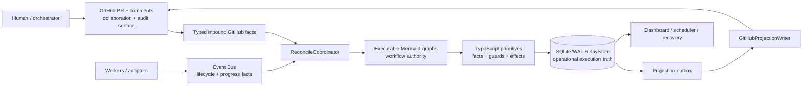

# Agents Relay

Agents Relay is a generic TypeScript runtime for durable asynchronous agent jobs coordinated through GitHub pull requests. The PR body stores the durable Job marker plus human-readable Job objective, while PR comments store durable Task and other append-friendly records; correlated terminal events are authoritative for model-backed task lifecycle transitions.

V2 separates **operational execution state** from that collaboration record. A local RelayStore may use SQLite/WAL for runtime snapshots, event idempotency and a durable GitHub projection outbox. ProjectedDurableStore bootstraps from the existing GitHub representation, commits Job/Plan/Task runtime changes locally, and lets GitHubProjectionWriter project them asynchronously. GitHub therefore remains the human-readable durable Job/Plan/Task/Review surface without being required for every high-frequency runtime transition.

## V2 architecture

RelayStore owns local operational execution facts; GitHub remains the human-readable collaboration and audit projection. Worker events are authoritative lifecycle inputs for model-backed tasks, but they are not a separate durable database. The graph engine owns workflow branching; TypeScript owns facts, persistence, locking/claims, I/O, and primitive guard/action implementations.

### Workflow graph navigation

| Area | Canonical graph |
| --- | --- |
| Job lifecycle | [`workflow/job-lifecycle-v2.mmd`](workflow/job-lifecycle-v2.mmd) |
| Task lifecycle | [`workflow/task-lifecycle-v2.mmd`](workflow/task-lifecycle-v2.mmd) |
| Review lifecycle | [`workflow/review-lifecycle-v2.mmd`](workflow/review-lifecycle-v2.mmd) |
| Planner trigger | [`workflow/planner-trigger-v2.mmd`](workflow/planner-trigger-v2.mmd) |
| Planner orchestration | [`workflow/planner-orchestration-v2.mmd`](workflow/planner-orchestration-v2.mmd) |
| Blocker resolution | [`workflow/blocker-resolution-v2.mmd`](workflow/blocker-resolution-v2.mmd) |
| Authoritative unblock | [`workflow/authoritative-unblock-v2.mmd`](workflow/authoritative-unblock-v2.mmd) |
| Scheduled run | [`workflow/scheduled-run-v2.mmd`](workflow/scheduled-run-v2.mmd) |
| Schedule cycle | [`workflow/schedule-cycle-v2.mmd`](workflow/schedule-cycle-v2.mmd) |
| Troubleshooter | [`workflow/troubleshooter-v2.mmd`](workflow/troubleshooter-v2.mmd) |
| Related-task action policy | [`workflow/task-related-action-v2.mmd`](workflow/task-related-action-v2.mmd) |

Legacy [`workflow/job-lifecycle.mmd`](workflow/job-lifecycle.mmd) and [`workflow/task-lifecycle.mmd`](workflow/task-lifecycle.mmd) are compatibility/parity fixtures only. See [`docs/workflow-engine.md`](docs/workflow-engine.md) and [`docs/architecture-v2.md`](docs/architecture-v2.md).

## Quick start

For GitHub-backed work, create or adopt the PR through Agents Relay itself. This guarantees the durable job marker exists before any managed task is submitted.

~~~sh
cat > job.md <<'EOF'
# Goal

Standalone Job context. Put a Mermaid block first when a workflow/state/architecture diagram helps.
EOF

npx agents-relay job create --repo OWNER/REPO --head feat/example --base main \
  --id job-1 --title "Objective" --objective-file job.md --mode fixed

# The orchestrator decides the initial batch separately
cat > task.md <<'EOF'
# Work

Implement this phase using the Job objective as context.
EOF
npx agents-relay task create --repo OWNER/REPO --pr 12 --id job-1 \
  --task-id initial --output task-pr --input-file task.md

npx agents-relay task create --repo OWNER/REPO --pr 12 --id job-1 \
  --task-id child --output task-pr \
  --input "Implement the described child task and publish a terminal event."

npx agents-relay reconcile --repo OWNER/REPO --pr 12 --id job-1
npx agents-relay job show --repo OWNER/REPO --pr 12 --id job-1
~~~

Task readiness is explicit: `DRAFT` means the durable task exists but is not executable yet; `QUEUED` means Relay may execute it now; `RUNNING` means worker execution has started. Tasks created with dependencies start `DRAFT` and become `QUEUED` when those dependencies succeed. A dependency-free task created with `--draft` stays held until `task update --queue`. Once a task has run, external waiting is represented as `BLOCKED`, never by returning to `DRAFT`.

Mutable draft/queued/retryable task fields can be changed in place without replacing the durable task identity. `task update` rejects `RUNNING`, `SUCCEEDED`, and `CANCELLED` tasks so active execution and terminal history cannot be rewritten. For example:

~~~sh
npx agents-relay task update --repo OWNER/REPO --pr 12 --id job-1 --task-id child \
  --adapter chatgpt --provider chatgpt --model gpt-5.6-sol --reasoning high \
  --capabilities model,chatgpt,browser-harness

# Explicitly release a held DRAFT task
npx agents-relay task update --repo OWNER/REPO --pr 12 --id job-1 --task-id child --queue
~~~

Jobs separate durable lifecycle from derived runtime status. Durable lifecycle is `DRAFT | ACTIVE | COMPLETED | CANCELLED`: a newly created unscheduled Job is DRAFT, creating executable work activates it, and scheduled Jobs are ACTIVE because the scheduler is allowed to advance them. Runtime status (`IDLE`, `WAITING`, `QUEUED`, `RUNNING`, `BLOCKED`, `FAILED`, `REVIEWING`, `MERGE_PENDING`, `MERGED`, or `CANCELLED`) is computed from Tasks, Review, PR, and schedule facts and is never persisted as lifecycle truth.

Lifecycle transition authority lives in the directly renderable V2 flowchart sources linked in [Workflow graph navigation](#workflow-graph-navigation). The legacy `stateDiagram-v2` files remain compatibility fixtures only; see [`docs/workflow-engine.md`](docs/workflow-engine.md) for the executable Mermaid profile and runtime boundary.

The canonical Mermaid Graph Engine is the authoritative durable workflow decision path. Job/Task lifecycle transitions plus Review, Planner, Blocker/Unblock, Schedule, and Troubleshooter orchestration branches are defined by the v2 workflow graphs and executed through the shared graph runtime. TypeScript supplies facts and primitive action/effect implementations; it must not duplicate those workflow branches as a second procedural state machine.

Job objectives and Task inputs are Markdown. Prefer `--objective-file` / `--input-file` (use `-` for stdin) for durable long-form context; inline `--objective` / `--input` remain for short/simple text and are mutually exclusive with the file variants. When a diagram materially clarifies the work, put Mermaid first and then Markdown detail. A newly created Job must capture enough context to finish independently of the originating chat. Its PR body contains exactly one hidden `agents-relay:job:v1` metadata marker followed by the objective Markdown; there is no separate Job comment duplicating the objective. Objective and Job metadata updates rewrite that same PR body. Legacy Job-comment markers remain readable and are migrated into the PR body on the next Job save.

Jobs default to `fixed`. `job create` persists only the durable job and never
creates executable tasks. The caller can either create work directly with
`task create` or invoke the Planner explicitly with `plan`. Direct
orchestrator-created tasks are persisted directly and are not wrapped in a
synthetic Plan. `agents-relay plan` works immediately on a zero-task DRAFT Job,
activates it, persists a real `plan-N` planning round, and materializes validated
`next_tasks`. Autonomous reconciliation still does not invent the first round
for an untouched zero-task Job; after explicit work begins, later autonomous
planning rounds reuse the same planning implementation. Fixed jobs never grow
another planning round automatically.

Manual planning syntax:

~~~sh
npx agents-relay plan --repo OWNER/REPO --pr 12 --id job-1 --prompt "Plan the implementation from the durable objective"
npx agents-relay plan --repo OWNER/REPO --pr 12 --id job-1 --prompt-file guidance.md
~~~

The optional prompt is additional round guidance; it does not replace the durable Job objective. New planning rounds use `plan-N`; historical `planner-N` records remain readable.

The durable status JSON and dashboard show the mode and planning provenance. An
autonomous runtime uses the bundled `skills/agents-relay/agents/planner.agent.md` by default; `--planner-command` is an optional override
snapshot as JSON on stdin and must return `{ "objective_status": "in_progress"|"satisfied", "assessment": "...", "next_tasks": [...] }`.
Planner-created tasks use stable IDs and the existing parent/subtask tree, so
retries and daemon restarts do not create duplicate work.
Task producers must follow `skills/agents-relay/contracts/task-job-contract.md`; that shared skill contract defines story size, lifecycle events, review, and auto-merge semantics.

Execution routing is code-driven: Relay builds complete executable worker+model routes from authoritative runtime/model/resource facts, removes only impossible routes, then calls the generic typed `decide(request, contract)` boundary once. Free-text routing guidance and task/resource/capability signals are soft decision facts; decision failure falls back deterministically to a usable Codex default route. See [Execution Router and typed decisions](docs/worker-model-routers.md).
All task producers use the same story-size contract: `S`≈5 minutes, `M`≈15 minutes, and `L`≈45 minutes of normal-reasoning execution, with `M` as the default. `high` reasoning doubles that overall window. ChatGPT Browser Worker start-ack timeout is derived as one third of the effective overall timeout, clamped between 1 and 5 minutes. Orchestrators and planners should choose `storySize`, not raw timeout milliseconds; `--timeout` remains only as an explicit compatibility/debug override.

Autonomous jobs can also be scheduled. The Job marker stores a five-field cron expression, IANA timezone, next run, and missed-run/concurrency policy. The daemon evaluates the SQLite-backed managed Job view and validates durable schedule facts before claiming a due slot. A repository heartbeat invokes `tick` at 10-minute resolution. See
[Scheduled autonomous jobs](docs/scheduled-autonomous-jobs.md) for the exact
operational contract.

job create first resolves an existing open PR with the same head/base, then creates it only when needed. Re-running it is idempotent: it reuses the PR and maintains exactly one trusted agents-relay:job:v1 marker. Job creation is always create-only. Task execution options belong to `task create`, and the orchestrator may create zero, one, or multiple initial Tasks according to user intent.

To create a Job on an existing unmanaged PR, use the same `job create` action with `--pr` instead of `--head`:

~~~sh
npx agents-relay job create --repo OWNER/REPO --pr 6 --id job-6 --title "Existing objective"
~~~

Use `job update` for partial mutable metadata changes on an already healthy Job marker/binding:

~~~sh
npx agents-relay job update --repo OWNER/REPO --pr 6 --id job-6 --priority P0 --no-auto-merge
~~~

`job update` validates the trusted Job marker first. Missing, malformed, duplicated, mismatched, or conflicting bindings fail with a precise diagnostic and are not repaired implicitly. The orchestrator handles exceptional repair explicitly according to the Job contract, then retries the update. `job show` reads one Job and `job list` lists managed Jobs in a repository.

Managed GitHub task create/update/show/list/retry/cancel and reconcile/serve commands also require a durable Job marker. Orchestrators do not need raw GitHub commands for normal Job creation or metadata updates: Agents Relay uses its authenticated GitHub client internally.

The original init command remains supported for backward compatibility:

~~~sh
npx agents-relay init --repo OWNER/REPO --pr 1 --id job-1 --title "Objective"
~~~

## npm publishing

Pushes to `main` run `.github/workflows/publish.yml`: install, test, choose the next npm version, pack-check, publish, and create the matching `vX.Y.Z` tag. Feature branches do not edit `package.json` versions. If `agents-relay` is not published yet the first release is `1.0.0`; later releases increment only the patch version from the npm registry. The repository must provide an `NPM_TOKEN` Actions secret with permission to publish the public `agents-relay` package.

Normal consumers should invoke the CLI with `npx agents-relay ...` (or `npx agents-relayd ...`).

After a successful npm publish, the workflow records one idempotent `agents-relay:package-published:v1` marker comment on the originating managed PR. The existing GitHub `issue_comment` webhook resolves that PR back to its durable Job and emits a correlated `package.published` events-bus event containing repository, package, version, registry, commit SHA, PR number, and webhook delivery ID. Its source identity is the GitHub delivery (`github/<repository>/delivery/<delivery-id>`), not a worker execution identity.

`package.published` is a release fact, not a service-management command. Agents Relay does not pull packages, restart PM2, or decide which local service consumes a package. An external deployment subscriber may listen for this event, verify that the exact version is pullable, update/restart the affected service, verify its running version and health, and publish its own deployment outcome event. This keeps publication, deployment, and healthy-running as separate facts and removes the need for an orchestrator thread to synchronously wait for npm readiness.

For explicit local demo/test mode:

~~~sh
npm install
npm run build
node dist/cli.js init --file .agents-relay.json --title "Dogfood" --id demo
node dist/cli.js task create --file .agents-relay.json --task-id hello --output task-pr --input "Complete the described task"
node dist/cli.js reconcile --file .agents-relay.json
npx agents-relay serve --file .agents-relay.json
~~~

### Opt-in Temporary Chat quality checks

The normal `npm test` suite does not open a browser or send ChatGPT messages.
For an explicit live check of the one-shot Temporary Chat path, use an
authenticated browser session and run:

~~~sh
npm run test:chatgpt-temp-quality
~~~

This small live suite covers two Temporary Chat submission gates: a normal text
prompt and a prompt with an attachment. It does not exercise worker lifecycle
events, durable-thread reuse, resume, or retry behavior.

Open the dashboard on localhost port 8787. The marker format is intentionally public and append-friendly. Daemon/workspace operation uses `ProjectedDurableStore` over SQLite RelayStore plus the authenticated GitHub projection adapter; GitHubStore is not the daemon operational state database.

External product feedback uses the reusable `src/feedback.ts` contract. See [docs/feedback-intake.md](docs/feedback-intake.md) for the schema, attachment limits, privacy rules, materialization path, and provenance envelope for later Jobs/Tasks/PRs.

reconcile leases and launches ready tasks without waiting inside the runtime scheduler; the CLI waits only long enough for its launched workers to persist results. agents-relayd (or the equivalent npx agents-relay serve) is the watchdog/dashboard mode. Model-backed workers require --events nats; the event transport carries authoritative terminal worker events as well as wake/progress traffic. See [docs/service.md](docs/service.md). --file PATH is explicit local demo/test mode only.

`agents-relayd` without `--pr`/`--id` runs in workspace mode by default: it discovers nested Git repositories under `~/Workspace`, keeps only GitHub `origin` remotes, and aggregates their managed PR jobs into one dashboard and worker pool. Pass `--workspace PATH` to use another root. `--repo OWNER/REPO` remains the single-repository pool mode.

For automation, Agents Relay can use GitHub App installation authentication via `AGENTS_RELAY_GITHUB_APP_ID`, `AGENTS_RELAY_GITHUB_APP_INSTALLATION_ID`, and `AGENTS_RELAY_GITHUB_APP_PRIVATE_KEY_FILE` (or matching CLI flags). Webhook mode is local-first: targeted webhook reconciliation is primary, dashboard auto-refresh reads the disposable in-process view restored from SQLite RelayStore state, and the broad watchdog drops to a 30-minute fallback. No separate persisted dashboard Job cache is maintained. See [docs/github-app-rate-limit.md](docs/github-app-rate-limit.md).

Run one logical reconciliation authority per Job. `ReconcileCoordinator` serializes in-process work; use a distributed atomic lease before multiple independent reconcilers own the same Job. Do not put secrets, credentials, private prompts, or large private payloads in the PR-body Job marker or PR-comment Task markers; store only summaries and artifact references.

Model-backed tasks are routed by Relay before launch. Normal task producers omit adapter/provider/model; explicit routing flags remain compatibility/debug constraints. See [docs/architecture.md](docs/architecture.md) and [skills/agents-relay/SKILL.md](skills/agents-relay/SKILL.md).

XChat and other orchestrators can consume Relay's exact shared discovery implementation without duplicating filesystem search logic:

~~~sh
npx agents-relay context resolve --project-path ~/Workspace/agents-relay --role orchestrator
~~~

The command resolves concrete paths only for the current execution. Use `--skills` / `--agents` for explicit selections; no resolved absolute path is written into durable task state.

The minimal agent-network surface is machine-driven registration and discovery. `agent-register` persists an agent identity, responsibility boundary, claimed capabilities, endpoint/runtime, availability, and routing metadata in a trusted PR marker; `agent-discover` applies hard filters and returns evidence-backed candidates. Adapters remain runtimes, not agent identities. See [docs/architecture.md](docs/architecture.md) for the constrained future remote submission contract.

### Agent worker lifecycle

Managed tasks are descriptive work for agents, not shell commands. Use `codex` or `chatgpt` for worker tasks. Commands such as tests, build tools, Markad Vision, ffmpeg, and other CLIs are invoked by the orchestrator or by an executing agent; they are not worker adapters.

Every model-backed task declares a durable output with `--output task-pr` or `--output file --output-path PATH`. Agents Relay bootstraps workers with the managed PR URL, durable task-comment URL, job/task identity, project, output contract, and mandatory terminal-event contract; workers retrieve the task intent from GitHub rather than receiving a duplicate copy of the stored task prompt.

For Codex and ChatGPT, **correlated worker events are authoritative lifecycle inputs**, not a separate durable store. Event publication uses the canonical Neo `events-bus` surface (`events__publish` for sandboxed/hosted workers, or `NEO_EVENTS_EMIT` for direct local workers); Agents Relay subscribes, validates correlation, applies graph transitions, persists results in RelayStore, and projects them to GitHub. Relay publishes `task.process.launched` only after successful adapter launch; `task.started` is worker-owned and must be a new, correlated start acknowledgement. Codex publishes `task.process.exited` when its synchronous runtime exits, while ChatGPT publishes `task.process.async_exited` after its submission runtime exits; neither substitutes for `task.completed`, `task.failed`, `task.blocked`, or `task.cancelled`. The ChatGPT worker-owned tab follows the configured close policy: `after-start` waits for the correlated start acknowledgement, `never` keeps it open for debug, and `after-terminal` waits for a new exact-task terminal event; start-ack failure closes only the owned tab after 60 seconds. The executing agent must publish exactly one correlated terminal event. Relay persists the matching durable state only from that terminal event. Model-backed tasks require an event bus and time out explicitly if no terminal event arrives.

The ChatGPT adapter uses the `chatgpt-browser-worker` path selected by the shared execution-context resolver; Relay does not bundle its own copy. The resolver applies project-local > Neo shared > global `~/.agents` precedence at execution time, so durable tasks store names/intent rather than stale absolute skill paths. It opens a fresh Temporary Chat tab, uses the account defaults, submits the prompt, verifies acceptance, and applies `--chatgpt-tab-close-policy` (or `AGENTS_RELAY_CHATGPT_TAB_CLOSE_POLICY`): `after-start` by default, `never` for test/debug, or `after-terminal` after a new exact-task terminal event. It never closes a user tab and does not poll for the assistant response, resume/reopen a thread, or use conversation text as the result channel. Any observed ChatGPT thread ID is diagnostic only.

~~~sh
npx agents-relay task create --repo OWNER/REPO --pr 5 --id job-1 \
  --task-id research-ui --adapter chatgpt \
  --capabilities model,chatgpt,browser-harness \
  --provider openai --model MODEL \
  --output file --output-path runs/research-ui.md \
  --input "Research the dashboard UX and write the final report to the declared output file."
~~~

GitHub PR state is authoritative for terminal lifecycle: a merged PR reconciles its managed job to `COMPLETED`; a closed, unmerged PR reconciles to `CANCELLED` and cannot launch queued work. The dashboard exposes `/api/jobs` and shows PR state, durable Job lifecycle, and derived runtime status separately. A merged PR reconciles lifecycle to `COMPLETED`; a closed, unmerged PR reconciles lifecycle to `CANCELLED`.

`adapter: orchestrator` is reserved for synchronous self-work by the exact orchestrator turn that creates the Task. Relay deliberately does not auto-start these Tasks during reconciliation. The creator must perform the work before ending the turn and terminalize the same Task with `npx agents-relay task complete --task-id <id> --summary 
 ...`. If work should continue asynchronously or in a later turn, use a real worker adapter instead.

For work that was completed outside the relay but must be represented truthfully in durable history, use `npx agents-relay record --task-id <id> --summary 
 --commit <sha>`. Recorded tasks use the `orchestrator` adapter and terminal `SUCCEEDED` state; they do not pretend a shell/model worker executed the work. This is a repair/backfill mechanism—normal work should be created as a durable Task before execution. For managed jobs, the GitHub PR body is the canonical Job surface: hidden Job metadata marker plus the visible Markdown objective.

### Automatic task troubleshooting

When an ACTIVE Job contains a current-run `FAILED` task, reconciliation may create one P0-priority `troubleshooter` recovery task for that exact failed attempt. `BLOCKED` work is not troubleshooter-owned: it remains blocked until authoritative unblock transitions it to `UNBLOCKED`. The recovery task is routed to a local Codex-capable worker with repository/tool access and runs under the bundled Troubleshooter agent contract. Troubleshooter diagnosis is event-first: it must inspect the failed task's task-scoped lifecycle event history (including ordering, duplicate/missing/late events, source and phase data) before classifying root cause or retrying.

The Troubleshooter diagnoses before retrying. A task-local or transient execution cause is repaired narrowly; a shared worker/runtime/tool defect is repaired through the owning repository's P0/self-job workflow. Only after the failure cause is repaired does it retry the original FAILED task and verify durable progress. Historical failures from older scheduled autonomous runs do not spawn recovery work, and deterministic reconciliation does not duplicate a Troubleshooter task for the same failed attempt.

### Authoritative unblock and Planner history

Dependency release and runtime unblock are separate concepts. Dependency completion simply releases DAG work. A runtime/external blocker remains `BLOCKED` until `task unblock`, `job unblock`, or blocker-Job resolution records the blocked baseline/current evidence and emits `task.unblocked`, transitioning the Task to `UNBLOCKED`.

For autonomous Jobs, `UNBLOCKED` is historical: Relay does not retry that old Task. The unblock evidence becomes the trigger/context of the next Planner round. Every Planner round is a first-class `agents-relay:plan:v1` PR comment. Relay creates that Plan comment before generated Task comments, then updates the same comment with the Planner assessment and generated Task IDs, preserving causal order in the PR timeline. Fixed Jobs may transition `UNBLOCKED -> QUEUED` through retry after the authoritative unblock record exists. Legacy Job `changeCycle` data is accepted only as compatibility input and is not written by the current model.
