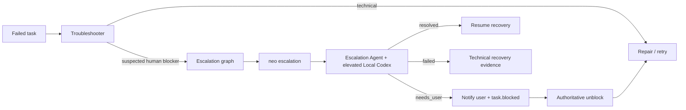

# Agents Relay

Agents Relay is a TypeScript runtime for durable asynchronous agent Jobs driven locally by SQLite and canonical workflow Graphs. The EventBus wakes reconciliation; an EventBus message or GitHub PR comment is never the lifecycle authority. Job, Plan, Task, Review, Execution, Lease and Recovery state survive daemon restarts in SQLite.

V2 uses a read-only local SQLite Job Registry for discovery. The immutable jobId selects the Job Store even when prNumber is zero; scheduled slot claims are atomic across processes. GitHub is **audit-only**: its PR/head/publish events are persisted for reporting, never consulted to start, stop, or complete local Workflows. Local Git delivery and its confirmed merge receipt—not a remote PR MERGED fact—gate Graph completion. Job creation and local Task operations require no GitHub authentication or PR.


The canonical V2 architecture contract is
[DESIGN-PRINCIPLES.md](DESIGN-PRINCIPLES.md). README sections below describe
the runtime; they do not replace that contract.

For authoritative Task unblock, Resolution ownership, Planner rejection feedback, and failure recovery, see [Unblock and Resolution workflow](docs/unblock-resolution-workflow.md) with its [Mermaid diagram](docs/diagrams/unblock-resolution-end-to-end.mmd).

## V2 architecture

\`\`\`mermaid
flowchart LR
    Human[Human / orchestrator] --> CLI[CLI / Dashboard]
    CLI --> Store[(SQLite / WAL<br/>Job Task Plan Review truth)]
    Worker[Workers / adapters] --> Events[EventBus<br/>wake + observations]
    Events --> Coordinator[ReconcileCoordinator]
    Store --> Coordinator
    Coordinator --> Graphs[Canonical Mermaid Graph Engine]
    Graphs --> Effects[Stateless actions / effects]
    Effects --> Store
    Store --> Views[Dashboard / Scheduler / Recovery]
    Effects --> Outbox[Durable external-action outbox]
    Outbox --> GH[GitHub Commit / PR / Review / Merge API]
    GH --> Facts[Confirmed external facts]
    Facts --> Store
\`\`\`

SQLite holds the sole lifecycle authority; the Graph Engine selects every transition.
GitHub operations are explicitly requested and confirmed by adapters, never used to
discover or reconstruct Job/Task state. EventBus delivery wakes reconciliation;
it cannot replace the durable SQLite record.

### Workflow graph navigation

| Area | Canonical graph |
| --- | --- |
| Job lifecycle | [`workflow/job-lifecycle.mmd`](workflow/job-lifecycle.mmd) |
| Task lifecycle | [`workflow/task-lifecycle.mmd`](workflow/task-lifecycle.mmd) |
| Review lifecycle | [`workflow/review-lifecycle.mmd`](workflow/review-lifecycle.mmd) |
| Planner trigger | [`workflow/planner-trigger.mmd`](workflow/planner-trigger.mmd) |
| Planner orchestration | [`workflow/planner-orchestration.mmd`](workflow/planner-orchestration.mmd) |
| Blocker resolution | [`workflow/blocker-resolution.mmd`](workflow/blocker-resolution.mmd) |
| Authoritative unblock | [`workflow/authoritative-unblock.mmd`](workflow/authoritative-unblock.mmd) |
| Scheduled run | [`workflow/scheduled-run.mmd`](workflow/scheduled-run.mmd) |
| Schedule cycle | [`workflow/schedule-cycle.mmd`](workflow/schedule-cycle.mmd) |
| Troubleshooter | [`workflow/troubleshooter.mmd`](workflow/troubleshooter.mmd) |
| Escalation | [`workflow/escalation.mmd`](workflow/escalation.mmd) |
| Related-task action policy | [`workflow/task-related-action.mmd`](workflow/task-related-action.mmd) |

These paths always represent the current canonical graphs. Historical graph definitions are available through Git history, tags, and commits rather than parallel versioned files in `workflow/`. See [`docs/workflow-engine.md`](docs/workflow-engine.md) for the executable profile and runtime boundary.

### Structured runtime observability

`src/observability.ts` is the single structured logging/event boundary that records why a lifecycle or projection decision happened. One correlated record chain (`wake -> graph -> transition -> store commit -> projection outcome`) lets an operator reconstruct a representative task lifecycle without ad-hoc stderr parsing. Records are observational only, never a second durable store; they correlate by repository/PR/job/task/execution, classify failures as deterministic `conflict` vs `transient` retry vs `terminal`, redact secrets/prompts, bound large payloads, and keep routine idle/no-op cycles quiet at the default level. See [`docs/structured-observability.md`](docs/structured-observability.md) for the record contract, fields, noise policy, and redaction rules.

## Quick start

For new work, create a local Job through Agents Relay. Use `job adopt` to bind a known legacy PR number without GitHub access; the external GitHub projection creates a display PR after the first meaningful code commit. Tasks are validated against the SQLite Job, not GitHub markers.

~~~sh
cat > job.md <<'EOF'
# Goal

Standalone Job context. Put a Mermaid block first when a workflow/state/architecture diagram helps.
EOF

npx agents-relay job create --repo OWNER/REPO \
  --id job-1 --title "Objective" --objective-file job.md --mode fixed

# The orchestrator decides the initial batch separately
cat > task.md <<'EOF'
# Work

Implement this phase using the Job objective as context.
EOF
npx agents-relay task create --repo OWNER/REPO --id job-1 \
  --task-id initial --output task-pr --input-file task.md

npx agents-relay task create --repo OWNER/REPO --id job-1 \
  --task-id child --output task-pr \
  --input "Implement the described child task and publish a terminal event."

npx agents-relay reconcile --repo OWNER/REPO --pr 12 --id job-1
npx agents-relay job show --repo OWNER/REPO --pr 12 --id job-1
~~~

Task readiness is explicit: `DRAFT` means the durable task exists but is not executable yet; `QUEUED` means Relay may execute it now; `RUNNING` means worker execution has started. Tasks created with dependencies start `DRAFT` and become `QUEUED` when those dependencies succeed. A dependency-free task created with `--draft` stays held until `task update --queue`. Once a task has run, external waiting is represented as `BLOCKED`, never by returning to `DRAFT`.

Mutable draft/queued/retryable task fields can be changed in place without replacing the durable task identity. `task update` rejects `RUNNING`, `SUCCEEDED`, and `CANCELLED` tasks so active execution and terminal history cannot be rewritten. For example:

~~~sh
npx agents-relay task update --repo OWNER/REPO --pr 12 --id job-1 --task-id child \
  --adapter chatgpt --provider chatgpt --model gpt-5.6-sol --reasoning high \
  --capabilities model,chatgpt,browser-harness

# Explicitly release a held DRAFT task
npx agents-relay task update --repo OWNER/REPO --pr 12 --id job-1 --task-id child --queue
~~~

Jobs separate durable lifecycle from derived runtime status. Durable lifecycle is `DRAFT | ACTIVE | COMPLETED | CANCELLED`: a newly created unscheduled Job is DRAFT, creating executable work activates it, and scheduled Jobs are ACTIVE because the scheduler is allowed to advance them. Runtime status (`IDLE`, `WAITING`, `QUEUED`, `RUNNING`, `BLOCKED`, `FAILED`, `REVIEWING`, `MERGE_PENDING`, `MERGED`, or `CANCELLED`) is computed from Tasks, Review, PR, and schedule facts and is never persisted as lifecycle truth.

Lifecycle transition authority lives in the directly renderable canonical flowchart sources linked in [Workflow graph navigation](#workflow-graph-navigation). Git history owns prior graph versions; the working tree contains only the current graph set.

The canonical Mermaid Graph Engine is the authoritative durable workflow decision path. Job/Task lifecycle transitions plus Review, Planner, Blocker/Unblock, Schedule, and Troubleshooter orchestration branches are defined by the canonical workflow graphs and executed through the shared graph runtime. TypeScript supplies facts and primitive action/effect implementations; it must not duplicate those workflow branches as a second procedural state machine.

Job objectives and Task inputs are Markdown. Prefer `--objective-file` / `--input-file` (use `-` for stdin) for durable long-form context; inline `--objective` / `--input` remain for short/simple text and are mutually exclusive with the file variants. When a diagram materially clarifies the work, put Mermaid first and then Markdown detail. A newly created Job must capture enough context to finish independently of the originating chat. Its PR body contains exactly one hidden `agents-relay:job:v1` metadata marker followed by the objective Markdown; there is no separate Job comment duplicating the objective. Objective and Job metadata updates rewrite that same PR body. Legacy Job-comment markers remain readable and are migrated into the PR body on the next Job save.

Jobs default to `fixed`. `job create` persists only the durable job and never
creates executable tasks. The caller can either create work directly with
`task create` or invoke the Planner explicitly with `plan`. Direct
orchestrator-created tasks are persisted directly and are not wrapped in a
synthetic Plan. `agents-relay plan` works immediately on a zero-task DRAFT Job,
activates it, persists a real `plan-N` planning round, and materializes validated
`next_tasks`. Autonomous reconciliation still does not invent the first round
for an untouched zero-task Job; after explicit work begins, later autonomous
planning rounds reuse the same planning implementation. Fixed jobs never grow
another planning round automatically.

Manual planning syntax:

~~~sh
npx agents-relay plan --repo OWNER/REPO --pr 12 --id job-1 --prompt "Plan the implementation from the durable objective"
npx agents-relay plan --repo OWNER/REPO --pr 12 --id job-1 --prompt-file guidance.md
~~~

The optional prompt is additional round guidance; it does not replace the durable Job objective. New planning rounds use `plan-N`; historical `planner-N` records remain readable.

The durable status JSON and dashboard show the mode and planning provenance. An
autonomous runtime uses the bundled `skills/agents-relay/agents/planner.agent.md` by default; `--planner-command` is an optional override
snapshot as JSON on stdin and must return `{ "objective_status": "in_progress"|"satisfied", "assessment": "...", "next_tasks": [...] }`.
Planner-created tasks use stable IDs and the existing parent/subtask tree, so
retries and daemon restarts do not create duplicate work.
Task producers must follow `skills/agents-relay/contracts/task-job-contract.md`; that shared skill contract defines story size, lifecycle events, review, and auto-merge semantics.

Execution routing is code-driven: Relay builds complete executable worker+model routes from authoritative runtime/model/resource facts, merges profile defaults with the user's explicit `[choices]`, deduplicates them, removes only impossible routes via hard gates, then calls the generic typed `decide(request, contract)` boundary exactly once with one merged choice list and the `[routing-instruction]` text forwarded verbatim. Task/resource/capability signals and the routing instruction are soft decision facts; decision failure falls back deterministically to a usable Codex default route. See [Execution Router and typed decisions](docs/worker-model-routers.md).
All task producers use the same story-size contract: `S`≈5 minutes, `M`≈15 minutes, and `L`≈45 minutes of inactivity, with `M` as the default. `high` reasoning doubles that inactivity window. Accepted `task.started` and newer `task.progress` events from the exact current execution reset it. ChatGPT Browser Worker start-ack timeout is derived as one third of the effective inactivity timeout, clamped between 1 and 5 minutes. Orchestrators and planners should choose `storySize`, not raw timeout milliseconds; `--timeout` remains only as an explicit compatibility/debug override.

Autonomous jobs can also be scheduled. The Job marker stores a five-field cron expression, IANA timezone, next run, and missed-run/concurrency policy. The daemon evaluates the SQLite-backed managed Job view and validates durable schedule facts before claiming a due slot. A repository heartbeat invokes `tick` at 10-minute resolution. See
[Scheduled autonomous jobs](docs/scheduled-autonomous-jobs.md) for the exact
operational contract.

GitHub projection creates or reuses a display PR after a meaningful source-branch commit; `job adopt` is reserved for existing legacy PR bindings. Re-running it is idempotent: it reuses the PR and maintains exactly one trusted agents-relay:job:v1 marker. Job creation is always create-only and always enables auto-merge; `--no-auto-merge` is not a `job create` option. Existing Jobs can still change that setting with `job update`. Task execution options belong to `task create`, and the orchestrator may create zero, one, or multiple initial Tasks according to user intent.

To create a Job on an existing unmanaged PR, use the explicit `job adopt` compatibility action:

~~~sh
npx agents-relay job adopt --repo OWNER/REPO --pr 6 --id job-6 --title "Existing objective"
~~~

Use `job update` for partial mutable metadata changes on an already healthy Job marker/binding:

~~~sh
npx agents-relay job update --repo OWNER/REPO --pr 6 --id job-6 --priority P0 --no-auto-merge
~~~

Request an eligible new review with `npx agents-relay review request --repo OWNER/REPO --pr NUMBER --id JOB_ID`.
Pass optional `--thread-id THREAD_ID` to persist a reviewer-thread override for subsequent
review routing. Without it, Relay uses the stored reviewer thread, then creator thread,
or the legacy review path when neither exists. This request wakes graph-owned
review orchestration; it is not a delivery receipt.

Review destinations are durable Job facts. `job create` and `job update` accept
`--reviewer-thread-id` and `--creator-thread-id`; a reviewer ID takes precedence
over the creator/origin ID. A local runtime invocation may pass
`--thread-id` as an explicit one-run review override. When a destination exists,
final-review routing requires a ChatGPT/browser-workspace worker and submits the
review request as a verified `new-turn` to that existing thread with the Job ID,
PR number, and immutable review head SHA. Failure still follows the ordinary
review task retry/recovery path; a transport failure is never treated as
review delivery.

`job update` validates the trusted Job marker first. Missing, malformed, duplicated, mismatched, or conflicting bindings fail with a precise diagnostic and are not repaired implicitly. The orchestrator handles exceptional repair explicitly according to the Job contract, then retries the update. `job show` reads one Job and `job list` lists managed Jobs in a repository.

Managed GitHub task create/update/show/list/retry/cancel and reconcile/serve commands also require a durable Job marker. Orchestrators do not need raw GitHub commands for normal Job creation or metadata updates: Agents Relay uses its authenticated GitHub client internally.

The original init command remains supported for backward compatibility:

~~~sh
npx agents-relay init --repo OWNER/REPO --pr 1 --id job-1 --title "Objective"
~~~

## npm publishing

Pushes to `main` run `.github/workflows/publish.yml`: install, test, choose the next npm version, pack-check, publish, and create the matching `vX.Y.Z` tag. Feature branches do not edit `package.json` versions. If `agents-relay` is not published yet the first release is `1.0.0`; later releases increment only the patch version from the npm registry. The repository must provide an `NPM_TOKEN` Actions secret with permission to publish the public `agents-relay` package.

Normal consumers should invoke the CLI with `npx agents-relay ...` (or `npx agents-relayd ...`).

After a successful publish, the workflow records one idempotent `agents-relay:package-published:v1` marker comment using local-merge Job metadata. It uses the closed display PR when present, otherwise a reusable `[Agents Relay] Publication events` issue. The GitHub `issue_comment` webhook resolves the embedded Job ID back to its durable SQLite Job and emits a correlated `package.published` events-bus event containing repository, package, version, registry, commit SHA, PR number, and webhook delivery ID. Its source identity is the GitHub delivery (`github/<repository>/delivery/<delivery-id>`), not a worker execution identity.

`package.published` is a release fact, not a service-management command. Agents Relay does not pull packages, restart PM2, or decide which local service consumes a package. An external deployment subscriber may listen for this event, verify that the exact version is pullable, update/restart the affected service, verify its running version and health, and publish its own deployment outcome event. This keeps publication, deployment, and healthy-running as separate facts and removes the need for an orchestrator thread to synchronously wait for npm readiness.

For explicit local demo/test mode:

~~~sh
npm install
npm run build
node dist/cli.js init --file .agents-relay.json --title "Dogfood" --id demo
node dist/cli.js task create --file .agents-relay.json --task-id hello --output task-pr --input "Complete the described task"
node dist/cli.js reconcile --file .agents-relay.json
npx agents-relay serve --file .agents-relay.json
~~~

### Opt-in Temporary Chat quality checks

The normal `npm test` suite does not open a browser or send ChatGPT messages.
For an explicit live check of the one-shot Temporary Chat path, use an
authenticated browser session and run:

~~~sh
npm run test:chatgpt-temp-quality
~~~

This small live suite covers two Temporary Chat submission gates: a normal text
prompt and a prompt with an attachment. It does not exercise worker lifecycle
events, durable-thread reuse, resume, or retry behavior.

Open the dashboard on localhost port 8787. The marker format is intentionally public and append-friendly. Daemon/workspace operation uses `ProjectedDurableStore` over SQLite RelayStore plus the authenticated GitHub projection adapter; GitHubStore is not the daemon operational state database.

Deterministic projection conflicts are safe and observable. A same-id/different-definition `append_task`/`append_plan` is classified once into a durable `conflict` state, stops consuming retry budget, keeps structured divergence evidence, and is never auto-overwritten. Inspect with `agents-relay projection conflicts --repo OWNER/REPO --pr NUMBER` and repair explicitly with `agents-relay projection resolve --repo OWNER/REPO --pr NUMBER --projection-id ID --action requeue|discard-local`. See [docs/architecture-v2.md](docs/architecture-v2.md).

External product feedback uses the reusable `src/feedback.ts` contract. See [docs/feedback-intake.md](docs/feedback-intake.md) for the schema, attachment limits, privacy rules, materialization path, and provenance envelope for later Jobs/Tasks/PRs.

reconcile leases and launches ready tasks without waiting inside the runtime scheduler; the CLI waits only long enough for its launched workers to persist results. agents-relayd (or the equivalent npx agents-relay serve) is the watchdog/dashboard mode. Model-backed workers require --events nats; the event transport carries authoritative terminal worker events as well as wake/progress traffic. See [docs/service.md](docs/service.md). --file PATH is explicit local demo/test mode only.

Router Rules are stored at `~/.agents-relay/execution-router-rules.md` by default and use `[choices]` plus `[routing-instruction]` sections (see the Execution Router doc). `agents-relayd --execution-router-rules PATH` selects a different file for that daemon process; the explicit CLI path takes precedence over `AGENTS_RELAY_EXECUTION_ROUTER_RULES`, which remains supported for compatibility.

`agents-relayd` without `--pr`/`--id` runs in workspace mode by default: it discovers nested Git repositories under `~/Workspace`, keeps only GitHub `origin` remotes, and aggregates their managed PR jobs into one dashboard and worker pool. Pass `--workspace PATH` to use another root. `--repo OWNER/REPO` remains the single-repository pool mode.

For automation, Agents Relay can use GitHub App installation authentication via `AGENTS_RELAY_GITHUB_APP_ID`, `AGENTS_RELAY_GITHUB_APP_INSTALLATION_ID`, and `AGENTS_RELAY_GITHUB_APP_PRIVATE_KEY_FILE` (or matching CLI flags). Webhook mode is local-first: targeted webhook reconciliation is primary, dashboard auto-refresh reads the disposable in-process view restored from SQLite RelayStore state, and the broad watchdog drops to a 30-minute fallback. No separate persisted dashboard Job cache is maintained. See [docs/github-app-rate-limit.md](docs/github-app-rate-limit.md).

Run one logical reconciliation authority per Job. `ReconcileCoordinator` serializes in-process work; use a distributed atomic lease before multiple independent reconcilers own the same Job. Do not put secrets, credentials, private prompts, or large private payloads in the PR-body Job marker or PR-comment Task markers; store only summaries and artifact references.

Model-backed tasks are routed by Relay before launch. Normal task producers omit adapter/provider/model; explicit routing flags remain compatibility/debug constraints. See [docs/architecture.md](docs/architecture.md) and [skills/agents-relay/SKILL.md](skills/agents-relay/SKILL.md).

XChat and other orchestrators can consume Relay's exact shared discovery implementation without duplicating filesystem search logic:

~~~sh
npx agents-relay context resolve --project-path ~/Workspace/agents-relay --role orchestrator
~~~

The command resolves concrete paths only for the current execution. Use `--skills` / `--agents` for explicit selections; no resolved absolute path is written into durable task state.

The minimal agent-network surface is machine-driven registration and discovery. `agent-register` persists an agent identity, responsibility boundary, claimed capabilities, endpoint/runtime, availability, and routing metadata in a trusted PR marker; `agent-discover` applies hard filters and returns evidence-backed candidates. Adapters remain runtimes, not agent identities. See [docs/architecture.md](docs/architecture.md) for the constrained future remote submission contract.

### Agent worker lifecycle

Managed tasks are descriptive work for agents, not shell commands. Use `codex` or `chatgpt` for worker tasks. Commands such as tests, build tools, Markad Vision, ffmpeg, and other CLIs are invoked by the orchestrator or by an executing agent; they are not worker adapters.

Every model-backed task declares a durable output with `--output task-pr` or `--output file --output-path PATH`. Agents Relay bootstraps workers with the managed PR URL, durable task-comment URL, job/task identity, project, output contract, and mandatory terminal-event contract; workers retrieve the task intent from GitHub rather than receiving a duplicate copy of the stored task prompt.

For Codex and ChatGPT, **correlated worker events are authoritative lifecycle inputs**, not a separate durable store. Event publication uses the canonical Neo `events-bus` surface (`events__publish` for sandboxed/hosted workers, or `NEO_EVENTS_EMIT` for direct local workers); Agents Relay subscribes, validates correlation, applies graph transitions, persists results in RelayStore, and projects them to GitHub. Relay publishes `task.process.launched` only after successful adapter launch; `task.started` is worker-owned and must be a new, correlated start acknowledgement. Codex publishes `task.process.exited` when its synchronous runtime exits, while ChatGPT publishes `task.process.async_exited` after its one-shot submission runtime exits; neither substitutes for `task.completed`, `task.failed`, `task.blocked`, or `task.cancelled`. The executing agent must publish exactly one correlated terminal event. Relay persists the matching durable state only from that terminal event. Model-backed tasks require an event bus and time out explicitly if no terminal event arrives.

The ChatGPT adapter uses Relay's `agents/chatgpt-worker.agent.md` lifecycle contract and invokes Browser Workspace exactly as a one-shot platform action: `browser-workspace platform run chatgpt temporary-submit --auto-session --config <file>`. Browser Workspace owns creation/release of the fresh Temporary Chat session, selectors, attachments, and submit verification; Relay does not self-heal browser failures and instead lets delivery failures enter its normal retry/recovery lifecycle. Legacy `--chatgpt-tab-close-policy` values remain accepted for compatibility around Relay's event barriers, but they do not control the Browser Workspace auto-session lifetime. The adapter never uses a pre-existing user tab, polls for the assistant response, resumes/reopens a thread, or treats conversation text as the result channel. Any observed ChatGPT thread ID is diagnostic only.

~~~sh
npx agents-relay task create --repo OWNER/REPO --pr 5 --id job-1 \
  --task-id research-ui --adapter chatgpt \
  --capabilities model,chatgpt,browser-harness \
  --provider openai --model MODEL \
  --output file --output-path runs/research-ui.md \
  --input "Research the dashboard UX and write the final report to the declared output file."
~~~

GitHub PR state is authoritative for terminal lifecycle: a merged PR reconciles its managed job to `COMPLETED`; a closed, unmerged PR reconciles to `CANCELLED` and cannot launch queued work. The dashboard exposes `/api/jobs` and shows PR state, durable Job lifecycle, and derived runtime status separately. A merged PR reconciles lifecycle to `COMPLETED`; a closed, unmerged PR reconciles lifecycle to `CANCELLED`.

Relay has no orchestrator worker adapter for new work. Orchestrators are external clients that create/plan durable Tasks; Execution Router selects a real worker route (`codex` or `chatgpt`). The CLI and dashboard do not expose manual orchestrator-only `task start`, `task complete`, or synthetic `record` paths.

Historical stores may still contain `adapter: orchestrator`. Reconciliation treats that value only as legacy migration evidence: QUEUED work that never started can be converted in place to normal worker requirements; RUNNING work with an unknown outcome is quarantined as BLOCKED instead of replayed; only explicit durable `externalCompletionVerified` evidence can complete legacy work without execution. New Task creation and Task update reject that adapter.

For managed jobs, the GitHub PR body is the canonical collaboration surface while SQLite remains lifecycle authority.

### Automatic task troubleshooting

When an ACTIVE Job contains a current-run `FAILED` task, reconciliation may create one P0-priority `troubleshooter` recovery task for that exact failed attempt. `BLOCKED` work is not troubleshooter-owned: it remains blocked until authoritative unblock transitions it to `UNBLOCKED`. The recovery task is routed to a local Codex-capable worker with repository/tool access and runs under the bundled Troubleshooter agent contract. Troubleshooter diagnosis is event-first: it must inspect the failed task's task-scoped lifecycle event history (including ordering, duplicate/missing/late events, source and phase data) before classifying root cause or retrying.

The Troubleshooter diagnoses before retrying. A task-local or transient execution cause is repaired narrowly; a shared worker/runtime/tool defect is repaired through the owning repository's P0/self-job workflow. A suspected human/external blocker enters the canonical [`workflow/escalation.mmd`](workflow/escalation.mmd) graph through `agents-relay escalation`; Troubleshooter does not decide the escalation result branch itself.



The escalation graph is the authority for what happens after Neo returns: `resolved` selects resume recovery, `failed` selects technical-failure handling, and only `needs_user` selects the block-for-user action. Notification mechanics stay caller-described through `--on-needs-user`; Relay does not bind WeChat, Discord, iMessage, or another channel. Only after the failure cause is repaired does Troubleshooter retry the original FAILED task and verify durable progress. Historical failures from older scheduled autonomous runs do not spawn recovery work, and deterministic reconciliation does not duplicate a Troubleshooter task for the same failed attempt.


### Authoritative unblock and Planner history

Dependency release and runtime unblock are separate concepts. Dependency completion simply releases DAG work. A runtime/external blocker remains `BLOCKED` until `task unblock`, `job unblock`, or blocker-Job resolution records the blocked baseline/current evidence and emits `task.unblocked`, transitioning the Task to `UNBLOCKED`.

For autonomous Jobs, `UNBLOCKED` is historical: Relay does not retry that old Task. The unblock evidence becomes the trigger/context of the next Planner round. Every Planner round is a first-class `agents-relay:plan:v1` PR comment. Relay creates that Plan comment before generated Task comments, then updates the same comment with the Planner assessment and generated Task IDs, preserving causal order in the PR timeline. Fixed Jobs may transition `UNBLOCKED -> QUEUED` through retry after the authoritative unblock record exists. Legacy Job `changeCycle` data is accepted only as compatibility input and is not written by the current model.


### Browser Workspace product boundary

Agents Relay owns the persistent `Relay` browser workspace as product infrastructure. At daemon startup it runs `browser-workspace status`, dynamically imports the returned absolute `admin_helper`, and calls `ensureWorkspace("Relay", 6)`. This bootstrap is best-effort: Browser Workspace discovery/helper failures are logged and skipped so they do not prevent `agents-relayd` from starting; ChatGPT browser work may remain unavailable until Browser Workspace recovers. Ordinary ChatGPT worker activity uses the public Browser Workspace one-shot `platform run ... --auto-session` command; orchestrator-owned self-healing flows may still use explicit session commands. Relay does not create or delete workspaces through CLI lifecycle commands.

## Shared publication reporting

Repositories with an existing verified publish/release workflow can report the final result back to Agents Relay with the reusable actions in this repository:

```yaml
permissions:
  contents: read
  issues: write
  pull-requests: read

- name: Report verified publication
  uses: lalalic/agents-relay/.github/actions/report-publication@publication-v1
  with:
    token: ${{ github.token }}
    artifact: my-package-or-artifact
    version: ${{ steps.release.outputs.version }}
    channel: https://registry.npmjs.org

- name: Report release failure
  if: ${{ failure() }}
  continue-on-error: true
  uses: lalalic/agents-relay/.github/actions/report-publication-failure@publication-v1
  with:
    token: ${{ github.token }}
    stage: release workflow
```

The caller must report only a release it has actually verified. For local-first Jobs, the action reads the Job ID and optional display PR from the authoritative local-merge commit message and posts the compatible `agents-relay:package-published:v1` or publish-failure marker to that display PR or to a reusable publication issue. Historical GitHub-merged PR correlation remains supported as a fallback. The marker and GitHub webhook are transport/correlation only: Agents Relay resolves the originating Job and persists publication facts through `RelayStore.recordPublication(...)` into the authoritative SQLite `publication_delivery` and `publication_state` tables. Publication success or failure never changes a completed Job's lifecycle state.

`artifact` can identify an npm/PyPI package, Chrome extension, GitHub Release artifact, or a custom published artifact. `channel` identifies the registry/store/release channel and is displayed as publication metadata. Repeated reports of the same artifact/version are idempotent.

### Project-scoped agent Markdown inheritance

Agent lookup has exactly two layers: Relay built-in `skills/agents-relay/agents/` and `<job-context-root>/agents/`. `job.projectPath` selects the context root within the repository (including monorepo content projects); no workspace/global agent fallback is searched. Project agent frontmatter can specify `extends: relay/planner`, `mode: extend`, and `sections: { replace: [Heading/Subheading], extend: [Other Heading] }` using heading paths, or `mode: replace` for a full behavioral replacement. Relay-owned lifecycle, Job/Task and events contracts are injected separately and cannot be replaced by a project agent. An unextended local agent is a standalone definition. The resolver emits a deterministic SHA-256 of composed Markdown; a missing section or unsupported parent fails instead of silently dropping instructions.
