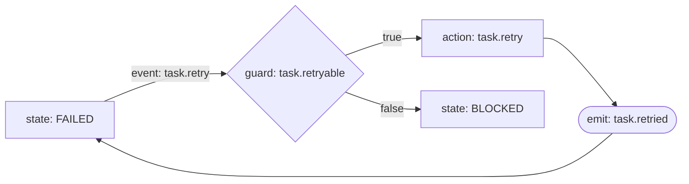
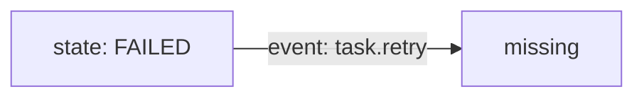
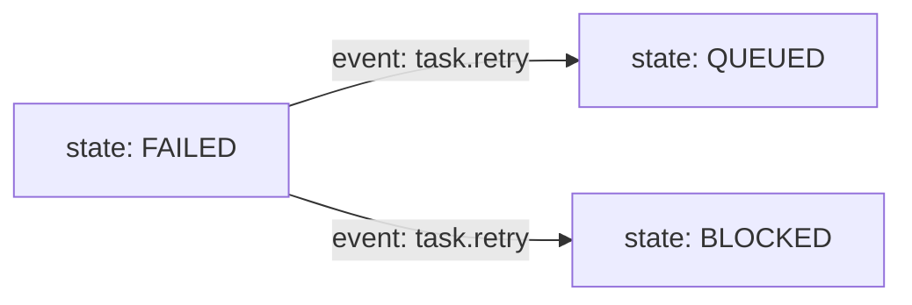

# Agents Relay v2 architecture specification

This document is the v2 design contract. It is intentionally narrower than
Mermaid: an executable graph is a deterministic workflow document, not a
general-purpose workflow programming language.

## Mental model

```text
Event -> Graph -> State -> Action -> Event
```

An **Event** is an observed fact or an explicit request, such as
`task.completed`, `github.pr.merged`, or `task.retry`. The **Graph** evaluates
the event against the current durable **State** and registered **Guard** facts.
The accepted transition records the next state and declares an **Action**.
An action executor performs the external intent and reports a new Event. A
graph may also declare an `emit` node for a deterministic event produced by
the transition itself.

The graph engine is the only lifecycle decision authority. It does not call
GitHub, the event bus, workers, or storage. Adapters, the CLI, relayd,
webhooks, the scheduler, and reconciliation collect facts or submit typed
actions/events through the same engine boundary.

## Durable boundaries

- GitHub PR bodies and comments remain the durable Job/Task record.
- Graph files are the canonical workflow source; generated JSON/YAML mirrors
  are not allowed.
- Registries provide executable meaning for names in a graph. They are typed
  code boundaries, not an alternate workflow definition.
- Durable persistence, leases, idempotency, event delivery, external I/O, and
  derived runtime-status projections remain outside graph semantics.
- Existing v1 Job/Task markers and public lifecycle behavior remain compatible
  during migration. A migration may add a graph or adapter, but must not
  reinterpret old marker fields silently.

The current `stateDiagram-v2` implementation in
[`workflow-engine.md`](workflow-engine.md) remains the compatibility profile
until the v2 flowchart runtime is implemented. This document defines the
target profile for the next runtime task; it does not authorize a broad
lifecycle migration in the documentation phase.

## Strict executable Mermaid profile

### File shape

An executable v2 file:

1. starts with exactly `flowchart LR`, `flowchart TD`, `flowchart TB`, or
   `flowchart RL`;
2. contains only the declarations and edges described below;
3. permits blank lines and `%%` comments;
4. has exactly one root `state:` node (a state with no incoming edge);
5. has at least one `state:` node and one executable edge; and
6. contains no Mermaid directives, styling, or renderer-only syntax.

The direction affects rendering only. It never changes execution order.

### Identifiers and declarations

Node IDs and semantic IDs match:

```text
[A-Za-z_][A-Za-z0-9_.-]*
```

Every node must be declared exactly once before it is referenced by an edge.
The declaration forms are the complete executable node vocabulary:

```text
NODE["state: STATE_ID"]
NODE{"guard: GUARD_ID"}
NODE["action: ACTION_ID"]
NODE(["emit: EVENT_ID"])
```

`state` nodes represent durable state. `guard` nodes read a registered,
side-effect-free fact. `action` nodes represent a typed intent/effect. `emit`
nodes represent an event that can be fed back into the graph. The Mermaid
shape is presentation only; the `state:`, `guard:`, `action:`, and `emit:`
prefixes are the semantic contract.

`STATE_ID`, `GUARD_ID`, `ACTION_ID`, and `EVENT_ID` must be registry names.
Display text may be added only as a non-executable Mermaid label in a future
profile; this profile does not parse or preserve arbitrary display text.

The root state is the initial durable state. A terminal state is a declared
state with no outgoing edge. There are no pseudo-state nodes in this profile;
using `[*]` or another undeclared Mermaid pseudo-node is unsupported. This
keeps the source valid as a normal Mermaid flowchart and avoids importing
`stateDiagram-v2` semantics into the v2 language.

### Edges and labels

An unlabeled edge is allowed only for structural flow between a state, guard,
action, or emit node:

```text
FROM --> TO
```

An event edge is the only executable transition input:

```text
STATE -->|event: EVENT_ID| NEXT
```

Guard branches must use exactly one of these labels:

```text
GUARD -->|true| NEXT
GUARD -->|false| NEXT
```

An action or emit node is reached structurally and carries its declared
registry meaning; action parameters, expressions, scripts, and arbitrary
payloads do not appear in Mermaid. There is no special final-edge syntax; a
terminal state is identified by its absence of outgoing edges.

A state may have multiple event edges only when their event IDs differ or
when they pass through distinct guard nodes. For one state, event, and guard
outcome, there must be exactly one reachable next node. This is the
determinism rule; declaration order never breaks a tie.

### Representative valid graph



The engine evaluates `task.retry` in `FAILED`, reads the typed
`task.retryable` guard, and either executes `task.retry` followed by
`task.retried`, or reaches `BLOCKED`. The exact persistence and delivery
semantics are supplied by the runtime, not by Mermaid.

## Registries and runtime contract

The parser produces a typed graph containing node IDs, node kinds, semantic
IDs, and ordered edges. It does not execute code. The runtime binds the graph
to four finite registries:

| Registry | Resolves | Required contract |
| --- | --- | --- |
| State | `state: X` | durable state identity and terminal/initial policy |
| Guard | `guard: X` | pure synchronous or explicitly awaited fact evaluation |
| Action | `action: X` | typed intent, payload, idempotency, and failure event |
| Event | `event: X`, `emit: X` | event schema and correlation rules |

Registries are selected by graph kind (for example Job or Task) and are
validated before the graph is installed. A graph may not invent a registry
entry through a label, node ID, or display string. Worker/model routing and
agent identity are runtime concerns, not graph-language primitives.

The decision boundary is:

```text
current durable state + event + canonical facts
  -> one accepted/rejected transition
  -> next state + declared actions/emits
```

Applying deterministic mutations and persisting the decision is an adapter
responsibility with normal fresh-read, lease, and idempotency protections.
An external action failure becomes its registered failure Event and is
re-evaluated by the same graph. Code must not assign a lifecycle state merely
because an effect threw an exception.

## Deterministic parsing and validation

Parsing is line-oriented and deterministic: trim whitespace, ignore blanks and
`%%` comments, parse declarations, then parse edges in source order. The
parser must reject, with the line number and offending text:

- missing or unsupported `flowchart` direction;
- duplicate declarations, undeclared edge endpoints, malformed identifiers,
  or malformed semantic prefixes;
- multiple root states, or a root node that is not a state;
- missing event labels on state-to-state executable transitions;
- guard branches without exactly one `true` and one `false` outcome;
- unknown state, guard, action, or event registry IDs;
- unreachable declared nodes, dead-end non-terminal nodes, and edges that
  cannot participate in a valid state/event path;
- duplicate edges and ambiguous state/event/guard outcomes; and
- any syntax outside this profile.

Validation must fail closed. It must not ignore a line, treat an unknown node
as a display label, infer a missing guard branch, or use source order as an
implicit priority. Cycles are allowed because retry and reconciliation
workflows may return to a prior state; every cycle must still be reachable
from the initial state and have a valid event/guard path.

### Invalid examples



Rejected: `missing` was not declared and therefore has no typed semantic
meaning.



Rejected: duplicate state/event outcomes are ambiguous; action presence is
not a priority rule.

```mermaid
flowchart LR
    start["state: FAILED"]
    classDef secret fill:#000
```



Rejected: styling and other renderer directives are unsupported executable
syntax, even though a Mermaid renderer may understand them.

## Compatibility and migration

Migration is incremental:

1. land and review this architecture specification and profile;
2. implement the parser, typed registries, deterministic validator, and
   decision runtime with focused tests;
3. adapt the existing canonical Job and Task lifecycle graphs through one
   runtime while preserving marker serialization and lifecycle results;
4. route one representative mutation through the common Action dispatcher
   from both CLI and relayd/API;
5. move reconciliation and orchestration decisions graph-by-graph;
6. add composition only when a real workflow requires it; and
7. remove duplicate procedural paths only after parity and restart/reconcile
   tests pass.

During each step, GitHub remains the durable source of truth, events remain
wake-up/evidence signals unless explicitly declared lifecycle facts, and
runtime status remains a derived projection. Existing `stateDiagram-v2`
graphs are not silently reinterpreted as v2 flowcharts; conversion is an
explicit, reviewed change.

## Review checkpoints and acceptance criteria

Durable review boundaries are required at these points:

1. architecture specification and executable profile;
2. parser/runtime/registry design before broad migration;
3. first CLI-to-relayd Action-dispatcher vertical slice;
4. lifecycle/reconciliation migration, checking for hidden procedural
   authority; and
5. final architecture, compatibility, restart/reconcile, and regression
   review.

The next runtime implementation is acceptable when it demonstrates that:

- the profile parses deterministically and renders as useful Mermaid;
- typed state, guard, action, and event registries reject unknown names;
- unsupported syntax and malformed topology fail with precise diagnostics;
- identical durable input and event produce identical decisions;
- CLI and relayd/internal callers share one Action dispatcher;
- migrated graphs, not ad-hoc reconciler conditionals, own lifecycle policy;
- v1 Job/Task markers and public behavior remain compatible; and
- tests cover parser validation, ambiguity, registry failures, dispatch parity,
  restart/reconcile behavior, and durable-record compatibility.

Adding or changing a workflow should normally mean editing a reviewed graph
and, only when necessary, adding a typed registry primitive—not adding another
procedural lifecycle branch.
