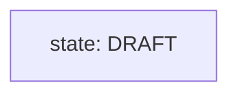
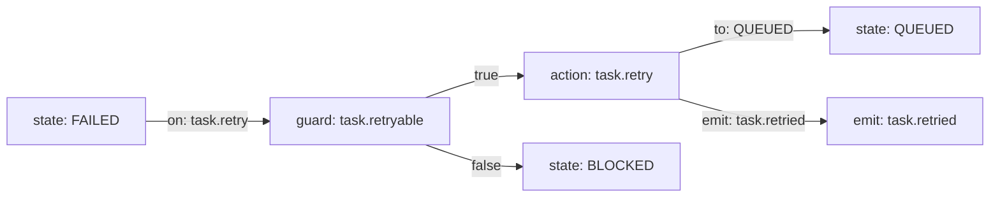
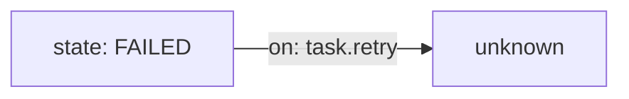
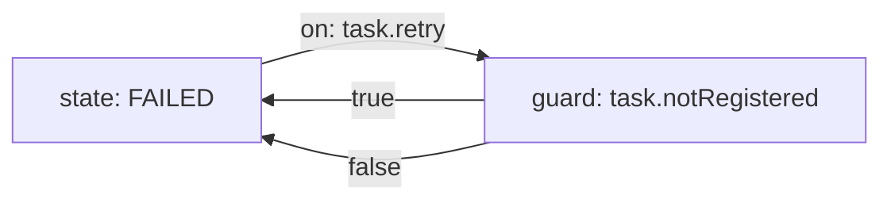
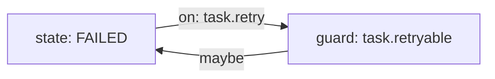
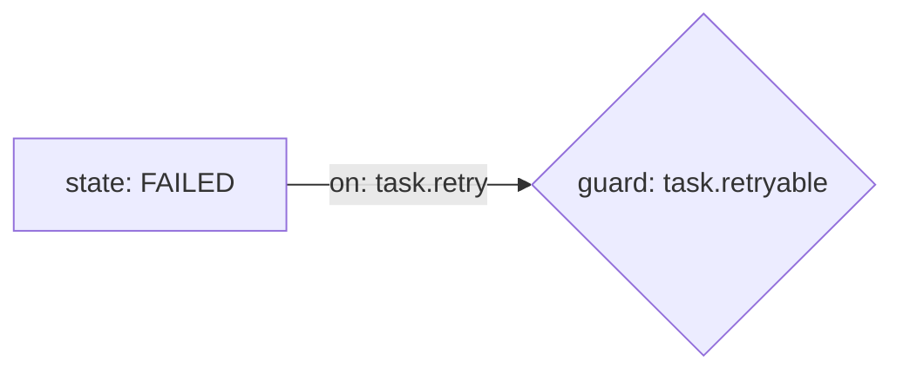
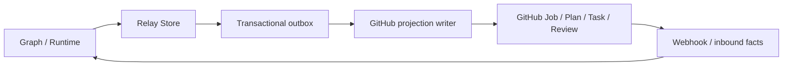

# Agents Relay v2 architecture specification

Status: architecture foundation for the incremental v2 migration. This document
defines the graph contract implemented by the v2 parser, runtime, and dispatcher.

## 1. Mental model and boundaries

Agents Relay v2 is an action-driven runtime for durable agent graphs. The
canonical loop is:

```text
Event / Action request
  -> Graph
  -> durable State transition
  -> declared Action/effect
  -> execution
  -> resulting Event
  -> Graph
```

An **Event** is an observed fact (`task.completed`, `github.pr.merged`, or
`schedule.due`). A **State** is durable truth (`Task=BLOCKED` or
`Job.lifecycle=ACTIVE`). An **Action** is an intent or effect (`task.retry`,
`worker.launch`, or `github.merge`). A graph is the deterministic policy that
connects those concepts; it is not a process runner or a scripting language.

The boundary is deliberately one-way:

- adapters (CLI, API, webhook, scheduler, and event subscriptions) normalize
  input into an Event or Action request;
- the Graph Engine validates topology, evaluates registered guards, and returns
  a transition plus declared effects;
- the state store applies only the returned deterministic mutation;
- Action executors perform I/O and publish resulting Events;
- the resulting Event is fed back through the same Graph Engine.

No adapter may assign lifecycle state directly. No graph may call GitHub, NATS,
worker processes, a browser, or a durable store. This keeps the graph
reviewable and makes CLI and relayd/API behavior semantically equivalent.

## 2. Strict executable Mermaid profile

The v2 executable format is a deliberately small Mermaid `flowchart` subset.
It is the canonical source for new workflow graphs: the same file is edited in
reviews, rendered by Mermaid, and parsed by Relay. There is no generated JSON,
YAML, or hidden TypeScript workflow definition.

### 2.1 Accepted document form

The document must contain:

1. one header: `flowchart LR`, `flowchart RL`, `flowchart TD`, or `flowchart TB`;
2. zero or more blank lines or `%%` comments;
3. node declarations and directed edges from the grammar below;
4. exactly one `initial` comment naming the initial state; and
5. at least one state node and one executable path.

The `initial` declaration is a Relay comment, not executable code:



This is the only supported comment directive. Other comments remain display
comments and have no semantic effect.

### 2.2 Nodes and controlled semantic identifiers

Node IDs are local topology names. They use
`[A-Za-z_][A-Za-z0-9_.-]*` and are not registry identifiers. The only
executable node declaration is the quoted square-bracket form below; the
bracket shape is part of the grammar, not presentation that the parser may
ignore. Each executable node has exactly one controlled label:

```text
node-id["state: STATE_ID"]
node-id["guard: GUARD_ID"]
node-id["action: ACTION_ID"]
node-id["emit: EVENT_ID"]
```

`STATE_ID`, `GUARD_ID`, `ACTION_ID`, and `EVENT_ID` use the same identifier
alphabet. The label prefix and the identifier are parsed separately. Display
text may be added only after a `|` separator and is never executable. The
label grammar is:

```text
PREFIX ":" SPACES IDENTIFIER ("|" DISPLAY_TEXT)?
DISPLAY_TEXT := zero or more characters other than `"`, `]`, or newline
```

Display text has no escape language in v2. It is never tokenized or evaluated;
text such as `action: task.retry` after the first separator is ordinary
display text, not a second executable declaration. A quote, closing bracket,
or newline in display text is a syntax error with the source line. Later pipe
characters are ordinary display characters. There is no heuristic for
"executable-looking" display text: the explicit delimiter is the complete rule
and keeps the profile deliberately small.

For example:

```mermaid
queued["state: QUEUED | ready to dispatch"]
retry["action: task.retry | emits task.retried"]
```

The parser must reject an unknown prefix, an empty identifier, duplicate node
IDs, duplicate semantic declarations of the same kind and identifier, and any
node declaration that does not use the exact quoted square-bracket form.
Styling, classes, icons, HTML, alternate Mermaid shapes, and other renderer
syntax are not accepted executable input. Display text does not affect
semantics, including when it resembles a controlled identifier.

### 2.3 Edges and edge labels

Edges have one of these forms:

```text
FROM -->|on: EVENT_ID| TO
FROM -->|request: ACTION_ID| TO
FROM -->|true| TO
FROM -->|false| TO
FROM -->|to: STATE_ID| TO
FROM -->|emit: EVENT_ID| TO
ACTION --> STATE
```

An edge label is metadata, not an expression. Only the listed keywords and
controlled identifiers are accepted. `true` and `false` are reserved guard
outcomes. Labels such as `if x == 1`, arbitrary prose used as a condition, or
embedded JavaScript are invalid.

The topology has these deterministic rules:

- a state node is the only legal source of an `on:` or `request:` edge;
- an `on:`/`request:` edge may go directly to a state or to one guard node;
- a guard has exactly two outgoing edges, labelled `true` and `false`;
- a guard edge must lead to an action or state node;
- an action may lead to one state using `to:`, and may additionally lead to
  emit nodes using `emit:`;
  the equivalent unlabelled edge is allowed only from an action to its state
  target;
- an emit node has no outgoing edges;
- every outgoing edge from a state uses `on:` or `request:`; an unlabelled
  state-to-state edge is not executable input;
- every state must be reachable from the declared initial state, except states
  explicitly marked by a future composition profile; and
- each state has at most one matching path for a given event/action identifier,
  whether that path is direct or begins with a guard.

The profile intentionally does not support subgraphs, nested graphs, links,
click handlers, `classDef`, styling, `style`, `%%{init: ...}%%`, HTML labels,
quoted edge expressions, Mermaid `stateDiagram`, sequence/class/ER diagrams,
or arbitrary node shapes as semantic constructs. Unsupported syntax is an
error, never an ignored line. For example, `retry{"action: task.retry"}`
must fail with a stable unsupported-node-shape diagnostic naming line and
shape; it must not be normalized into the accepted square-bracket form.

### 2.4 Normative input and transition semantics

A graph input is a typed record:

```ts
type GraphInput<FPayload, AInput> = {
  transport: "event" | "action";
  id: string;
  payload: FPayload | AInput;
};
type GraphFacts<FPayload, AInput> = {
  readonly currentState: StateId;
  readonly input: GraphInput<FPayload, AInput>;
  readonly durableFacts: Readonly<Record<string, unknown>>;
};
```

The concrete v2 implementation may add execution correlation and generic
parameters, but it must preserve these rules:

1. The adapter resolves the durable current state and normalizes transport,
   identifier, and payload. An event uses an `on:` edge; an action request uses
   a `request:` edge. There is no implicit or identifierless input.
2. Before evaluation, the event/action registry validates the payload for that
   exact `transport` and `id`, and the state registry validates
   `currentState`. An invalid input is rejected before guard evaluation.
3. Guard context is only the readonly typed `GraphFacts`. Guards are pure
   predicates: they may not mutate durable state, invoke I/O, read the clock,
   use process identity, call a model, or select from unordered external data.
4. Exactly one path participates in evaluation: the unique matching `on:` or
   `request:` path. If it reaches a guard, that guard runs once and only its
   `true` or `false` branch continues. The path terminates at exactly one
   target state, optionally after passing through exactly one action node.
5. The accepted decision is a value, not a side effect:
   `{ accepted: true, source, target, action?, emittedEvents? }`. `action`
   carries the controlled action ID and validated input. `emittedEvents`
   carries declared event IDs before action execution; their payloads are
   supplied later by a successful action receipt. A rejected graph decision
   carries no mutation and no effect.
6. The dispatcher persists the accepted source-to-target state transition
   before performing the action intent. This ordering makes durable graph
   policy authoritative even when an external effect fails.
7. If the path declares emitted events, the successful action receipt supplies
   their payloads. The dispatcher validates those payloads against the event
   registry and publishes the events in the physical source order of their emit
   edges. Action failure produces its own registered failure event; it does not
   publish the success emit, silently retry outside policy, or write a new
   lifecycle state directly. The failure event returns to the same graph.
8. Resulting event payloads are validated by the event registry before graph
   evaluation. A publish failure is explicit delivery evidence and never a
   hidden successful transition.

### 2.5 Representative valid graph

This is a complete small retry graph. The graph describes policy; the action
executor owns the actual retry and event publication.



For `FAILED + task.retry`, the engine evaluates the registered
`task.retryable` guard. A true result returns `FAILED -> QUEUED`, the declared
`task.retry` action, and the `task.retried` event intent. A false result returns
`FAILED -> BLOCKED` and no retry action. The same input and canonical facts
must always produce the same decision; wall-clock time, process IDs, and model
output are not graph inputs unless represented as durable facts.

### 2.6 Representative invalid graphs and diagnostics

Diagnostics must identify the line and the reason. Implementations should keep
the wording stable enough for tests and operators to act on it.
Line numbers are one-based physical source lines, counting the `flowchart`
header.



Invalid: `unknown` is not a declared node. Required diagnostic shape:
`line 4: edge target 'unknown' is not declared`.



Invalid: `task.notRegistered` is absent from the guard registry. Required
diagnostic shape: `unknown guard 'task.notRegistered'`.



Invalid: `maybe` is not an executable edge label. Because syntax validation
precedes topology validation, the required diagnostic shape is
`line 6: unsupported edge label 'maybe'`.



Invalid: the `{...}` shape is not part of the executable profile. Required
diagnostic shape: `line 4: unsupported node shape '{...}'; expected '["..."]'`.
Mermaid rendering syntax may evolve independently, but executable graphs
accept only the documented node form and must fail closed when it is not used.

### 2.7 Deterministic validation sequence

The parser/runtime validates in this order so the first diagnostic is stable:

1. document header and permitted comments;
2. line grammar and node/edge tokenization;
3. declaration uniqueness and referenced-node existence;
4. semantic node/edge prefixes and syntax;
5. initial-state declaration and state reachability;
6. guard arity and required `true`/`false` branches;
7. action target and emit topology;
8. duplicate or ambiguous input paths; then
9. typed state, guard, action, event, and emitted-event registry binding.

Validation is pure: it does not mutate durable state, call an external system,
or execute an action. Runtime evaluation sorts no user-provided collection and
does not use hash-map iteration order to choose a transition. Ambiguity is an
error, not a tie-break opportunity.

## 3. Typed registries and execution boundary

The graph references names; typed registries supply behavior. The minimum
interfaces are conceptually:

```ts
type StateId = string;
type GuardId = string;
type ActionId = string;
type EventId = string;

type Guard = (context: Readonly<GraphFacts>) => boolean | Promise<boolean>;
type Action = (context: ActionContext) => Promise<ActionReceipt>;
type EventDefinition = { readonly id: EventId; readonly payload: PayloadSchema };
```

The concrete TypeScript types may differ, but the boundary must preserve these
properties:

- state IDs are finite per graph and are checked against the durable subject;
- guards are named, typed facts predicates and cannot mutate state or perform
  external I/O;
- actions are named, typed intents with explicit input/output and idempotency
  contracts. A successful receipt may supply values for the action's declared
  emit nodes; a failed receipt names its registered failure event. A receipt
  never assigns the durable subject's lifecycle state directly; and
- events are named facts with validated payloads, not commands disguised as
  events.

Registry binding is a runtime load-time operation. `parseGraphV2` remains
syntax/topology-only; `GraphRuntime` resolves the graph against all registries
before returning an executable runtime. It binds state IDs
to the subject's durable state schema, input `EVENT_ID` values to the event
registry, action paths to the action registry, and both emit edges and
resulting input events to the same event registry. This separation prevents a
parseable diagram from becoming executable through an unknown semantic name.

Unknown state, guard, action, or event IDs fail graph loading before execution.
Registries are versioned in code and tested against every canonical graph.
Adding a semantic capability should normally add one registry entry and tests,
not expand the Mermaid language.

Command-style lifecycle mutations use the shared Action service boundary.
CLI commands, relayd/dashboard handlers, and internal callers that express the
same intent reuse the same typed Action implementation; they do not duplicate
transition policy in adapter code.

Observed facts are different: scheduler, webhook, worker, review, planner, and
reconcile facts enter as Events and are evaluated directly by the Graph
Runtime. They are not wrapped as Actions merely for uniformity. Deterministic
transition mutations declared by the graph are applied atomically with the
accepted state transition; declared external effects execute only after durable
persistence through the idempotent workflow effect executor. External
executors publish receipts or failure Events and never assign lifecycle state
directly.


## Operational store and GitHub projection

V2 separates operational execution state from the durable collaboration surface.



The ownership rule is deliberately asymmetric:

- **Graph** owns deterministic workflow decisions.
- **Relay Store** owns operational execution facts such as local snapshots, event idempotency/offsets, leases/attempt metadata, scheduler state and pending projection work. The local product backend is SQLite in WAL mode.
- **Event Bus** carries wake-up and progress signals; it is not durable workflow truth by itself.
- **GitHub** remains the durable collaboration and audit surface for Job Objective, Plan, Task/Result, Review, PR/code state and human decisions.

Relay-originated GitHub mutations are committed to a durable outbox before they are projected. One logical projection writer claims due work, coalesces compatible pending updates, applies idempotent GitHub mutations and persists retry/backoff state. retry-after and x-ratelimit-reset take precedence over bounded exponential fallback.

This is not symmetric database synchronization. Human GitHub changes enter through typed inbound facts/events/actions; runtime components do not race GitHub and SQLite as equal writers of the same field.

SQLiteRelayStore and ProjectedDurableStore establish the first executable vertical slice. A managed Job bootstraps from GitHub once, then Job/Plan/Task runtime mutations can commit locally while GitHub is unavailable. Pending projection survives daemon restart and converges after GitHub recovers without changing the existing marker/comment representation.

The storage boundary is intentionally adapter-shaped. SQLite is a permanent supported local backend, while a future Cloud/Postgres implementation may satisfy the same Relay Store contract without changing Graph Engine, Planner, Worker, Scheduler or Reconciler semantics.

## 4. Compatibility and migration

Production lifecycle authority uses the current canonical files
`workflow/job-lifecycle.mmd` and `workflow/task-lifecycle.mmd` through the
strict executable `flowchart` runtime. The working tree does not retain older
graph copies or version-suffixed graph filenames. Prior graph definitions and
formats are retrieved from Git history, tags, or commits when regression or
migration evidence is needed.

The migration preserves existing Job/Task markers, lifecycle values, task
attempts, leases, execution IDs, review facts, and derived runtime status.
Regression tests compare the canonical graph decisions with the public lifecycle
API for transition targets, ordered mutation/effect actions, guarded rejection,
and ambiguity.

The executable graph boundary remains mechanically testable:

1. The current `flowchart` parser validates every canonical graph and fails
   closed on unsupported syntax or unknown registry identifiers.
2. Regression coverage preserves durable marker serialization and lifecycle
   behavior without shipping historical graph files beside current ones.
3. Parser and validator fixtures cover accepted node/edge forms, required
   rejection classes, stable diagnostics, unknown state/guard/action/input-event/
   emit-event identifiers, duplicate and ambiguous input paths, guard
   determinism, transition-result ordering, and action/emit execution.
4. Typed registry fixtures cover successful binding and negative cases for each
   registry kind. Canonical workflow fixtures and expected decisions remain in
   the repository; historical graph sources remain in Git history.

The migration path that produced the current architecture was incremental: the
strict flowchart parser and Graph Engine landed first, lifecycle/reconcile
decisions moved behind graph authority, shared Actions replaced duplicated
mutation entry points, and procedural workflow authority was removed after
restart/reconciliation and durable-record compatibility checks passed.

`task.retry` was the first shared Action vertical slice. CLI and
relayd/dashboard dispatch the same domain action mutation, while the production
lifecycle graph authoritatively accepts or rejects the retry transition. Manual
CLI/dashboard retry, lease-expiry retry, Planner retry, blocker-resolution
retry, and fixed-job authoritative unblock now use controlled Action semantics.

`task.cancel`, task release/hold, orchestrator self-task completion, and
`job.activate` / `job.cancel` likewise use shared Action helpers across their
CLI, dashboard, blocker, manual-plan, and reconcile callers. External effects
such as closing or merging a pull request remain adapter concerns. Worker,
review, planner, webhook, and reconcile lifecycle facts remain direct Graph
Event ingestion and are not wrapped as Actions merely to hide the distinction.

Any future behavior change must begin in the canonical graph when it changes
workflow policy and include migration/regression evidence when durable behavior
is affected. Historical graph content is inspected from Git rather than copied
back into the current workflow directory.

## 5. Review checkpoints and acceptance criteria

The Job's durable review gates are:

1. architecture specification and executable profile (this artifact);
2. parser/runtime/registry design before broad migration;
3. first CLI + relayd/API vertical slice using one Action Dispatcher;
4. lifecycle/reconcile migration, including hidden-authority audit; and
5. final architecture, restart/reconcile, durable-record, and regression review.

Each checkpoint binds review findings to the exact PR head being reviewed.

The later implementation is accepted only when it demonstrates:

- strict parsing with precise rejection of unsupported syntax;
- deterministic validation and transition selection;
- typed state/guard/action/event registries;
- no direct lifecycle mutation path outside the Graph Engine and Dispatcher;
- CLI and relayd/API parity for a representative action;
- compatibility with existing Job/Task markers and public behavior;
- restart/reconcile safety and event-to-state recovery coverage; and
- graph edits as the normal starting point for workflow changes, with no hidden
  procedural second engine.

## 6. Current implementation evidence

The current lifecycle architecture is implemented with these mechanically
checked boundaries:

- `src/workflow/definitions-v2.ts` loads the canonical Job/Task flowcharts
  with typed state, guard, action, and event registries;
- `src/workflow/lifecycle.ts` uses those graph runtimes for production lifecycle
  decisions, and `src/types.ts` uses the same topology for transition
  assertions;
- `test/workflow-v2-lifecycle-parity.test.js` compares canonical graph decisions
  against the lifecycle API for target states, ordered actions, guarded rejection,
  and ambiguity;
- command/adapter mutation tests reject new bypasses around the shared Action
  boundaries, while production-source tests reject reintroduction of the legacy
  lifecycle definitions;
- npm packaging tests require the complete current canonical graph set to ship,
  with no version-suffixed or historical graph copies; and
- the full repository test suite is the final local regression gate before each
  reviewable migration checkpoint.

The remaining Job work is review/reconciliation of this implementation against
the current immutable PR head, incorporation of any findings, final regression
validation, and merge. Composition remains intentionally absent because no
current lifecycle workflow requires it.
