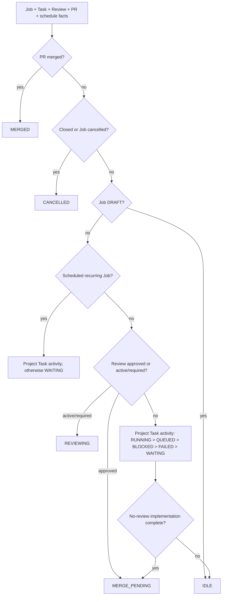

# Agents Relay v1 architecture

## Goal

Provide a generic, shareable async agent job system where agents can create durable child tasks, specialized workers execute them asynchronously, results are persisted, and the parent agent can continue when dependencies become ready.

## Core model

- **GitHub pull request** — durable top-level job container and audit surface.
- **PR body Job marker + objective** — the canonical durable Job surface: hidden job metadata/continuation state followed by the visible Markdown objective.
- **Task marker comments** — append-friendly durable child-task records.
- **Agents Relay daemon** — reconciler, scheduler, dispatcher, lease/recovery manager, continuation engine, and dashboard server.
- **Agent adapters** — agent execution backends such as Codex and ChatGPT browser workers.
- **Event adapter** — required lifecycle channel for model-backed workers. Correlated terminal events drive task-state transitions, while GitHub PR/task markers persist the resulting durable state.
- **Periodic watchdog** — low-frequency recovery sweep that re-reads durable PR/job state to repair missed wakeups and recover stale execution state (30 minutes with webhook mode by default; 5 minutes without webhooks for compatibility).
- **Indexed autonomous scheduler** — optional 10-minute GitHub Actions heartbeat that queries current/recent next-run labels, claims due slots in GitHub, and wakes the local Relay daemon through the existing issue-comment webhook. Durable schedule state remains in the trusted job marker; see [scheduled autonomous jobs](scheduled-autonomous-jobs.md).
- **Artifact references** — large/private outputs stay outside GitHub comments; task records store references.

## Agent network slice

An agent is a registered, result-owning worker/social role with a responsibility boundary. It is not the same thing as a skill (a callable capability) or an execution adapter (Codex or ChatGPT). Registration is machine-driven through the CLI/core API and is stored as a trusted `agents-relay:agent:v1` marker comment on the same PR.

Registration records identity/name, role and responsibility, claimed capabilities, explicit boundaries/non-goals, endpoint/runtime, availability, and routing metadata. `agent-register` and `agent-discover` provide the smallest useful registry surface. Discovery applies hard filters first and returns observed evidence and reasons rather than a universal score. Evidence can include representative evaluations, outcomes, reliability, latency, and cost. `--explore` allows new/unobserved agents to be considered first; the orchestrator still owns the final choice.

The registry does not yet execute remote agents or expose a public marketplace. A constrained ChatGPT/voice/mobile runtime should eventually use a small authenticated service surface with only `POST /jobs` (intention-only/public jobs) and `GET /jobs/:id`; credentials and private payloads must stay out of PR markers and events. Private-data/credential jobs, multi-owner trust, isolation, billing, and public discovery are future security-gated work.

## Execution modes

Jobs persist `executionMode` as `fixed` or `autonomous`; missing mode in legacy
markers is read as `fixed`. Fixed remains the default. Direct orchestrator work is created with `task create`; explicit planner-driven decomposition uses `plan`, and autonomous continuation uses the same planner-round implementation when Relay invokes the planner. Autonomous jobs use the existing task records and parent hierarchy:
when all currently runnable work is settled and no planner task is active,
reconciliation appends one durable `kind: "planner"` `plan-N` task. Historical `planner-N` task IDs remain readable. The planner returns
typed `objective_status`, `assessment`, and `next_tasks` values. Each
`next_tasks` item becomes a normal child task of that planner task.

Stable task IDs and append-if-same-definition behavior make planner retries
idempotent. Leases, owner recovery, and completion decisions remain in the
reconciler; planner output never directly marks a job complete.

## Reconciliation rule

Every wake-up means only: "the durable state may have changed." The daemon reloads the PR and task records, derives desired actions, and reconciles actual execution state. It never advances a job solely because an event claimed something happened. Event-driven and periodic reconciles are single-flight within one process; a periodic sweep may create the next autonomous planner task only from durable settled state.

## State

Durable Job/Task lifecycle legality is defined by directly renderable Mermaid graphs in `workflow/job-lifecycle.mmd` and `workflow/task-lifecycle.mmd`. Relay parses those files using the minimal executable profile documented in [workflow-engine.md](workflow-engine.md); there is no JSON/YAML mirror. Runtime status remains a separate derived projection.

Job state is split into durable lifecycle and derived runtime status.

Durable Job lifecycle is defined and rendered from [`workflow/job-lifecycle.mmd`](../workflow/job-lifecycle.mmd). This document explains the semantics but does not duplicate the transition table.

- `DRAFT`: the Job exists but Relay must not execute it yet.
- `ACTIVE`: Relay may reconcile it, evaluate triggers/schedules, release dependencies, and launch executable Tasks.
- `COMPLETED`: terminal business lifecycle. For a PR-backed Job, PR merge is authoritative completion evidence.
- `CANCELLED`: terminal cancellation. A closed, unmerged managed PR reconciles to this lifecycle state.

`RUNNING`, `WAITING`, `BLOCKED`, and `FAILED` are not durable Job lifecycle states. They are runtime projections derived from Task, Review, PR, and schedule facts. The current runtime statuses are `IDLE`, `WAITING`, `QUEUED`, `RUNNING`, `BLOCKED`, `FAILED`, `REVIEWING`, `MERGE_PENDING`, `MERGED`, and `CANCELLED`. Runtime status is recomputed; it is never persisted as Job lifecycle truth.

Runtime-status projection intentionally remains TypeScript in `src/runtime-status.ts` rather than becoming a third executable Mermaid profile. Unlike Job/Task lifecycle, it does not describe legal transitions of one durable state machine; it folds several orthogonal fact sets into one observation. Making the projection executable would either duplicate those facts as fake states or expand the Graph Engine beyond its deliberately small `stateDiagram-v2` contract. Mermaid is still useful here as explanatory documentation:

Within Task activity, runnable/running work outranks blocked or failed siblings. `BLOCKED` or `FAILED` describes the Job only when no `RUNNING` or `QUEUED` work can still advance it. A scheduled `ACTIVE` Job with no current executable activity projects `WAITING` between runs.

Task lifecycle is defined and rendered from [`workflow/task-lifecycle.mmd`](../workflow/task-lifecycle.mmd). This document explains the semantics but does not duplicate the transition table.

A task is DRAFT when it exists durably but is not executable yet. Dependency-backed DRAFT tasks move to QUEUED when their dependencies succeed; a DRAFT task with no dependencies requires an explicit release to QUEUED. QUEUED means executable now. Once RUNNING, a task must not return to DRAFT; an external condition discovered during execution is BLOCKED. Autonomous objective satisfaction and review/merge readiness are runtime/reconcile facts and do not rewrite an ACTIVE Job into intermediate lifecycle states.

## Task record

Each task is one GitHub PR comment containing a human-readable summary plus a hidden `agents-relay:task:v1` JSON marker. Minimum durable fields:

- task id and parent task id
- dependencies
- capabilities
- adapter + execution input
- routing decision for model-backed workers
- worker requirements and the worker-router selection evidence
- state + attempt
- lease owner and expiry
- execution id/thread id
- result summary and artifact references
- timestamps

Task submission is append-only at creation time, which avoids a single giant mutable manifest and makes agent-to-agent delegation natural.

## Execution

1. An agent creates a durable task under the Job.
2. A task comment is created durably.
3. The relay wakes and reloads the PR.
4. Scheduler marks dependency-satisfied tasks ready.
5. Worker-router resolves declared worker requirements using the fresh shared usage snapshot, then model-router resolves provider/model details; Relay persists both before launch.
6. Final review uses the same worker-router boundary: hard constraints are applied first, then worker and provider/model diversity are preferences. The durable review task records the selected worker and reason.
7. Dispatcher validates the selected worker's routing/capabilities and claims a lease.
8. Adapter launches/submits the worker; Relay emits `task.process.launched` only after that succeeds.
9. The worker emits its own correlated `task.started` after real work begins. Relay never synthesizes this event.
10. Codex emits `task.process.exited` on synchronous runtime exit; ChatGPT emits `task.process.async_exited` after its submit runtime exits while the remote worker may continue.
11. Worker reports progress and exactly one terminal task event over the canonical event channel.
12. Relay persists terminal task state/result back into the task comment.

Managed Codex and ChatGPT bootstrap prompts carry only the durable PR URL and
task-comment URL, plus the Job/Task IDs and project name. The worker retrieves
the job and task from GitHub using the access available in its environment, so
the stored task input is not duplicated into the launch prompt. GitHub comment
URLs are hydrated onto tasks when the durable graph is reloaded.

The ownership boundary is strict: workers own `task.started` and the exact
terminal task event; Relay owns `task.process.launched` and
`task.process.exited`/`task.process.async_exited`. Process exit remains
observational only: Relay performs no exit-time terminal check and does not
synthesize task failure from process exit. Semantic completion/failure comes
from the exact worker terminal event or the normal task timeout.
12. Relay reconciles dependents and/or resumes the parent continuation.
13. Periodic watchdog reconciliation only repairs missed wake-ups and expired leases; webhook mode uses targeted reconciliation for the normal path and cached dashboard reads do not trigger broad discovery.

The ChatGPT adapter establishes its event cursor/barrier before submission and accepts only a post-barrier, worker-owned `task.started` for the exact job/task. Its owned Temporary Chat tab uses the configurable `after-start` policy by default; `never` keeps it open for tests/debugging, and `after-terminal` waits for a new, correlated `task.completed`, `task.failed`, `task.blocked`, or `task.cancelled` event before closing it. Stale or wrong-task events never satisfy either barrier. If no start acknowledgement arrives within 60 seconds, Relay closes only the owned tab under `after-start` and records an explicit `worker_start_timeout` start-ack failure; process-exit events remain distinct from task terminal events.

Configure the daemon or CLI service with `--chatgpt-tab-close-policy after-start|never|after-terminal`, or set `AGENTS_RELAY_CHATGPT_TAB_CLOSE_POLICY`. The default is `after-start`.

## Continuations

Continuations are adapters, separate from worker adapters. v1 supports Codex-thread continuation plus a generic command/webhook contract. Hosted web chat continuations may rely on their host integration; their durable state remains recoverable from the PR.

## v1 acceptance criteria

1. A reusable TypeScript package/CLI named `agents-relay`.
2. GitHub PR/comment durable store with job/task marker parsing and updates.
3. CLI to manage Jobs, create/update/show/list/retry/cancel Tasks, reconcile, and run the daemon.
4. Dependency scheduling and nested parent/child lineage.
5. Worker lease, expiry detection, recovery, retry, timeout, and cancellation semantics.
6. Codex and ChatGPT agent adapters behind one adapter interface; shell commands remain tools used by orchestrators/agents, not managed worker tasks.
7. Routing metadata is mandatory before a model-backed worker can launch.
8. Optional event integration for wake-ups/progress with durable-state reconciliation.
9. Parent continuation interface with Codex-thread continuation implemented.
10. Dashboard web page showing jobs, task tree/state, worker/model, dependencies, results, leases, and live events/status.
11. SSE or equivalent local live dashboard updates.
12. Tests for marker parsing, state transitions, scheduling, reconciliation/recovery, and API/dashboard data.
13. `skills/agents-relay/SKILL.md` plus supporting agent files describing how an agent creates async work, propagates lineage, consumes results, and treats events vs durable state.
14. Documentation and a runnable local dogfood example.
15. Browser-level verification of the dashboard before merge.

## Non-goals for v1

- Reimplement GitHub as a database.
- Build a general workflow-language/DAG editor.
- Require Redis, Postgres, Temporal, or Kubernetes.
- Make NATS mandatory.
- Implement a hosted multi-tenant control plane.
- Encode domain-specific agent roles in the core runtime.
- Build a broad public agent marketplace or unauthenticated remote HTTP API.

## Dogfood

This PR is the first top-level Agents Relay job. Development, review, fixes, and verification remain on this PR until the v1 acceptance criteria are met.

## Shared execution context

`resolveExecutionContext(projectPath, role, options)` is the common discovery boundary for XChat-compatible orchestrators and Relay runtimes. It resolves project instructions, skills, visible agents, and adapter/runtime capabilities from three layers with project-local > Neo shared > global `~/.agents` precedence. The resolver returns concrete paths only for the current execution; GitHub-backed durable task records keep semantic names and routing intent rather than filesystem paths.

Planner, reviewer, normal worker, and nested worker launches consume the same resolved structure. The planner may select its visible `planner` agent definition from that context; the ChatGPT adapter consumes the resolved `chatgpt-browser-worker` skill instead of a Relay-owned duplicate. Leaf workers receive the generic resolved context and do not inherit the full top-level `xchat-orchestrator` responsibilities.

Relay remains the only durable delegation boundary. A nested worker may inspect visible agents and propose sub-work, but execution of that sub-work must be a durable child task with `parentTaskId`; direct arbitrary child-agent spawning is outside the contract. This preserves output contracts, leases/retries, model routing, events-bus lifecycle, and review gates. XChat bootstrap code can consume the same resolver through `agents-relay context resolve --project-path <path> --role orchestrator` (or reuse the underlying module inside the package) rather than maintaining a second discovery algorithm.
