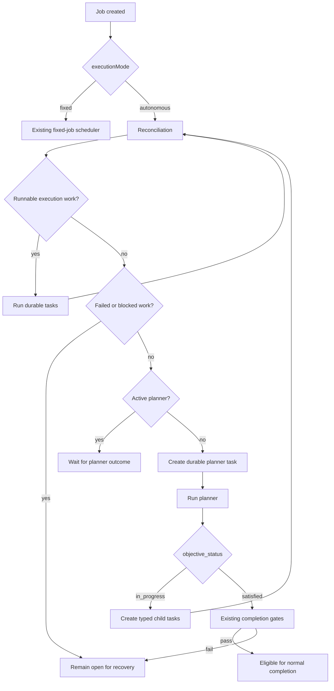
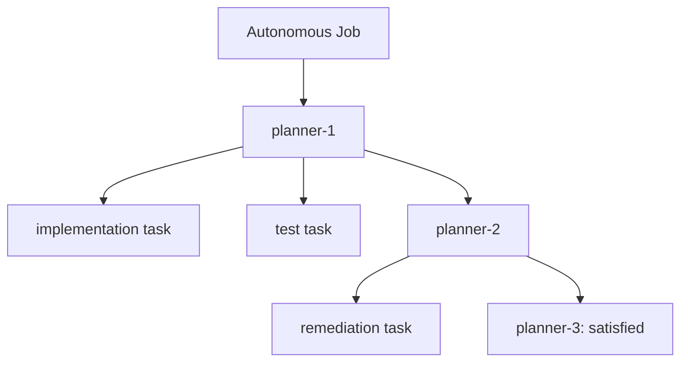
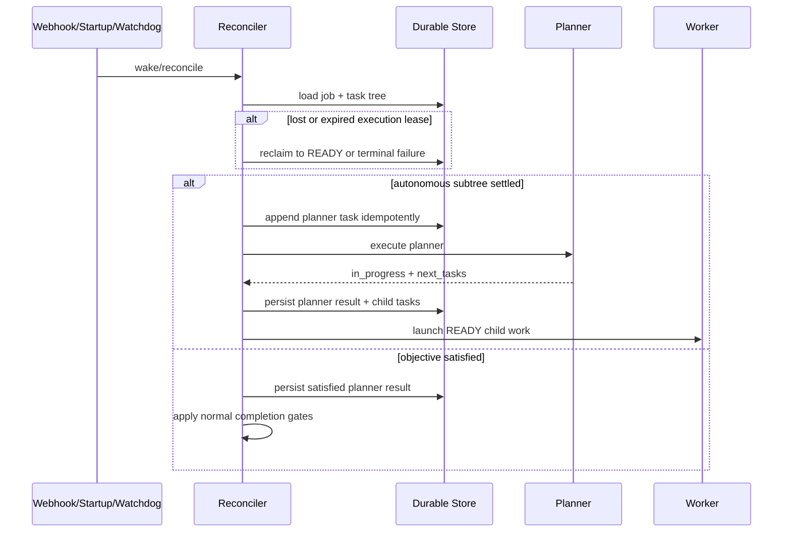
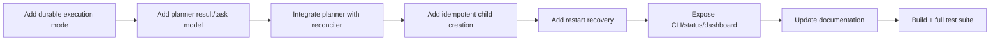

# Autonomous Objective-Driven Jobs

This document records the design, implementation flow, recovery semantics, and validation of autonomous objective-driven jobs in Agents Relay.

## Objective

Existing jobs remain `fixed` by default. An `autonomous` job may grow its own durable task tree until the objective is satisfied. Planning is represented by real durable planning decisions rather than hidden generations or a second state store. GitHub-backed durable state remains authoritative.

## Design principles

- `executionMode` is explicitly `fixed` or `autonomous`; legacy jobs deserialize as `fixed`.
- A planner is a real durable task (`kind: planner`) in the same parent/subtask hierarchy as execution work.
- Reconciliation owns liveness: it decides when another planner is required, including after daemon restart or a missed wake-up.
- The planner owns reasoning: it returns `objective_status`, an assessment, and typed `next_tasks`.
- The default planner is the installable `skills/agents-relay/agents/planner.agent.md` agent contract shipped with the npm package; runtime command configuration is only an override.
- `in_progress` creates durable child work; `satisfied` stops growth but does not bypass normal completion gates.
- Failed or blocked work prevents autonomous completion and prevents blindly creating another planning round.
- Planner and generated task creation are idempotent so repeated reconciliation does not duplicate work.

## Initial planning contract

No executable task may exist without a completed planning decision that created
it. An orchestrator that knows the initial task set records a completed
`planner-0` decision with `planningSource: orchestrator`; every initial task
stores that decision ID, source, and round `0`. Job creation keeps an
`initialPlanning: pending` barrier while the decision and task comments are
being appended, so an autonomous watchdog cannot race ahead and create
`planner-1`. A job created with only an objective may instead create a real
model planner task first; its children are materialized only after the planner
is successful.

The lifecycle is therefore:

```text
fixed:      orchestrator decision -> initial batch -> review/completion
autonomous: orchestrator decision -> batch -> review gate -> model planner -> batch -> ...
```

Planning provenance is retained on every task (`planningDecisionId`,
`planningSource`, and `planningRound`). Nested delegation uses the same Relay
path: the worker's durable delegation decision is recorded before child tasks,
and the child retains its worker parent lineage.

## Autonomous lifecycle



## Durable hierarchy

Planning causality is visible directly in the existing task tree. No wave/generation abstraction is introduced.



Each planner result is persisted with its assessment and generated work. Stable generated task IDs plus durable append semantics make replay safe.

## Reconciliation and restart recovery

The daemon does not depend on a planner remembering to schedule its successor. Reconciliation reconstructs the next action from durable state.



A restarted daemon can reclaim a durable planner lease owned by the previous runtime. Repeated reconciliation observes existing planner/task markers instead of creating duplicate work.

## Completion semantics

Planner satisfaction is evidence about the objective, not authority to close the job. The existing job lifecycle remains authoritative. An autonomous job can stop growing only after a planner reports `satisfied`; it can complete only when the normal completion conditions also allow it. Failed or blocked tasks remain visible and prevent accidental success.

## Compatibility and surfaces

Fixed jobs retain their previous scheduling behavior. Execution mode and planner state are serialized in durable markers, exposed through CLI/status data, and surfaced in the dashboard. Legacy markers without an execution mode are interpreted as `fixed`.

## Implementation sequence



## Validation

The completed branch was validated with `npm test`, which runs the TypeScript build before the Node test suite. Final result on 2026-09-19:

- TypeScript build: passed.
- Tests: **108 passed, 0 failed, 0 skipped/cancelled**.
- Focused coverage includes marker round-trip and legacy defaults, fixed-job compatibility, autonomous task-tree growth, stable/idempotent generated task IDs, restart planner-lease recovery, objective satisfaction, and failed/blocked completion gates.

## Follow-up

GitHub API quota exhaustion prevented managed PR bootstrap during this implementation. The feature was therefore completed and validated on `feat/autonomous-objective-jobs`; managed PR/job bootstrap can be retried after quota recovery. The next P0 work is intentionally separate: GitHub App authentication and reducing residual GitHub API consumption while retaining webhook-driven targeted reconciliation.
