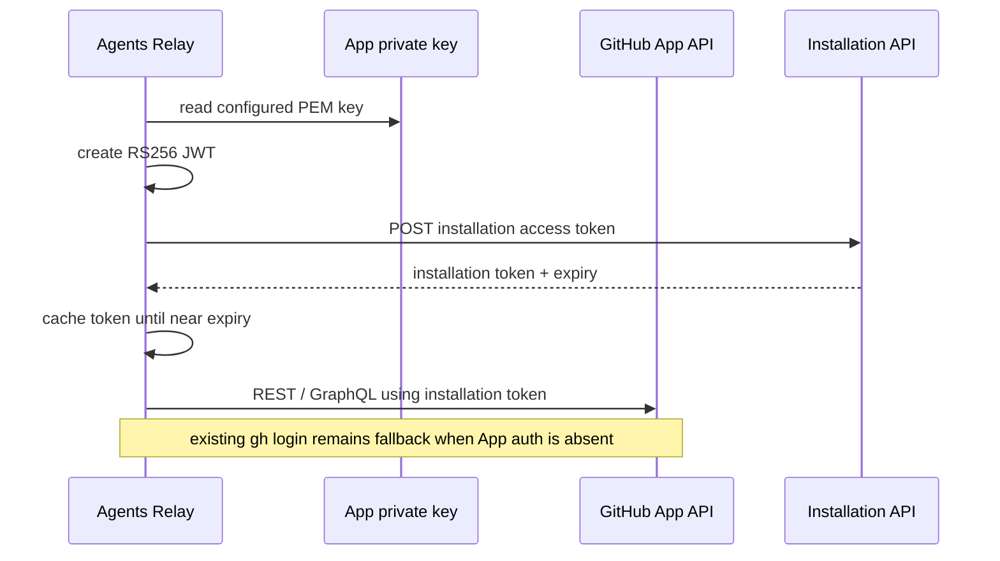
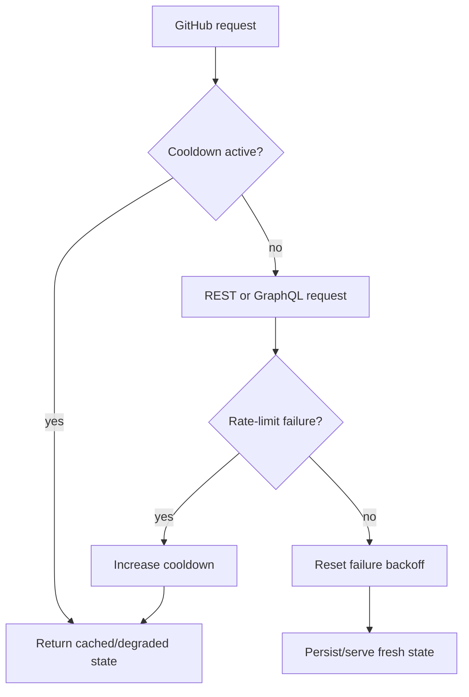
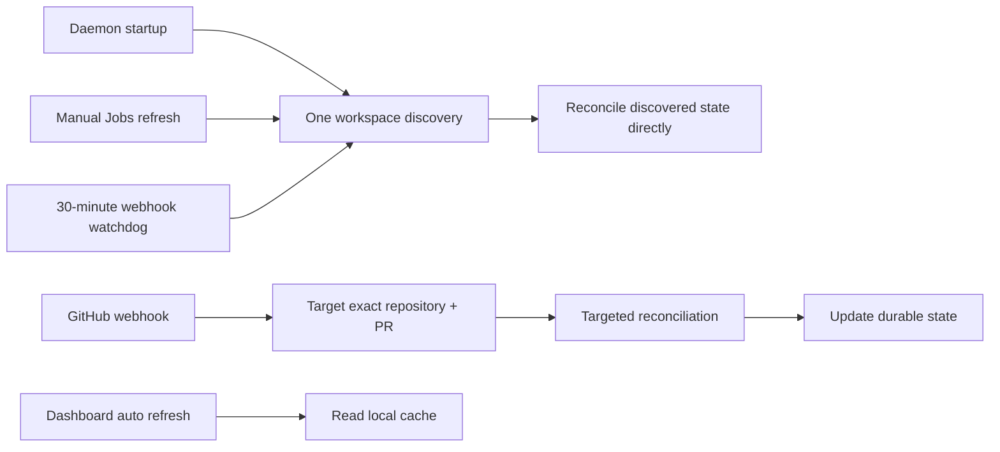
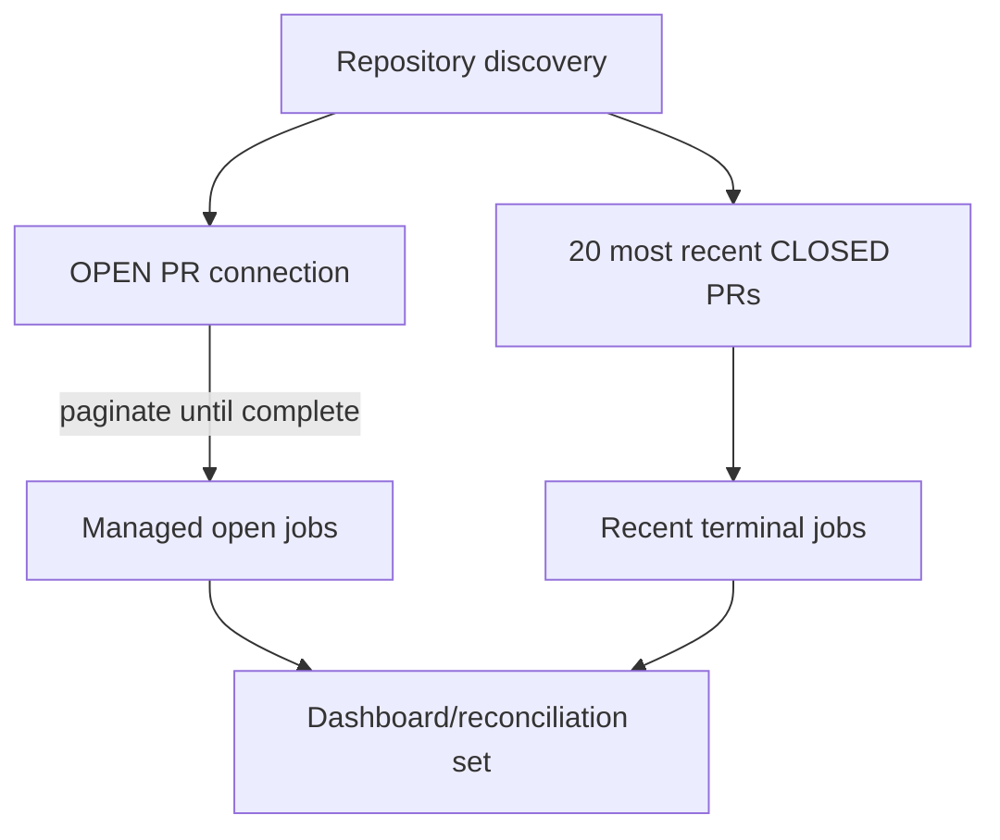

# GitHub App Authentication and API Consumption

Agents Relay can authenticate GitHub API traffic with a GitHub App installation instead of consuming the interactive user account quota. This document also records the API-consumption changes that make webhook-driven reconciliation the normal path.

## Goals

- Separate automation API traffic from the developer's interactive GitHub identity.
- Cache GitHub App installation tokens instead of minting one per request.
- Apply the same rate-limit cooldown to REST and GraphQL calls.
- Stop periodic dashboard refreshes from causing workspace-wide GitHub scans.
- Keep webhook wakes targeted to a repository and pull request.
- Retain a low-frequency watchdog and startup reconciliation for missed events/restarts.
- Preserve existing `gh` authentication when GitHub App settings are not configured.

## Authentication flow



The JWT uses a 60-second backdated `iat` and an expiry nine minutes in the future. Installation tokens are cached and refreshed only when fewer than five minutes remain. No private key or token is written to durable PR state.

## Configuration

All three GitHub App settings are required together. They can be provided as CLI flags or environment variables. CLI flags take precedence.

| CLI flag | Environment variable | Meaning |
| --- | --- | --- |
| `--github-app-id` | `AGENTS_RELAY_GITHUB_APP_ID` | GitHub App ID |
| `--github-app-installation-id` | `AGENTS_RELAY_GITHUB_APP_INSTALLATION_ID` | Installation ID for the account/repositories |
| `--github-app-private-key-file` | `AGENTS_RELAY_GITHUB_APP_PRIVATE_KEY_FILE` | Local PEM private-key path |
| `--trusted-authors` | `AGENTS_RELAY_TRUSTED_AUTHORS` | Extra trusted marker authors |

Example:

```bash
export AGENTS_RELAY_GITHUB_APP_ID=123456
export AGENTS_RELAY_GITHUB_APP_INSTALLATION_ID=7890123
export AGENTS_RELAY_GITHUB_APP_PRIVATE_KEY_FILE=$HOME/.config/agents-relay/github-app.pem
node dist/relayd.js --workspace ~/Workspace
```

When App auth is enabled, Agents Relay trusts both the App bot identity and the current local `gh` user (when one exists). This keeps existing durable markers readable during migration from user auth to App auth.

## Rate-limit behavior

REST and GraphQL now share one cooldown circuit. A rate-limit/secondary-limit/HTTP 429 failure activates exponential cooldown (one minute initially, capped at fifteen minutes). While cooldown is active, workspace refresh/reconciliation uses cached state rather than continuing to spend requests.



## Webhook-first consumption model

The workspace daemon previously had several independent paths that could trigger broad GitHub reads: the five-minute watchdog, dashboard `/api/jobs` refreshes, startup discovery, and webhook reconciliation. The new flow keeps broad discovery exceptional.



Key changes:

- Startup discovery is reused directly for startup reconciliation, avoiding a second immediate workspace scan.
- Dashboard automatic refresh reads the in-process/disk cache. Only an explicit Jobs refresh asks for a broad refresh.
- Selected-job refresh remains targeted to that job's pull request.
- Webhook mode uses a 30-minute watchdog by default instead of five minutes; `--interval` still overrides it.
- Without webhook configuration, the existing five-minute watchdog remains for compatibility.
- Full discovery queries every open PR but only the 20 most recently updated closed PRs; it no longer paginates the complete closed PR history.

## Discovery query shape



This keeps all active managed jobs discoverable while bounding historical reads needed for dashboard history and missed terminal lifecycle recovery. Webhooks remain the primary path for immediate merge/close transitions.

## Failure and migration behavior

- Partial App configuration fails fast; Agents Relay will not silently mix identities.
- If App authentication is not configured, existing local `gh` authentication is unchanged.
- If GitHub becomes rate limited, dashboard data remains available from cache and the daemon stops broad retries until cooldown expires.
- The private key is read locally and used only to sign App JWTs. Durable GitHub comments never contain the key, JWT, or installation token.

## Validation

Coverage includes App-config validation, RS256 JWT signature/claims, existing fixed/auth fallback behavior, dashboard manual-vs-cached refresh wiring, startup reconciliation reuse without a second workspace scan, targeted webhook reconciliation, and open-PR pagination with bounded closed history. Run the full suite with:

```bash
npm test
```
