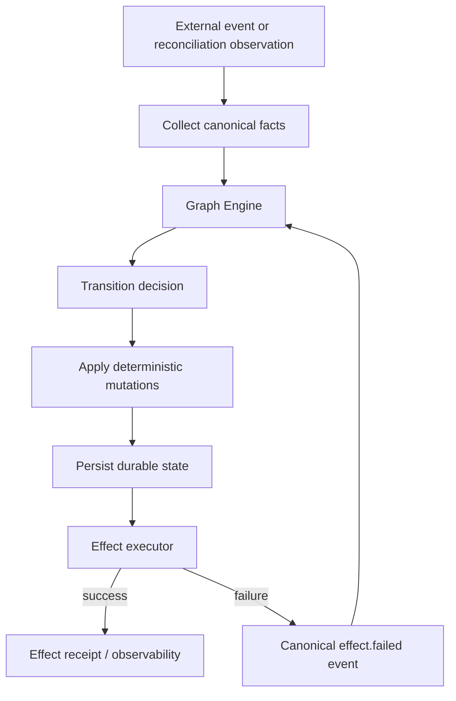
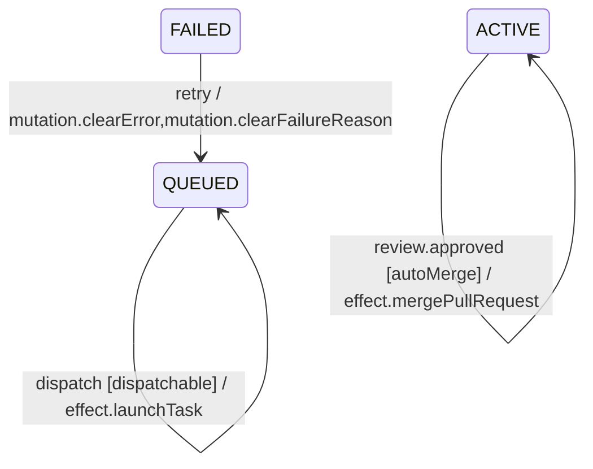

# Graph Engine orchestration core

The Graph Engine is the lifecycle decision core for Agents Relay. Its contract is:

```text
current state + event + canonical facts
  -> transition + deterministic mutations + declarative side effects
```

The graph decides lifecycle policy and which next actions are required. It does not directly call GitHub, NATS, worker processes, PM2, browser automation, or durable storage APIs.

## Canonical vocabulary

`src/workflow/contracts.ts` owns finite registries for workflow events, facts, deterministic mutations, and external effects. Canonical Job and Task Mermaid definitions are validated against those registries when loaded.

Mutations are deterministic changes to the durable subject, such as clearing a stale error when a task becomes healthy. They are applied by `src/workflow/runtime.ts`.

Effects are declarative external intents. The initial effect vocabulary is:

- `effect.launchTask`
- `effect.cancelActiveTasks`
- `effect.mergePullRequest`

Each effect has a typed payload contract plus a documented idempotency strategy, failure event, retry owner, and observability namespace.

## Execution loop



A transition can declare actions in Mermaid:



Declarative actions are parsed and validated by the Mermaid engine but are not invoked inside the graph. `WorkflowEffectExecutor` executes external effects outside the decision layer.

## Idempotency and failure semantics

`WorkflowEffectHandler` is the base abstraction for effect implementations. Specialized handlers provide the actual external operation and may override the idempotency key. `WorkflowEffectExecutor` records completed keys and returns `completed`, `failed`, or `deduplicated` outcomes.

Current policies are:

| Effect | Idempotency | Failure event | Retry owner |
| --- | --- | --- | --- |
| `effect.launchTask` | Job + Task + attempt | `effect.launchTask.failed` | workflow |
| `effect.cancelActiveTasks` | Job + transition | `effect.cancelActiveTasks.failed` | workflow |
| `effect.mergePullRequest` | Job + head SHA | `effect.mergePullRequest.failed` | workflow |

The Reconciler never translates an effect exception directly into an arbitrary lifecycle assignment. It feeds the canonical failure event back to the graph, then persists the graph's decision.

Worker launch also retains the existing durable execution claim/lease protections, so process launch remains protected beyond the in-process effect receipt.

## Responsibility boundaries

The refactor uses a class hierarchy to keep the orchestration surface small:

```text
ReconcilerRuntimeBase
  └─ ReconcilerReviewBase
       └─ Reconciler
```

- `ReconcilerRuntimeBase`: worker events, watchdog/recovery runtime, effect outcome feedback.
- `ReconcilerReviewBase`: review lifecycle and review-driven graph events.
- `Reconciler`: top-level observation/reconciliation, planner orchestration, and effect handler bindings.
- `workflow/task-reconcile.ts`: dependency facts and graph reconciliation.
- `scheduler.ts`: cron/schedule timing plus a compatibility facade around task reconciliation.
- `runtime-status.ts`: pure derived projection; it is not durable lifecycle state.
- Store implementations: persistence only.

Direct lifecycle state assignment is reserved for the explicit historical compatibility repair boundary. Normal lifecycle changes go through graph transitions.

## Stability contract

The Mermaid Graph Engine is the only authoritative Job/Task lifecycle decision path. There is no alternate lifecycle evaluator or runtime mode switch.

Canonical graphs fail closed at load time when they reference an undeclared event, fact/guard, mutation, or effect. Dependency reconciliation persists graph-decided Task transitions before later dispatch/effect work proceeds. External effects remain behind `WorkflowEffectExecutor`; they do not mutate lifecycle policy directly.

This stabilization phase is complete once the repository contract tests pass. Future lifecycle regressions are treated as bugs against this contract rather than as unfinished Graph Engine migration work.
