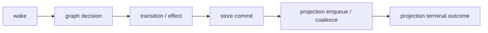

# Structured runtime observability

Agents Relay records one structured observability stream so an operator can
reconstruct why Relay made a lifecycle/projection decision without parsing
ad-hoc PM2 stderr warnings. The abstraction lives in `src/observability.ts` and
is the single logging/event boundary for the runtime.

Records are **observational only**. They never mutate durable state, never
replace the RelayStore, and never become a second workflow store. GitHub PR
state and the SQLite RelayStore remain the only durable truth.

## Reconstruction chain

Every representative task lifecycle can be reconstructed from one correlated
chain of records:



| Stage | Owner | Representative events |
| --- | --- | --- |
| `wake` | `RepositoryWorkerPool.consumeSignals` | `wake.signal` |
| `graph` | `src/workflow/dispatcher.ts` | `<event id>` (accepted/ambiguous/no-op) |
| `transition` | `task-transitions.ts`, `workflow/durable-transition.ts` | `transition`, `task.dispatch` |
| `store` | `ProjectedDurableStore` | `store.commit` |
| `projection` | `relay-store.ts`, `projected-store.ts` | `projection.enqueued`, `projection.completed`, `projection.retry_scheduled`, `projection.dead_lettered` |
| `reconcile` | `Reconciler.reconcile` | `reconcile`, `reconcile.failed`, `reconcile.signal_unrouted` |
| `daemon` | `relayd.ts` | `daemon.*_failed` |

## Record shape

```json
{
  "ts": "2026-10-01T19:31:10.671Z",
  "stage": "transition",
  "event": "task.started",
  "level": "info",
  "outcome": "succeeded",
  "message": "Task t1 QUEUED -> RUNNING",
  "correlation": { "repository": "lalalic/agents-relay", "prNumber": 228, "jobId": "job-1", "taskId": "t1", "executionId": "exec-1" },
  "transition": { "graph": "task-lifecycle", "from": "QUEUED", "to": "RUNNING", "actions": ["mutation.clearError"] },
  "data": { "attempt": 1 }
}
```

Fields:

- **correlation** — `repository`, `prNumber`, `jobId`, `taskId`, `executionId`
  where applicable. Correlation set through `withObservabilityCorrelation` is
  inherited by nested work via `AsyncLocalStorage`, so a record emitted deep in
  an effect still carries the originating job/task.
- **transition** — `graph` identity plus `from`/`to` lifecycle states and the
  declarative `actions`/effects selected by that graph. This is the link from a
  decision back to the owning canonical `workflow/*.mmd` graph.
- **outcome** — `started`, `succeeded`, `failed`, `deduplicated`, `skipped`, or
  `noop`.
- **level** — `debug`, `info`, `warn`, `error`.

## Noise policy

Normal idle watchdog cycles stay quiet:

- graph `no_transition` decisions are recorded at `debug`;
- reconcile that makes no lifecycle change is recorded at `debug` with
  `outcome: noop`;
- wake signals that produce no reconcile work are recorded at `debug`;
- routine successful `store`/`projection` records are `info`.

Only meaningful changes (`info`), retries/transient failures (`warn`), and
conflicts/daemon failures (`error`) are visible at the default `info` level.

## Conflict vs transient classification

`classifyFailure` provides one deterministic classification shared by store,
projection, and daemon error paths:

| Classification | Meaning | Examples |
| --- | --- | --- |
| `conflict` | Divergent durable definition; retrying cannot help. | `already exists with a different definition`, HTTP `409` |
| `transient` | Same request may succeed later. | HTTP `429`/`5xx`, `retry-after`, `ECONNRESET`/`ETIMEDOUT`/`fetch failed`, rate limits |
| `terminal` | Everything else; needs operator inspection. | Unexpected shapes and unknown errors |

Projection outcomes use this classification: a conflict is dead-lettered with
`classification: conflict`; a transient failure is retried with
`classification: transient`, the observed `status`, and the scheduled
`retryAt`. `isTerminalProjectionFailure` remains the single source of truth for
which outbox operations treat a divergent definition as terminal.

## Redaction and payload limits

`sanitizeObservationData` bounds and redacts every `data` value before it is
emitted:

- keys matching `secret|token|password|authorization|cookie|credential|api_key|
  private_key|bearer|prompt` are replaced with `[redacted]`;
- long bulk keys (`payload|input|body|diff|patch|content|messages`) are replaced
  with `[omitted N chars]` instead of being logged;
- generic strings are truncated to 512 characters; arrays to 20 items; object
  nesting to 4 levels.

Secrets, prompts, credentials, and large payloads are therefore never written to
the observability stream. Messages may contain durable identifiers and lifecycle
states, but no secret material.

## Configuration

Observability is configured once per process:

- `RelayObservability.fromEnvironment()` reads `AGENTS_RELAY_OBSERVABILITY` (or
  `RELAY_OBSERVABILITY_LEVEL`): `silent`/`off`/`none` disables the sink and
  `debug`/`info`/`warn`/`error` sets the minimum level (default `info`).
- `agents-relayd` calls `configureDaemonObservability()` at startup.
- `setObservability()` installs the active sink; `observability()` returns it.
- The default sink writes one JSON record per line to stderr. Tests and
  diagnostics can use `collectObservations` to capture records in memory.

## Dashboard and event-history compatibility

Structured observability is additive. It does not change the events-bus
envelope, the `/api/events` history endpoint, or the dashboard event feed.
Workflow lifecycle events published through the event bus remain the transport
for dashboard/event-history consumers; structured records are a separate,
richer, correlated diagnostic stream.

## Tests

`test/observability.test.js` verifies:

- redaction of secrets/prompts and bounding of large payloads;
- deterministic conflict vs transient vs terminal classification;
- graph decision identity and quiet `no_transition` behavior at `info`;
- a representative `wake -> graph -> store -> projection` chain that is
  reconstructible from one correlation envelope;
- projection terminal/retry records with classification and retry scheduling;
- async correlation propagation into nested work.
