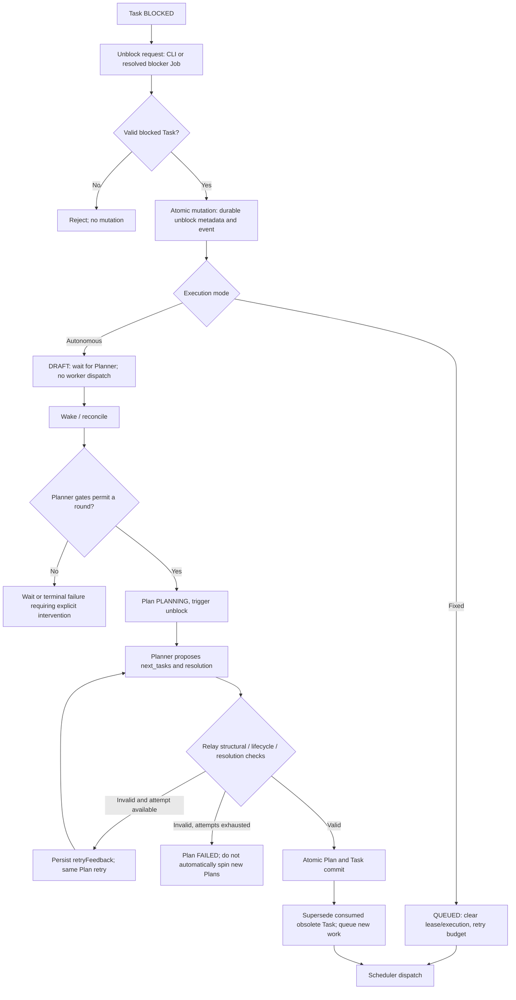

# Unblock, task resolution, and Planner recovery (as implemented)

This document is an **end-to-end explanatory view** of the current Relay implementation. The executable Mermaid graphs in [`workflow/`](../workflow/) remain the lifecycle authority; the overview [Mermaid graph](diagrams/unblock-resolution-end-to-end.mmd) must **not** be loaded as an executable workflow. Consult code and tests if a graph or policy changes.

## End-to-end overview



The complete cross-boundary illustration lives in [`diagrams/unblock-resolution-end-to-end.mmd`](diagrams/unblock-resolution-end-to-end.mmd).

## Authority and state semantics

- `unblock` is an **action**, and `task.unblocked` is an **event/record**, **not** a persisted lifecycle state. The current Task states exclude `UNBLOCKED` (`src/types.ts`, `workflow/task-lifecycle.mmd`). Older SQLite snapshots are normalized on read/mutation; the former autonomous state maps to `DRAFT`, fixed to `QUEUED`.
- An authoritative autonomous unblock is `BLOCKED -> DRAFT`. Persist `task.unblock` facts (source, reason, blocked baseline, HEAD changes) and wake the Planner; dependency reconciliation must not accidentally release that `DRAFT` as ordinary work.
- A fixed-mode unblock is `BLOCKED -> QUEUED`, clearing prior execution/lease and reopening retry capacity. Interactive decision resume has a separate validated path (`src/interactive-resume.ts`) and is not an autonomous planner trigger.
- `FAILED` describes execution outcome, whereas missing resolution means **planning cannot proceed**. Do **not** relabel a `FAILED` Task as `BLOCKED` simply because its missing resolution blocks a Plan.
- Job/Plan/Task snapshots in SQLite are authoritative; EventBus emissions request wake-ups and provide observability. Never treat external event delivery as an atomic substitute for the stored record.

## Canonical graph / runtime crosswalk

| Boundary | Executable graph | Implementation |
| --- | --- | --- |
| Decide autonomous replan vs fixed retry | [`authoritative-unblock.mmd`](../workflow/authoritative-unblock.mmd) | `src/unblock.ts`, `src/workflow/authoritative-unblock-v2.ts` |
| Task state transitions | [`task-lifecycle.mmd`](../workflow/task-lifecycle.mmd) | `src/scheduler.ts`, `src/task-actions.ts` |
| Resolve another Job's blockers | [`blocker-resolution.mmd`](../workflow/blocker-resolution.mmd) | `src/blockers.ts` |
| Select Planner trigger | [`planner-trigger.mmd`](../workflow/planner-trigger.mmd) | `src/planner.ts` |
| Decide create/recover/wait | [`planner-orchestration.mmd`](../workflow/planner-orchestration.mmd) | `src/workflow/planner-orchestration-v2.ts`, `src/reconciler.ts` |
| Validate/apply Task resolution paths | [`task-resolution.mmd`](../workflow/task-resolution.mmd) | `src/workflow/task-resolution.ts`, `src/planner.ts` |
| Run, retry and commit Plan | N/A: coordinated application of several graphs | `src/planner-runtime.ts` |

## Resolution responsibility and validation

**Planner** determines how to handle a failed or blocked Task. **Relay** rejects structurally or lifecycle-invalid proposals, and owns atomic commits. **Troubleshooter** can supply diagnosis / exact original recovery. **Human** participates only where an escalation or external decision is required. Relay does not determine semantic truth by inspecting a `rootCause` string.

`TaskResolutionPath` values: `exact_original_retry`, `same_job_dependency`, `blocker_job_dependency`, `escalation_gate`, and `cancel_supersede`. `validateResolutionProposal()` checks, respectively: original `FAILED`; existing target Task in the same Job; target Job and resolution mode; nonempty rootCause/solution; or explicit obsolescence rootCause. The `task-resolution.mmd` graph selects the associated action and owner branch. Graph acceptance is not evidence that the model's diagnosis is factually correct.

Before committing a Planner batch, `validatePlannerResolutionMaterialization()` examines existing `FAILED` / `BLOCKED` work. When proposing nonempty `next_tasks`, each unresolved Task must either already have active/waiting resolution ownership or be explicitly targeted by a new child resolution. Otherwise Relay rejects the batch. For a same-Job recovery child, the Planner must output, for example:

```json
{
  "id": "recovery-task",
  "title": "Recover and verify the failed task",
  "input": "Investigate and recover the failed work with fresh evidence",
  "storySize": "M",
  "output": { "kind": "task_pr" },
  "resolution": {
    "path": "same_job_dependency",
    "targetTaskId": "34",
    "rootCause": "Diagnosis or acknowledged uncertainty supported by evidence",
    "solution": "How this recovery task resolves the original"
  }
}
```

The `targetTaskId` references the **existing unresolved original Task**. The new child is the replacement/recovery work. The graph action attaches ownership/dependency to that original Task; it does **not** imply the original failure has already been resolved.

## Planner rejection, retry, and stops

1. `finishPlanner()` parses the JSON, validates hierarchy, resolution coverage, lifecycle ownership, and objective progress before materializing children. Failure does not commit partial children.
2. On rejection, `failOrRetry()` durably sets `retryFeedback` with the validation error. If an attempt remains, the **same Plan ID** executes again, and `plannerInput()` passes `retry_feedback` to the Planner. The Planner instruction contract explicitly requires correcting missing resolution targets rather than resending the same sibling tasks.
3. Attempt limits are durable (`Plan.attempt`, `maxAttempts`); JSON-correction exhaustion also terminates. A terminally failed unblock Plan keeps the event/facts available but does not create unbounded new Plans on every reconcile; explicit intervention is required.
4. On valid output, the Plan and its new children / resolution ownership are committed atomically where supported, the unblock-triggered old Task is superseded as appropriate, and ordinary dependency/scheduling rules resume. Cross-Job blocker registrations are retained as pending durable intents until acknowledged.

**Important limitation:** the bounded correction path does not guarantee that a Planner can produce a safe resolution. A terminal `FAILED` Plan is a visible recovery-needed outcome, not success, and the Job can remain `ACTIVE` without executable work. Do not force retry, silently cancel unrelated Tasks, or claim the Job is complete.

## Job 473 example / operator checklist

The observed sequence was: Task 30 `BLOCKED -> DRAFT` via unblock; Plan 8 and 9 failed after proposing replacement work without a graph resolution for `FAILED` Task 34. The new Planner guidance and specific validation feedback address this known output defect but do **not** prove that the next Plan succeeds. Check the live Job before intervening.

1. Inspect the latest authoritative Job/Task/Plan records and the exact `Plan.error`, `retryFeedback`, `attempt/maxAttempts`, and Task 34 resolution fields.
2. Determine whether Task 34 should be retried, owned by recovery work, depend on another Job, escalated, or superseded. Ensure evidence rather than a guessed resolution.
3. Start an explicit Planner round if the terminal unblock Plan has exhausted attempts; confirm corrected `next_tasks[].resolution.targetTaskId`, and check Plan success and durable resolution attachment.
4. Check that no duplicate execution starts and that Task 30 does not directly dispatch from its waiting `DRAFT` state.

## Tests and maintenance

Relevant suites include `test/autonomous.test.js`, `test/unblock.test.js`, `test/planner-orchestration-v2.test.js`, `test/workflow-v2-lifecycle-parity.test.js`, and `test/source-size.test.js`. Run `npm run test:publish` before releasing changes. If modifying an executable workflow, update its canonical `.mmd`, implementation bindings, and tests together; **do not** copy the explanatory graph into `workflow/`.
