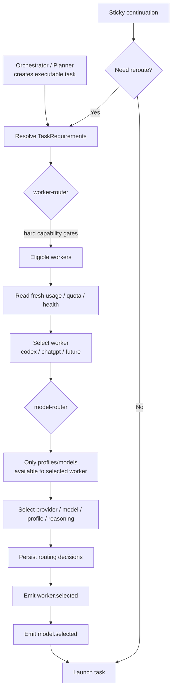

# Worker Router and Model Router

Agents Relay uses two routing stages for model-backed executable work:

- **worker-router** chooses the execution environment.
- **model-router** chooses the model/profile inside that environment.

The order is always:

```text
Task requirements → worker-router → model-router → launch
```

## Responsibilities

| Router | Decides | Typical choices | Must not decide |
| --- | --- | --- | --- |
| `worker-router` | **Where/how the task runs** | `codex`, `chatgpt`, future workers | Provider/model quality inside the selected worker |
| `model-router` | **Which intelligence configuration runs there** | provider, model, profile, reasoning level | Switching to another worker/runtime |

`worker-router` applies hard execution requirements first, then considers fresh resource/usage information, continuity, and reliability.

`model-router` runs only after a worker has been selected and may only choose profiles/models available to that worker.

## When routing runs

Routing is required whenever an orchestrator, planner, or task-producing agent creates a **new model-backed executable task**.

Sticky continuations do not reroute unless routing must be reconsidered because of capability, availability, quota/resource pressure, or an explicit request.



## Worker Router inputs

Typical inputs:

- required capabilities such as local repo, shell, browser session, attachments, or persistent iteration
- worker availability and runtime constraints
- fresh usage/quota/health information
- continuity with prior work
- recent reliability

Examples:

- Local repo edit/test/retry loop → usually `codex`
- ChatGPT web session or attachment-heavy one-shot work → usually `chatgpt`
- If both are capable, resource pressure may shift work to the healthier worker

Capability constraints are always stronger than resource preference.

## Model Router inputs

After the worker is fixed, `model-router` considers only models/profiles that worker can actually use.

Typical inputs:

- task complexity and minimum capability
- available provider/model profiles
- subscription/quota/resource state
- reasoning level needed
- sticky model/profile continuity

Example:

```text
worker-router → codex
model-router  → openai / gpt-5.6-luna / medium
```

The model router cannot change the selected worker to ChatGPT; that requires a new worker-routing decision.

## Usage data

Both routers should reuse the shared Agents Relay usage readers/registry used by the dashboard.

Usage is read **on demand when routing needs it**. The routing layer should not duplicate provider-specific usage readers or introduce a separate usage cache/scheduler.

## Core rule

> **Worker Router selects the execution runtime. Model Router selects the intelligence inside that runtime.**
