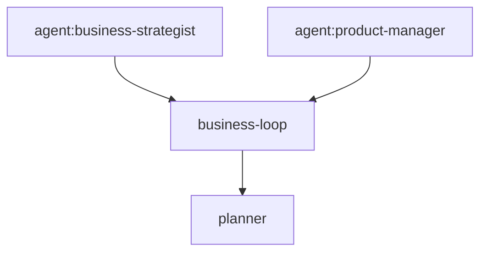

# Executable Mermaid workflow profile

Agents Relay uses a deliberately small subset of Mermaid `stateDiagram-v2` as the source of truth for durable lifecycle graphs. The same `.mmd` file is intended to be rendered by Mermaid, reviewed and edited by humans/agents, and parsed directly by Relay. There is no generated JSON/YAML workflow definition.

Canonical graphs:

- `workflow/job-lifecycle.mmd`
- `workflow/task-lifecycle.mmd`

## Supported profile

A file must start with `stateDiagram-v2`. Blank lines and Mermaid `%%` comments are allowed. The executable profile supports only transitions:

```text
[*] --> STATE
STATE --> STATE: event
STATE --> STATE: event [guard]
STATE --> STATE: event / action
STATE --> STATE: event [guard] / action1, action2
STATE --> [*]
```

State, event, guard, and action identifiers use letters/numbers plus `_`, `.`, and `-` (identifiers start with a letter or `_`). Exactly one initial `[*] --> STATE` transition is required. Initial/final pseudo-state transitions have no event label. Unsupported Mermaid constructs fail validation rather than being silently ignored.

The label grammar is intentionally small:

```text
event [guard] / action1, action2
```

Guards and actions are **names**, not embedded JavaScript. Runtime code registers implementations for those names. The graph defines policy/structure; TypeScript implements primitive capabilities and side effects.

## Engine boundary

The generic engine parses and validates the Mermaid graph, checks whether a state-to-state transition is legal, resolves transitions by event, evaluates named guards, and invokes named actions. Callers remain responsible for durable persistence, locking/claims, event delivery, and external side effects.

The canonical graphs are the target lifecycle authority, but rollout is confidence-gated. CLI mutations, reconciliation, dependency release/hold, worker lifecycle events, planner lifecycle, review invalidation, and PR merge/close all feed the same lifecycle event seam. That seam can run the temporary legacy evaluator, compare legacy vs Mermaid in shadow mode, or explicitly select the graph. Runtime status remains a derived projection from Job/Task/Review/PR/schedule facts and is intentionally outside this state-machine engine.

## Non-goals

- no JSON/YAML mirror or generated workflow source;
- no arbitrary Mermaid syntax or Mermaid renderer implementation;
- no JavaScript expressions embedded in labels;
- no BPMN/general-purpose scripting language;
- no distributed workflow/locking implementation;
- no worker-internal step graph;
- no runtime-status projection engine; projection intentionally remains a separate orthogonal TypeScript calculation.


## Integrated runtime boundary

The graph owns lifecycle policy: legal source/target states, event names, named guards, and named actions. TypeScript still owns the primitives that are not state-machine policy:

- durable persistence and GitHub marker serialization;
- leases, execution IDs, and the lightweight atomic launch claim;
- GitHub/NATS/process/browser I/O and scheduler clock handling;
- concrete guard/action implementations and external side effects;
- initial Task creation choice (`DRAFT` vs `QUEUED`) before any transition occurs;
- runtime-status projection across Job/Task/Review/PR/schedule facts;
- explicit compatibility repair of legacy records that persisted invalid derived Job states.

These boundaries keep the executable Mermaid profile small while preventing lifecycle policy from drifting across CLI, reconciler, scheduler, planner, worker, review, and PR paths.

## Integration verification checklist

- `workflow/job-lifecycle.mmd` and `workflow/task-lifecycle.mmd` are the only persistent lifecycle transition sources.
- Both canonical files parse through Relay's executable Mermaid engine and render directly with a standard Mermaid renderer.
- The npm package includes both canonical `.mmd` files alongside `dist/`.
- Worker process launch does not imply `RUNNING`; worker-owned `task.started` performs the semantic transition.
- Canonical terminal worker events own normal Task completion/failure/block/cancel transitions.
- Dependency release/hold and runnable normalization are graph-driven `reconcile` transitions with named guards/actions.
- PR merge/close drives Job lifecycle through graph events; review state remains orthogonal.
- Planner lifecycle uses the same Task graph.
- Runtime status remains derived and is not persisted as lifecycle truth.
- No JSON/YAML mirror exists. During A/B rollout, one isolated legacy evaluator is retained only as the temporary comparison oracle; it must not spread back into callers.

## A/B rollout modes

Graph Engine integration is intentionally gated by one process-level setting:

```text
AGENTS_RELAY_WORKFLOW_MODE=legacy|shadow|graph
```

The default is `legacy`.

```mermaid
flowchart LR
    I[State + event + facts] --> A[Legacy evaluator]
    I --> B[Mermaid evaluator]
    A --> C{rollout mode}
    B --> C
    C -->|legacy| LA[A is authoritative]
    C -->|shadow| SC[Compare A and B; A authoritative]
    C -->|graph| GB[B is authoritative]
    SC --> O[/api/workflow-rollout + mismatch diagnostics]
```

- **legacy** keeps the isolated TypeScript lifecycle evaluator authoritative. The legacy evaluator exists only as a temporary rollout oracle; it is not a new durable workflow source and should be deleted after graph cutover.
- **shadow** evaluates the same pre-transition state/event/facts through both evaluators. Only the legacy decision is applied. Graph evaluation uses transition inspection only: it does not persist state, invoke graph actions, acquire leases, launch/cancel workers, or perform external side effects.
- **graph** makes the canonical Mermaid decision authoritative. This is opt-in until the shadow confidence gate is explicitly approved.

Shadow comparison is semantic: accepted/rejected outcome, target state, selected guard, selected actions, and rejection reason are compared. Matches increment an in-process counter without producing routine user-visible noise. Mismatches increment a mismatch counter and emit a structured JSON diagnostic containing Job/Task correlation, event, source state, facts, and both decisions.

The dashboard HTTP server exposes the current process snapshot at:

```text
GET /api/workflow-rollout
{"mode":"shadow","matches":1234,"mismatches":0}
```

These counters and diagnostics are observability only; they are never durable lifecycle truth.

### Cutover gate

Do not change the default to `graph` merely because the graph unit tests pass. A later cutover should require all of:

1. zero mismatches in the deterministic parity corpus;
2. the full regression suite passing in `legacy`, `shadow`, and explicit `graph` mode;
3. zero shadow mismatches over an agreed representative workload/observation window;
4. no duplicate persistence, worker, PR, or action side effects;
5. explicit human approval to remove the temporary legacy oracle and change the default.

Until then, shipping the Graph Engine means shipping it behind this rollout boundary, not replacing live lifecycle behavior.

## Task Agent Graph execution

A durable Task may select one canonical agent contract with `agentName`, or declare an Agent Graph with `agentGraph`. These are execution semantics inside one Task; they are not additional durable Tasks and do not create a second Job/Task lifecycle.

Single-agent execution resolves `<name>.agent.md` through the shared execution-context precedence and injects that Markdown as the authoritative behavioral contract. Worker/model routing remains separate from agent identity. The final-review path uses this mechanism: a final-review Task declares `agentName=reviewer`, while the PR/head SHA and Job objective remain Task context rather than a duplicated review protocol.

The canonical Agents Relay Planner contract is bundled at `skills/agents-relay/agents/planner.agent.md` and is exposed as a lowest-precedence built-in agent so Task Agent Graphs can use `planner` without copying that contract into each project. Project, Neo, or global agents with the same name still override the built-in definition through normal context precedence.

Agent Graphs use a minimal directly renderable Mermaid `flowchart` profile. Node IDs default to agent names; `node[agent:name]` may bind a different canonical agent. Edges are dependencies. Relay validates acyclicity and compiles the graph into execution waves. Nodes in the same wave reason independently from the same original Job/Task context; fan-in nodes receive the original context plus structured predecessor outputs. The outer durable Task owns exactly one `task.started` and one terminal event; graph nodes never masquerade as child Tasks.



This keeps three boundaries distinct: the Job's durable Task dependency graph, the Agent Graph inside one Task, and worker/model routing used to execute that Task.
