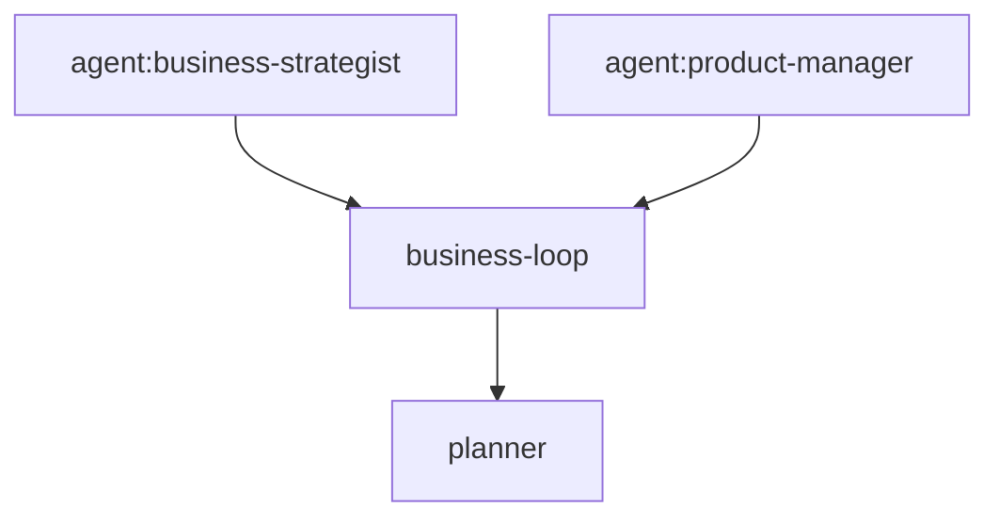

# Current executable Mermaid workflow profile

Agents Relay uses a deliberately small subset of Mermaid as the source of
truth for durable lifecycle graphs. The same `.mmd` file is intended to be
rendered by Mermaid, reviewed and edited by humans/agents, and parsed directly
by Relay. There is no generated JSON/YAML workflow definition.

The working tree contains one current canonical graph for each workflow. Graph history and prior formats are retrieved from Git commits or tags rather than kept as parallel versioned files.
Canonical workflow filenames and graph identities must not carry `v1`, `v2`, or similar version suffixes. Git commits, tags, and history are the versioning mechanism; callers always reference the stable canonical graph name.

Production durable lifecycle graphs:

- `workflow/job-lifecycle.mmd`
- `workflow/task-lifecycle.mmd`

Production orchestration-policy graphs:

- `workflow/review-lifecycle.mmd`
- `workflow/planner-trigger.mmd`
- `workflow/planner-orchestration.mmd`
- `workflow/blocker-resolution.mmd`
- `workflow/authoritative-unblock.mmd`
- `workflow/scheduled-run.mmd`
- `workflow/schedule-cycle.mmd`
- `workflow/troubleshooter.mmd`
- `workflow/escalation.mmd`
- `workflow/task-related-action.mmd`
- `workflow/projection-conflict.mmd`

Job/Task graphs own durable lifecycle state transitions. Orchestration graphs
own durable workflow branching and declared next actions without inventing
additional Job/Task lifecycle states.

## Supported production profile

Production lifecycle graphs use the strict executable `flowchart` subset defined in
[`architecture-v2.md`](architecture-v2.md) and implemented by
[`src/workflow/graph-v2.ts`](../src/workflow/graph-v2.ts). The executable
concepts remain intentionally small: state, guard, action, emit, and labeled
input/branch edges. Unsupported Mermaid syntax fails closed.

A graph declares one initial state with:

```text
flowchart LR
%% relay: initial queued
queued["state: QUEUED"]
```

State input edges use `on: event` or `request: action`. Guards use explicit
`true`/`false` branches; a missing branch means that candidate is not
enabled. A guard branch may lead to another guard, which keeps multi-fact
eligibility policy visible in the graph instead of collapsing it into a
procedural composite boolean. Multiple guarded candidates for the same state/input are allowed so
the runtime preserves deterministic `no_transition` / `ambiguous`
semantics. Actions may form an unlabelled chain before the target state, which
preserves ordered mutation/effect lists without adding another DSL construct.

Semantic identifiers are registry-bound names, never embedded code. Display
text has no executable meaning. Historical graph syntax belongs to Git history,
not to a parallel graph file in the current workflow directory.

## Engine boundary

The generic engine parses and validates the Mermaid graph, checks whether a state-to-state transition is legal, resolves transitions by event, evaluates named guards, and invokes named actions. Callers remain responsible for durable persistence, locking/claims, event delivery, and external side effects. Those primitives must not duplicate transition legality.

The canonical graphs are the lifecycle authority. CLI mutations, reconciliation, dependency release/hold, worker lifecycle events, planner lifecycle, review invalidation, and PR merge/close all feed the same graph lifecycle event seam. Runtime-owned Task inputs use `DurableTaskTransitionRuntime` to serialize one Task, load fresh durable state, ask the graph about the event plus facts, and persist only an accepted graph decision. Runtime status remains a derived projection from Job/Task/Review/PR/schedule facts and is intentionally outside this state-machine engine.

## Non-goals

- no JSON/YAML mirror or generated workflow source;
- no arbitrary Mermaid syntax or Mermaid renderer implementation;
- no JavaScript expressions embedded in labels;
- no BPMN/general-purpose scripting language;
- no distributed workflow/locking implementation;
- no worker-internal step graph;
- no runtime-status projection engine; projection intentionally remains a separate orthogonal TypeScript calculation.


## Integrated runtime boundary

The graph owns lifecycle policy: legal source/target states, event names, named guards, and named actions. TypeScript still owns the primitives that are not state-machine policy:

- durable persistence and GitHub marker serialization;
- leases, execution IDs, and the lightweight atomic launch claim;
- GitHub/NATS/process/browser I/O and scheduler clock handling;
- concrete guard/action implementations and external side effects;
- factual execution context used by graph guards, such as exact execution correlation and `recoverableExecution`;
- serialization/fresh-read primitives used to apply one graph decision safely;
- initial Task creation choice (`DRAFT` vs `QUEUED`) before any transition occurs;
- runtime-status projection across Job/Task/Review/PR/schedule facts;
- explicit compatibility repair of legacy records that persisted invalid derived Job states.

These boundaries keep the executable Mermaid profile small while preventing lifecycle policy from drifting across CLI, reconciler, scheduler, planner, worker, review, and PR paths.

## Integration verification checklist

- `workflow/job-lifecycle.mmd` and `workflow/task-lifecycle.mmd` are the production durable lifecycle transition sources; the orchestration-policy graphs listed above own review/planner/blocker/schedule/recovery/related-task branching.
- Both canonical files parse through Relay's executable Mermaid engine and render directly with a standard Mermaid renderer.
- The npm package includes both canonical `.mmd` files alongside `dist/`.
- Worker process launch does not imply `RUNNING`; worker-owned `task.started` performs the semantic transition.
- Canonical terminal worker events own normal Task completion/failure/block/cancel transitions.
- Watchdog/delivery failures are explicit graph events; they are not direct state assignments.
- Late correlated worker recovery keeps the original `task.*` event and uses the graph's `recoverableExecution` guard; runtime code does not invent recovery transitions.
- Dependency release/hold and runnable normalization are graph-driven `reconcile` transitions with named guards/actions.
- PR merge/close drives Job lifecycle through graph events; review state remains orthogonal.
- Planner lifecycle uses the same Task graph.
- Runtime status remains derived and is not persisted as lifecycle truth.
- No JSON/YAML mirror or parallel lifecycle evaluator exists; the canonical Mermaid graphs are the single lifecycle policy source.

## Task Agent Graph execution

A durable Task may select one canonical agent contract with `agentName`, or declare an Agent Graph with `agentGraph`. These are execution semantics inside one Task; they are not additional durable Tasks and do not create a second Job/Task lifecycle.

Single-agent execution resolves `<name>.agent.md` through the shared execution-context precedence and injects that Markdown as the authoritative behavioral contract. Worker/model routing remains separate from agent identity. The final-review path uses this mechanism: a final-review Task declares `agentName=reviewer`, while the PR/head SHA and Job objective remain Task context rather than a duplicated review protocol.

The canonical Agents Relay Planner contract is bundled at `skills/agents-relay/agents/planner.agent.md` and is exposed as a lowest-precedence built-in agent so Task Agent Graphs can use `planner` without copying that contract into each project. Project, Neo, or global agents with the same name still override the built-in definition through normal context precedence.

Agent Graphs use a minimal directly renderable Mermaid `flowchart` profile. Node IDs default to agent names; `node[agent:name]` may bind a different canonical agent. Edges are dependencies. Relay validates acyclicity and compiles the graph into execution waves. Nodes in the same wave reason independently from the same original Job/Task context; fan-in nodes receive the original context plus structured predecessor outputs. The outer durable Task owns exactly one `task.started` and one terminal event; graph nodes never masquerade as child Tasks.



This keeps three boundaries distinct: the Job's durable Task dependency graph, the Agent Graph inside one Task, and worker/model routing used to execute that Task.
