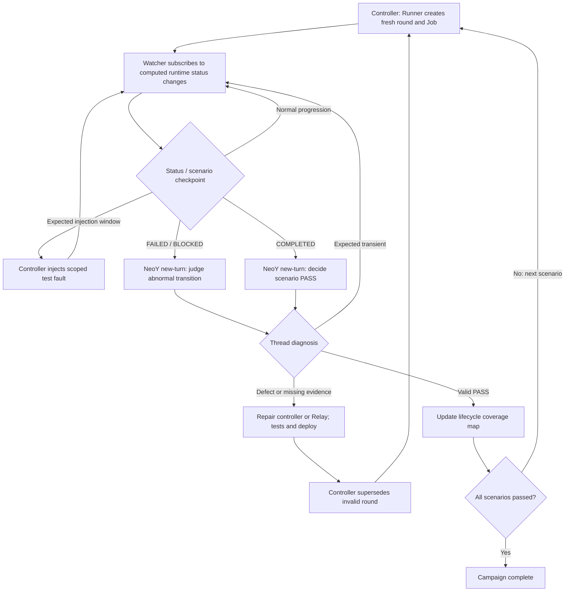

# Agents Relay E2E: event-driven Runner → Watcher → ChatGPT Turn → Runner loop

## Objective and acceptance contract

Run the production Agents Relay V2 E2E scenario catalog continuously, **in one ChatGPT thread**, until every scenario has a valid PASS. Do not use hourly schedules or user prompts as the campaign driver. The external E2E controller drives rounds; Agents Relay is the **system under test (SUT)** and retains exclusive ownership of its Task/Job lifecycle.

For every scenario **except a genuine unresolved human/external blocker**, success requires the authoritative Job to reach `COMPLETED`, with GitHub PR `MERGED` when GitHub is enabled. `COMPLETED` alone is **not** a scenario PASS: the test's required injected failure, recovery, isolation, review, merge, and related evidence must also be demonstrated. Human blockers require durable explicit `NEEDS_USER`/escalation evidence and a separate objective-specific judgment; failed workers, planners, reviewers, providers or troubleshooters are **not** human blockers.

## Closed-loop architecture



### Responsibility boundaries

| Component | Owns | Must never do |
|---|---|---|
| Runner (`e2e/runner/run.mjs`) | New scenario/round, unique branch/Job, objective and watcher startup | Declare a failed round PASS; exit without monitoring a Job created before planner failure |
| Relay SUT | SQLite authority, Graph, dispatch/recovery, review, local merge, optional GitHub projection; compute/publish runtime status transitions | Depend on the E2E controller for ordinary recovery |
| Watcher (`e2e/runner/watch.mjs`) | Subscribe to Job computed-status events; capture current snapshot, evaluate gates, invoke scenario-specific external injection, submit judgment turn | Treat `COMPLETED` as automatic PASS; mutate SUT Task/Job lifecycle |
| ChatGPT thread | Interpret scenario objective and evidence, classify expected vs defect, repair/test/deploy, decide PASS or next round | Manually retry/reconcile/review/unblock/merge the SUT Job |
| Handoff (`e2e/runner/handoff.mjs`) | Deliver event/decision payload through NeoY/browser-workspace `new-turn` into **same** thread | Create a fresh thread per event or rely on an hourly automation |

## Computed runtime-status event

Relay computes `deriveJobRuntimeStatus(job)` and compares it with the previous observation **in process memory**. After authoritative local Job commit, publish an event only for a changed computed status:

```json
{
  "type": "job.runtime_status.changed",
  "job_id": "005-watchdog-stale-generation-r6",
  "data": {
    "from": "QUEUED",
    "to": "RUNNING",
    "jobState": "ACTIVE",
    "repository": "lalalic/agents-relay-e2e",
    "updatedAt": "<authoritative Job updatedAt>"
  }
}
```

Do **not** persist a separate computed-status value. Events are wakeups; the watcher must read the **latest authoritative Job snapshot** and never treat an event payload as definitive state. Startup and missed-event fallback reads are allowed. Event delivery should not block SQLite commit or corrupt the SUT lifecycle. The watcher subscribes by Job ID; ordinary Task events may supply *diagnostic/fixture evidence*, but Task-event watching must not replace computed Job status as the principal decision trigger.

## Transition-driven decisions

| Observed computed status | Watcher action |
|---|---|
| `IDLE`, `WAITING`, `QUEUED`, `RUNNING`, `REVIEWING`, `MERGE_PENDING` | Capture progress; perform only scenario-specified, scoped fault injection when its exact trigger is proven; otherwise continue listening |
| `FAILED`, `BLOCKED` | Submit a `runtime_status_judgment` new turn **on each distinct transition** with status from/to, snapshot, error, objective and receipts. The thread determines expected recovery vs defect |
| `COMPLETED` | Submit a `scenario_completion_judgment` new turn with complete evidence, *including if a known evidence gate fails*. **Do not auto-PASS or auto-advance** |
| `CANCELLED` | End an explicitly controller-superseded round. Unexpected cancellation is an incident requiring a judgment turn |

The snapshot must include latest Plan and Task states, retries/attempts, execution identities, review state, local merge receipt, PR number and GitHub projection state. Include durable injection receipts. GitHub projection may converge after local `COMPLETED`; judgment must distinguish pending projection from final `MERGED`, and a subsequent change/fallback check must re-submit updated evidence rather than incorrectly passing.

## Turn protocol and decisions

Every handoff identifies `campaign`, `scenario`, `round`, `jobId`, `threadId`, runtime-status transition, objective path, candidate evidence, diagnostic events and controller receipt location. The thread emits one of the following **decisions and executes it in the same turn**:

1. **EXPECTED_CONTINUE** — injected failure or benign intermediate state; no SUT lifecycle intervention; watcher remains active.
2. **REPAIR_RETRY_ROUND** — unexpected defect, missing proof or invalid round; diagnose, change code only outside the SUT workload, add focused tests, deploy runtime if needed, controller-cancel/supersede *nonterminal* round, launch new round **of the same scenario** using `npm run e2e`. Completed Jobs remain immutable; record their invalid E2E verdict externally.
3. **PASS_NEXT** — verify full objective, authoritative `COMPLETED` and (if enabled) GitHub `MERGED`, update `e2e/scenarios/LIFECYCLE-COVERAGE.md`, then start next unpassed scenario via `npm run e2e` **in the same turn**.
4. **PASS_ALL** — all required scenario objectives satisfied; record final campaign outcome, stop watchers/controllers and close campaign.
5. **NEEDS_USER** — true external/human blocker with explicit evidence; preserve state and escalate rather than silently marking success.

**No status-only terminal turn** is acceptable when a concrete next action is available. All event handoffs use the existing thread, not a newly generated thread.

## Reliability and idempotency

- **At most one active round** across this campaign: check controller processes, round state and authoritative Job state before starting another.
- **Round identity**: `(repository, scenario, round, jobId)`; immutable run artifacts and injection receipts in `e2e/runs/...`. Never reuse a Job for a new round.
- **Transition identity**: `(jobId, from, to, authoritative updatedAt)`; suppress duplicate new turns for the *same transition* but allow a later distinct `FAILED` or `BLOCKED` transition.
- **Completion identity**: `(jobId, updatedAt, githubState, evidence revision)`; re-evaluate when projection or evidence changes. Avoid parallel completion/incident handoffs for the same transition.
- **Handoff delivery**: record submitted/failed and acknowledgment state; retry transient new-turn delivery errors without silently dropping the campaign. A successful CLI exit must correspond to an actual handoff receipt. Never declare PASS before a thread decision.
- **Controller startup**: create/watch boundary must survive synchronous initial Planner failure *after* the Job has been committed. A startup snapshot detects an already-abnormal or completed Job.
- **Event loss / daemon restart**: re-subscribe; read a fresh snapshot at startup and on a low-frequency safety check (only backup, not primary driver). In-memory status comparisons restart cleanly; no requirement to persist computed status.
- **Injection discipline**: use scoped external injector with actual executionId/PID and receipts; verify the worker and generation again at execution time. A Job that finishes without a mandatory injection is an invalid round even if `COMPLETED/MERGED`.
- **Thread failure**: keep watcher and controller state resumable; surface unrecoverable handoff failures to operators instead of pretending the campaign has advanced.

## Concrete implementation references

- `src/runtime-status.ts`: authoritative computed status function.
- `src/runtime-status-events.ts`: in-memory change comparison and event publication after local commit.
- `src/local-commit-events.ts`: post-commit notifications; no computed-status persistence.
- `e2e/runner/run.mjs`: round preparation and watcher startup.
- `e2e/runner/watch.mjs`: status subscription, scenario gates and turn handoffs.
- `e2e/runner/handoff.mjs`: same-thread `new-turn` transport.
- `e2e/runner/inject.mjs`: external, scoped fault injection.
- `e2e/scenarios/*.md`: scenario-specific objectives and evidence contracts.
- `e2e/scenarios/LIFECYCLE-COVERAGE.md`: canonical PASS coverage tracking.

## Design vs validation status

The high-level loop and computed-status publish/subscribe, abnormal-status judgment, and COMPLETED judgment pathways are implemented on the E2E branch. **The whole campaign is not yet proven autonomous end-to-end**. In particular, durable handoff acknowledgments, restart recovery, one-active-round enforcement and per-objective evidence verification require production E2E validation. This document specifies the intended invariant; it does not claim those checks have already passed.
