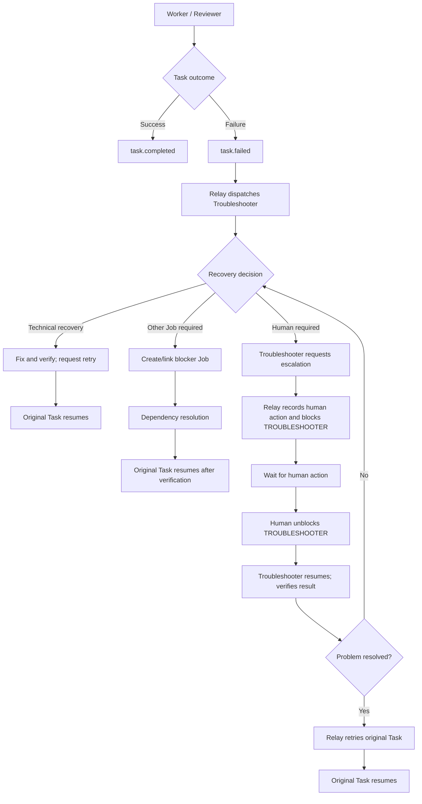
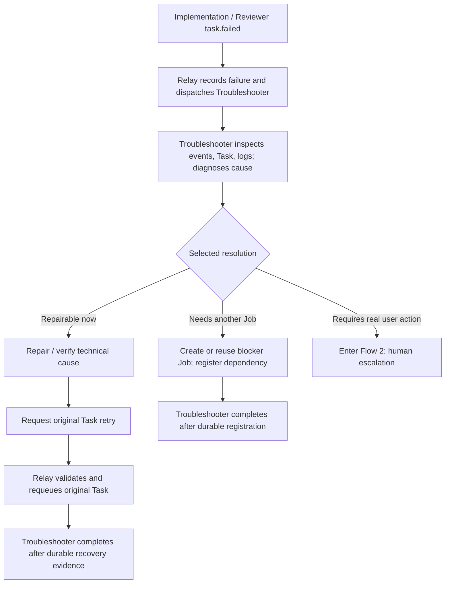
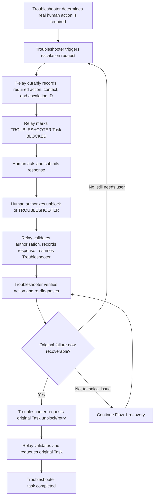

# Task Failure Recovery and Human Escalation — Current Contract

**Status:** Current recovery contract. Query Task state, recovery status, and comments through the matching Relay CLI.

The direct Escalation CLI has an **operator-selected executor**, configured
only through `AGENTS_RELAY_ESCALATION_COMMAND`. The canonical Graph maps
`resolved`, `failed` and `needs_user` results to durable workflow actions;
missing configuration or a failed/invalid provider result is a technical
failure, not proof that a human should be contacted. This is separate from
Relay's durable `task escalate` action, which the Troubleshooter may use only
when it has concrete evidence of an owner-only boundary. A Neo deployment may
select `["/opt/homebrew/bin/neo","escalation"]` as its executor, but Relay
cannot assume Neo exists. Never pass arbitrary Task text as a Shell command.

## Principles and ownership

- **Events Bus is neutral.** Its generic event envelope consists of event identity, type, time, and opaque client-defined data (plus any transport metadata needed by the bus). It must not understand Relay Jobs, Tasks, roles, or verdicts.
- **One agent Task event contract** applies to Implementation, Reviewer, and Troubleshooter: `task.started`, optional `task.progress`, then exactly one agent terminal event, `task.completed` or `task.failed`. Role-specific results belong in `data`. A review with findings is a *completed* review, not a failed agent execution.
- **`task.blocked` and `task.unblocked` are authoritative Relay lifecycle transitions**, not ordinary agent terminal events. A human may authorize unblocking a Troubleshooter but does not directly unblock the failed original Task.
- **Troubleshooter owns diagnosis and recovery decisions.** It chooses technical repair/retry, blocker-Job dependency, or human escalation. There is no separate Escalator agent.
- **Relay owns transitions and dispatch.** Troubleshooter requests authorized operations through Relay CLI, then checks the CLI response and fresh Task Context. Event transport acceptance alone is not confirmation of a Task transition.
- Preserve the original failure, exact execution correlation, evidence, and idempotency throughout retries and resumes.

## External recovery interface

Task agents publish their required Task events via the canonical Neo Events Bus
protocol. All Relay status reads and authorized changes use the Prompt-pinned
Relay CLI (`task context`, `task show`, `task events`, `task recover`,
`task escalate`, or other documented commands as appropriate). Event transport
acceptance does not confirm a Task transition. Never access Relay backing
storage, PR markers, or private HTTP endpoints to infer or change state.

## Overall flow — Task outcome and recovery branches

This captures the overall decision tree in the accompanying design screenshot, with the **human-action branch corrected** to the agreed ownership: Relay blocks the **Troubleshooter Task**, not the original failed Task.

The original Task remains `FAILED` while its Troubleshooter is blocked for a human action. Technical and dependent-Job paths may close the Troubleshooter Task after durable recovery or handoff; the human-action path resumes that same recovery responsibility after authorized unblock.

## Flow 1 — Failure → Troubleshooter → Recovery

1. Original agent reports `task.failed` with useful diagnostic `data`; Relay durably records `FAILED`.
2. Relay assigns a correlated Troubleshooter Task. Troubleshooter examines durable Task history and technical evidence before choosing a resolution.
3. For a technical remedy, Troubleshooter repairs/validates, requests authorized retry, confirms the original Task requeued, and completes **its own** Task.
4. For a blocker Job, Troubleshooter registers a durable dependency, then completes **its own** Task; the dependency mechanism later wakes the original Task after verified resolution.
5. Only a **real user action** calls for human escalation (Flow 2). Missing credentials that can be found or configured automatically, crashes, and retries are Troubleshooter work, not escalation.
6. If Troubleshooter itself encounters an unrecoverable execution failure, it emits `task.failed`; Relay handles that failure without discarding original context.

## Flow 2 — Human Escalation → Blocked Troubleshooter → Human Unblock → Original Task Recovery

1. **Troubleshooter** selects escalation as its recovery resolution and requests a concrete user action. Escalation is an interaction mechanism, **not a second problem-solving agent**.
2. Relay durably records the escalation ID, original failed Task/execution, Troubleshooter Task/execution, required human action, resolution condition, communication evidence/status, and audit trail; then it authoritatively moves the **Troubleshooter Task** to `BLOCKED`. The original Task stays `FAILED` (pending recovery), not `BLOCKED` merely because the Troubleshooter awaits a human.
3. While awaiting human action, no Troubleshooter execution continues running. Notification failures and duplicate requests must not silently create orphaned BLOCKED Tasks.
4. Human performs the requested action and explicitly unblocks the **Troubleshooter** through an authorized Relay operation. Relay stores the response and resumes Troubleshooter with its previous diagnostic context.
5. Troubleshooter validates whether the action resolved the problem. Human saying “done” is evidence, not by itself proof of technical resolution (unless the requested action was itself an authoritative approval).
6. If resolved, Troubleshooter requests Relay to unblock/retry the **original Task**, verifies the durable transition, then emits `task.completed` for its own Task. If unresolved, it continues technical diagnosis or initiates another recorded escalation.
7. Relay guards against stale execution IDs, cancelled/superseded Tasks, duplicate human responses, and paused Jobs. No old response may resurrect obsolete work.

## Event contract versus state transitions

| Actor | Action | Meaning |
| --- | --- | --- |
| Implementation / Reviewer | `task.completed` | Assigned work finished; Reviewer verdict is in `data` |
| Implementation / Reviewer | `task.failed` | Execution could not fulfill assigned work |
| Troubleshooter | `task.completed` | Technical recovery verified, or durable blocker-Job handoff established |
| Troubleshooter | `task.failed` | Troubleshooter execution failed |
| Troubleshooter | Escalation request (Relay operation) | Request a specific real human action; does **not** complete its own Task |
| Relay | Block / unblock Troubleshooter | Authoritative lifecycle actions before/after human interaction |
| Relay | Retry / unblock original Task | Authorized transition **only after** Troubleshooter establishes recovery |
| Events Bus | Transport generic events | No knowledge of task roles, blocker semantics, or response structure |

`BLOCKED` is a durable Task state and `task.blocked` may be published by Relay as a state-change fact; it is **not** an agent-selected terminal outcome. Human unblocking resumes the blocked Troubleshooter Task rather than terminating or re-creating its recovery responsibility.

## Durable recovery history

`Task.input` remains the stable objective and original evidence. `Task.resolution` and
`Task.escalation` remain the current authoritative states; comments are append-only
history, not current state. Use `task context` through the matching Relay CLI
to read the current recovery state and history; do not read internal storage
or invent a second recovery-history source.

Human responses are comments. Resuming a Troubleshooter must not rewrite its
input or append a stale “Required resolution condition” as new objective text.
The condition remains in escalation provenance. Reviewer and Troubleshooter
prompts receive current authoritative state and relevant task comments as runtime
context; Troubleshooters independently verify a response against evidence from
the original failing execution. Repeating an identical escalation with unchanged
evidence is idempotent.
