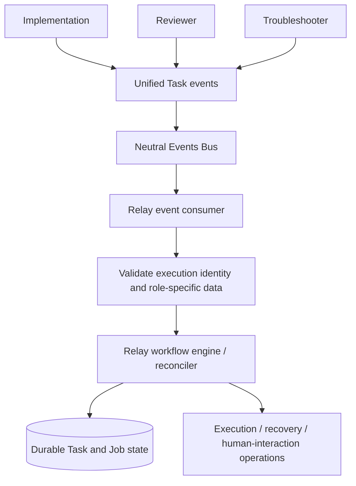
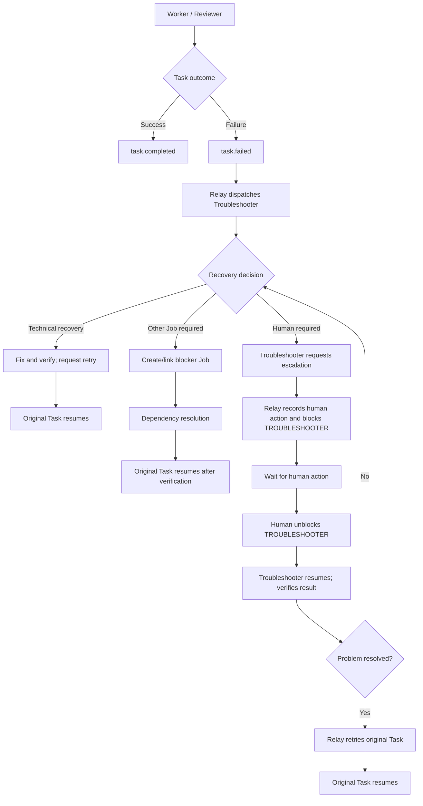
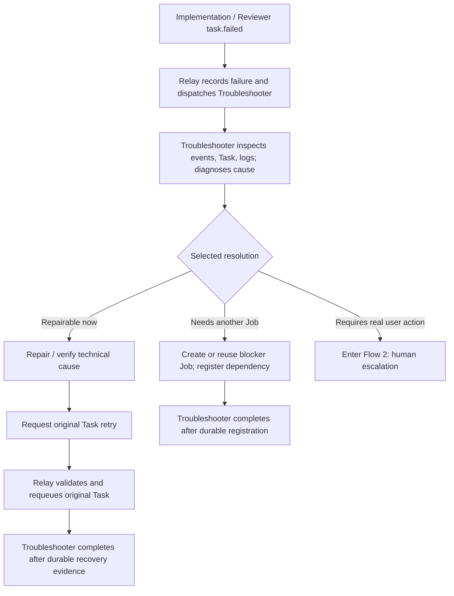
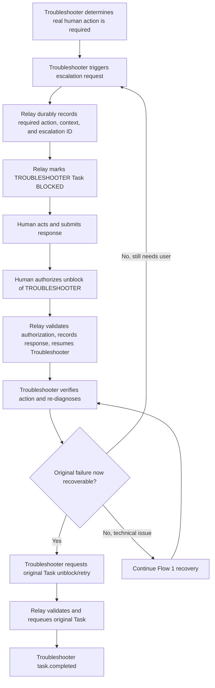

# Task Failure Recovery and Human Escalation — Agreed Target Design

**Status:** Design agreement; not an assertion of current implementation. This document describes two flows. Existing runtime, workflow graphs, and agent instructions may need changes to conform.

## Principles and ownership

- **Events Bus is neutral.** Its generic event envelope consists of event identity, type, time, and opaque client-defined data (plus any transport metadata needed by the bus). It must not understand Relay Jobs, Tasks, roles, or verdicts.
- **One agent Task event contract** applies to Implementation, Reviewer, and Troubleshooter: optional progress, then exactly one agent terminal event, `task.completed` or `task.failed`. Role-specific results belong in `data`. A review with findings is a *completed* review, not a failed agent execution.
- **`task.blocked` and `task.unblocked` are authoritative Relay lifecycle transitions**, not ordinary agent terminal events. A human may authorize unblocking a Troubleshooter but does not directly unblock the failed original Task.
- **Troubleshooter owns diagnosis and recovery decisions.** It chooses technical repair/retry, blocker-Job dependency, or human escalation. There is no separate Escalator agent.
- **Relay owns transitions and dispatch.** Troubleshooter requests authorized operations; the reconciler/engine validates and durably applies them. An event arriving over the bus is not proof its transition was applied.
- Preserve the original failure, exact execution correlation, evidence, and idempotency throughout retries and resumes.

## Unified architecture

All three agent roles publish through the **same Task event contract**. Events Bus treats `data` as opaque; Relay interprets role-specific results and alone changes durable Task/Job state.

- Agents publish `task.completed` or `task.failed` as terminal execution outcomes; Reviewer verdicts and Troubleshooter recovery evidence are results inside `data`.
- `task.blocked` / `task.unblocked` describe Relay-authorized state changes, not a third agent terminal outcome.
- Transport does not interpret verdicts, execution IDs, blocker relations, or recovery decisions.

## Overall flow — Task outcome and recovery branches

This captures the overall decision tree in the accompanying design screenshot, with the **human-action branch corrected** to the agreed ownership: Relay blocks the **Troubleshooter Task**, not the original failed Task.

The original Task remains `FAILED` while its Troubleshooter is blocked for a human action. Technical and dependent-Job paths may close the Troubleshooter Task after durable recovery or handoff; the human-action path resumes that same recovery responsibility after authorized unblock.

## Flow 1 — Failure → Troubleshooter → Recovery

1. Original agent reports `task.failed` with useful diagnostic `data`; Relay durably records `FAILED`.
2. Reconciler starts a correlated Troubleshooter Task. Troubleshooter examines durable Task history and technical evidence before choosing a resolution.
3. For a technical remedy, Troubleshooter repairs/validates, requests authorized retry, confirms the original Task requeued, and completes **its own** Task.
4. For a blocker Job, Troubleshooter registers a durable dependency, then completes **its own** Task; the dependency mechanism later wakes the original Task after verified resolution.
5. Only a **real user action** calls for human escalation (Flow 2). Missing credentials that can be found or configured automatically, crashes, and retries are Troubleshooter work, not escalation.
6. If Troubleshooter itself encounters an unrecoverable execution failure, it emits `task.failed`; Relay handles that failure without discarding original context.

## Flow 2 — Human Escalation → Blocked Troubleshooter → Human Unblock → Original Task Recovery

1. **Troubleshooter** selects escalation as its recovery resolution and requests a concrete user action. Escalation is an interaction mechanism, **not a second problem-solving agent**.
2. Relay durably records the escalation ID, original failed Task/execution, Troubleshooter Task/execution, required human action, resolution condition, communication evidence/status, and audit trail; then it authoritatively moves the **Troubleshooter Task** to `BLOCKED`. The original Task stays `FAILED` (pending recovery), not `BLOCKED` merely because the Troubleshooter awaits a human.
3. While awaiting human action, no Troubleshooter execution continues running. Notification failures and duplicate requests must not silently create orphaned BLOCKED Tasks.
4. Human performs the requested action and explicitly unblocks the **Troubleshooter** through an authorized Relay operation. Relay stores the response and resumes Troubleshooter with its previous diagnostic context.
5. Troubleshooter validates whether the action resolved the problem. Human saying “done” is evidence, not by itself proof of technical resolution (unless the requested action was itself an authoritative approval).
6. If resolved, Troubleshooter requests Relay to unblock/retry the **original Task**, verifies the durable transition, then emits `task.completed` for its own Task. If unresolved, it continues technical diagnosis or initiates another recorded escalation.
7. Relay guards against stale execution IDs, cancelled/superseded Tasks, duplicate human responses, and paused Jobs. No old response may resurrect obsolete work.

## Event contract versus state transitions

| Actor | Action | Meaning |
| --- | --- | --- |
| Implementation / Reviewer | `task.completed` | Assigned work finished; Reviewer verdict is in `data` |
| Implementation / Reviewer | `task.failed` | Execution could not fulfill assigned work |
| Troubleshooter | `task.completed` | Technical recovery verified, or durable blocker-Job handoff established |
| Troubleshooter | `task.failed` | Troubleshooter execution failed |
| Troubleshooter | Escalation request (Relay operation) | Request a specific real human action; does **not** complete its own Task |
| Relay | Block / unblock Troubleshooter | Authoritative lifecycle actions before/after human interaction |
| Relay | Retry / unblock original Task | Authorized transition **only after** Troubleshooter establishes recovery |
| Events Bus | Transport generic events | No knowledge of task roles, blocker semantics, or response structure |

`BLOCKED` is a durable Task state and `task.blocked` may be published by Relay as a state-change fact; it is **not** an agent-selected terminal outcome. Human unblocking resumes the blocked Troubleshooter Task rather than terminating or re-creating its recovery responsibility.

## Required follow-up implementation alignment

- Align `skills/agents-relay/SKILL.md` and role instructions with the two agent terminal events; remove agent-directed `task.blocked` emission.
- Align escalation graph, CLI, reconciler, and unblock commands so human intervention blocks **Troubleshooter**, not the original failed Task; preserve the original failure and correlated recovery context.
- Ensure the blocked Troubleshooter can resume after an authorized human unblock rather than being treated as a finished terminal execution.
- Add integrated checks: technical retry, blocker-Job handoff, human request/block, human unblock/resume, failed verification/re-escalation, stale/duplicate responses, and correct original-Task retry.
