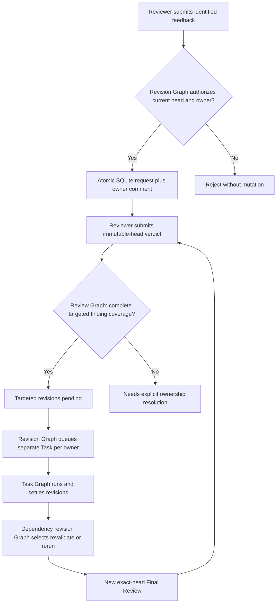

# Architecture plan and action boundaries

## Canonical workflow ownership

The existing `workflow/review-lifecycle.mmd` owns final verdict selection; its `review.awaitTargetedRevisions` and `review.requireOwnerResolution` effects are mutually exclusive. `workflow/revision-lifecycle.mmd` owns request eligibility and revision status transitions. `workflow/task-lifecycle.mmd` remains authoritative for execution state and event correlation. Downstream dependency validity/impact scheduling belongs in a canonical dependency-revision Graph (to be implemented by its assigned downstream Task), not in CLI or reconciler branches.

## Current action contracts (Task 727)

| Action / helper | Required facts | Durable result |
| --- | --- | --- |
| `revision.recordRequest` / `recordTargetedRevisionRequest` | RUNNING reviewer and matching execution; matching immutable current head; succeeded original owner; unique stable request ID and nonempty identified findings | `Job.reviewRevisionRequests[]`, one append-only original Task comment, no Task state rewrite |
| `review.awaitTargetedRevisions` | Current reviewer generation/head and complete findings coverage from persisted request IDs | `review.outcome=changes_required`, `revisionDisposition=targeted`; no generic fix |
| `review.requireOwnerResolution` | No valid targeted requests or partial finding ownership | `review.outcome=changes_required`, `revisionDisposition=needs-ownership`; no implicit Planner invocation |
| `review.requestMerge` | Immutable-head approved verdict | Existing local delivery Graph controls actual merge; no bypass |
| `dependencyRevisionVector` | Explicit `dependencyValidity` on declared upstream edges | Sorted logical evidence identities of mandatory revalidate/rerun dependencies; no filename heuristic |

Review completion and its optional `reviewRevisionRounds[]` record occur in the same SQLite Job mutation as the Reviewer terminal state. A stale/out-of-generation event cannot add a round.

## Required downstream action contracts (not implemented here)

1. **Authenticated reviewer CLI** (`task revise --id ... --task-id ... --review-task-id ... --execution-id ... --request-id ... --findings-file ...`): resolve exact local Job and current local Git head; invoke the same revision Graph and atomic request reducer; transactionally create/reuse a child Task of the original; record request-to-child linkage. Never use GitHub comments as a source of state.
2. **Queue and worker continuation:** `revision.queueTask` must require a committed `changes_required` verdict, stable request identity, generation/head fence, and parent-child lineage. Route to compatible original worker session only when live identity is independently verified; otherwise record a safe new-context fallback.
3. **Revision terminal action:** correlate exact execution/Task generation, persist new result only on the child, advance request status to `verified` only after true Worker terminal evidence, and fail closed on unknown outcome.
4. **Dependency revision Graph:** for each accepted upstream revision compute exact affected direct/transitive downstream Tasks from explicit edge policies; fan-in waits for all upstream current evidence. Dedupe by (original downstream Task, dependency revision vector, revision kind). `rerun` cannot be treated as `revalidate`; even unchanged outputs record verification against the vector. Completed earlier revisions remain historical.
5. **New Final Review:** after all required child and downstream evidence is settled, bind new current source head and create a new Reviewer Task with fresh immutable SHA; preserve round linkage and verify same approved SHA at merge. Bound rounds/no-progress retries; route repeated failure to standard recovery or explicit Planner re-plan.
6. **Feedback adapter:** future external `changes_requested` intake must authenticate its origin before invoking the exact shared action/Graph, not a separate Vlog-specific state machine.

## Failure, restart and migration behavior

- **Atomicity:** callers MUST use `submitTargetedRevisionRequest(SQLiteRelayStore, jobId, input)` (which calls `mutateJob`), which begins an IMMEDIATE transaction and writes a complete updated Job snapshot. Rejecting intake throws and rolls back both request and original Task comment.
- **Dedupe:** `requestId` is stable across retries. An identical duplicate is a no-op even after Reviewer Task completion; a conflicting payload fails closed. Concurrent same-ID mutations serialize under SQLite's write lock. Append-only review rounds key on (reviewTaskId, reviewExecutionId).
- **Stale head:** source head verification is a caller-owned *fresh Git fact* before intake; the reducer separately validates the authoritative Job's head and Reviewer generation. Review verdict rechecks stored request coverage inside the mutation to defend against concurrent intake.
- **Restart:** requests, comments, vectors and round links live inside the Job JSON committed to SQLite; a daemon can reload without reconstructing them from Events Bus or GitHub. `mergeInboundJobSnapshot` preserves local revision history against stale collaboration projections.
- **Legacy:** missing `reviewRevisionRequests`/`reviewRevisionRounds` are empty arrays semantically. Missing `dependencyValidity` is `order-only`. Missing `revision` means historical original evidence. Existing review Tasks and earlier results remain intact.
- **Version fences:** old Reviewer execution/head cannot submit new work; event finalization uses `reviewGenerationMatches` and exact event source. Downstream must additionally compare captured dependency vector to newest committed evidence at launch and completion.
- **Failure limits:** the model alone does not authorize re-review, repair a failed revision, or assume a browser send succeeded. Those remain explicit Graph/action contracts for the later tasks.

## Verification boundaries

Task 727 exercises canonical Graph unit tests, isolated SQLite restart/dedupe/rollback, and Reviewer verdict integration; existing Reviewer tests were adjusted because a generic `review-fix` is no longer legal. L2 physical provider, L4 prompt, and managed Job Review→Fix→Re-review→Delivery are not demonstrated in this slice and must remain `NOT_RUN` until the owning Tasks prove them.
