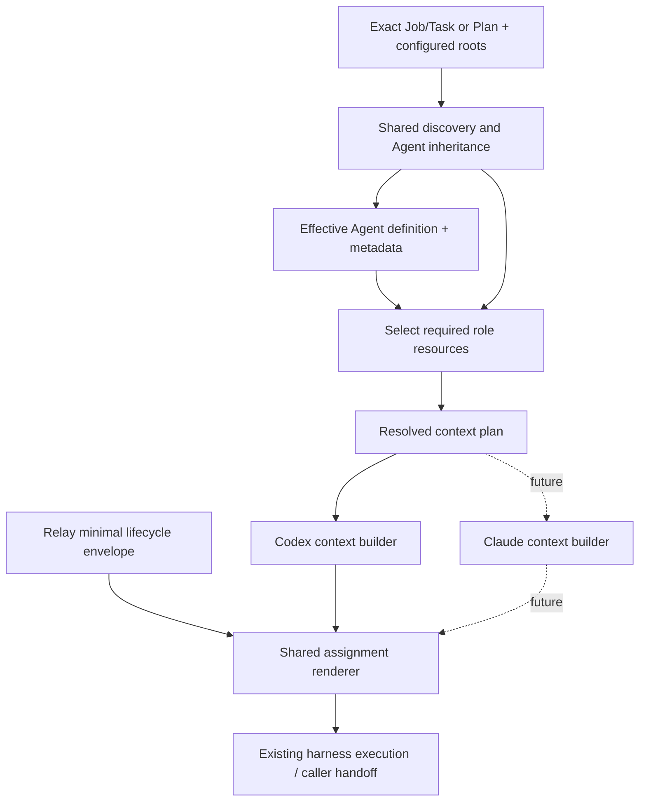

# Design — Agent-driven context delivery

Companion to [spec.md](spec.md), [research.md](research.md) and
[verification.md](verification.md). Proposed interfaces, not shipped APIs.

## Delivery priority

P0: historical/current Job and Task Execution Report in the existing Neo
Eval layer, using read-only Relay lifecycle evidence and actual harness
traces. Establish the #745 report and human review workflow first, then
use its findings to guide the Agent-driven Context Builder changes.
Structured builder provenance improves later reports but is not a
prerequisite for historical analysis. See agent-eval-design.md.

## Architecture



Discovery may see all available Agents, skills and instruction files. Visibility
does not imply reading or injection. Use the existing Agent layering and
immutable merged Markdown mechanism; no new registry. The effective Agent
chooses additional resources. The harness chooses their delivery, with a
single shared assignment/lifecycle renderer.

The Relay graph still selects launch/review/recovery actions and owns all
workflow decisions. The context builder is a deterministic input transformation,
not a Graph state machine, new adapter routing policy or lifecycle decision.
Agent domain guidance never overrides the execution envelope.

## Ownership and boundaries

| Owner | Responsibilities |
| --- | --- |
| Harness Context Builder setup | On first use, safely establish/verify native Global AGENTS.md wiring, native catalog and transport configuration, without duplicating loaded instructions. |
| Agent definition | Role, input/output expectations, required/optional resources, role QA, scoped recovery guidance. |
| Resolver | Configured project/workspace/global/builtin layers; effective metadata, file provenance, visibility, validation. |
| Harness context builder | Represent selected resources as native-loaded, inline or on-demand; plan launch args and avoid duplicates. |
| Shared Relay assignment | Non-overridable lifecycle semantics, exact bindings, CLI read/apply/complete/event operations. |
| Relay graph and daemon | Lease/execution fencing, durable result validation, review, retries, finalization. |
| Domain project | Producer-specific facts, handoff, Evals and genuine quality standards. |

Global baseline is an explicit exception to Agent-selected dependencies.
Codex-native instruction loading is not a replacement for the Relay lifecycle
envelope. Global rules may describe engineering generally, but should not
mandate project development work for a non-development Agent. XChat direct
orchestration and managed leaf-worker bootstrap are distinct roles.

## Agent metadata proposal

Retain existing simple inline-list syntax and advisory fields. New fields
declare required startup dependencies separately from existing advisory
`skills`, `model`, `reasoning`.

```yaml
# Built-in implementation.agent.md (illustrative)
---
name: implementation
required_skills: [ponytail]
contexts: [AGENTS.md, CLAUDE.md]
contracts: [relay:worker-self-review.md]
---
# Vlog editor.agent.md (illustrative)
---
name: editor
required_skills: [markcut, video-shotcraft]
contexts: []
contracts: [project:contracts/video.edl.schema.json]
---
```

Actual domain contracts and skill names must be checked against the effective
catalog before migration; these examples are not claims about current metadata.
A JSON Schema may be referenced on demand rather than dumped as prose.
Markcut/Shotcraft startup skills should only be mandatory if the Agent truly
requires them for every execution; otherwise use advisory skills with a clear
trigger. A domain Agent can reference a stable contract in its body; do not
create a second manifest for the same rule.

- `contexts`: **alternative harness-native filenames**, not a bulk list of
  documents. Allowed names are `AGENTS.md` and `CLAUDE.md` (case-insensitive
  declarations); the first matching file for the actual Harness is selected
  **once**: Codex → `AGENTS.md`, future Claude → `CLAUDE.md`. Bare
  names refer to the selected project root; scoped
  `project:<folder>/AGENTS.md` references a specific folder. Never load both.
  If the effective field is absent, empty, `[]` or contains only a different
  Harness's filename, select **no directory Context**. Do not automatically
  add `AGENTS.md` from the project. The separate native Global baseline still
  applies. When a selected instruction belongs to a managed checkout, verify
  the corresponding checkout revision rather than silently reading main.
- `required_skills`: resolve by existing visible skill name and precedence;
  missing mandatory resource fails before launch. Existing `skills` stays an
  optional suggestion. Do not auto-install missing skills.
- `contracts`: explicit role contracts, e.g. `relay:<relative-path>` under
  version-matched bundled contracts and `project:<relative-path>` for domain
  files. Task/Plan execution envelope remains unconditional and cannot be
  removed by an Agent.
- Parse lists using existing frontmatter grammar, rejecting malformed required
  values, unsupported namespaces, traversal and unauthorized symlink escapes.
  Use a typed view of the *merged* metadata; do not derive execution requirements
  from a raw source document or a second independent parser. Inheritance uses
  existing overlay semantics: omitted retains inherited value, explicit list
  replaces, explicit [] or an empty scalar clears. Test both name and absolute external-base
  inheritance. Canonical identity dedupes aliases; same file cannot be mandatory
  both as a context and a skill. Stable order: global (native), Relay envelope,
  Agent, selected role resources in declared order, Task identity. Resource
  selection does not change which instruction is more authoritative.

Prefer short authoritative Agent instructions, not a large number of linked
manuals. Required normative Markdown can be injected once or supplied by one
explicit immutable reference where necessary, as a harness capability.
Use short content budgets and prefer inline essential rules, on-demand
details/schemas/assets; no mandatory re-read on compaction. Never turn
historical worker text or untrusted Task data into governing instructions.
Validate all required reference access before launch. Existing immutable
Agent snapshot semantics and absolute-link anchoring must be preserved.

## Three-layer prompt architecture

The canonical logical artifact is a PromptBundle, not a monolithic prompt.
Separate instruction authority, current assignment and on-demand resources:

| Layer | Contents | Loading rule |
| --- | --- | --- |
| System Instructions | Native harness instructions, Global, effective Agent responsibility, essential stable invariants, minimal static Relay protocol | Supplied at startup once; no bulk document reads |
| User Prompt | Current authoritative Task/Plan locator, bounded intent, exact execution identity, input/output and acceptance facts or their authoritative lookup, task-specific constraints | Each assignment; current binding supersedes stale history |
| References / Context | Detailed contracts/schemas, selected project policies, skill procedures, domain inputs, output artifacts and history | Agent reads only when needed; index provides path/ID, purpose and trigger |

Logical System Instructions do not imply a literal API system message.
Never promote user Task text, external facts, tool results or arbitrary
files to developer authority. Role and normative content must be selected
from trusted, authorized Agent sources. Keep static protocol rules separate
from dynamic CLI arguments and identities. Required input/output and
completion invariants must remain immediately available; move only detailed
reference material behind on-demand access. The Agent declares required
resources and when to use them, not a blanket read-every-file startup list.
Required means resolve/validate availability and obey relevant invariants;
it does not automatically mean inline every document or read it at startup.
A compact role instruction can contain a reference to an existing authoritative
contract without copying the contract body. Skills remain on-demand procedures
unless a genuinely necessary startup invariant is explicitly declared.

Each reference index entry contains resource ID/kind, locator, purpose,
activation condition and provenance. Do not include all discovered skills
or paths merely because they are visible. Distinguish actual model-visible
content, a reference locator, and later observed read in Eval. An already
loaded normative body is not a mandatory re-read after compaction.

### Harness delivery mapping

Codex CLI 0.165.0 isolated debug prompt-input probes show that
developer_instructions appends a sentinel in a developer message while
preserving built-in Codex instructions; native Global AGENTS.md is inserted
as a user message. Both model_instructions_file and instructions replaced
the built-in base instructions in the probe. Do not use these base-override
options for Agent role delivery.

Use trusted developer_instructions for stable Agent/essential Relay
instructions if integration proves the configured developer instructions
are preserved or intentionally composed; never silently overwrite profile
policy. Use normal Codex exec task prompt for the User Prompt and a compact
reference index, with project_doc_max_bytes=0 for managed launches.
Global delivery remains native and separately verified. If necessary,
a verified user-message fallback for role delivery must be explicitly
labeled as such, not called a real system prompt. Preserve original
harness instructions and report actual message roles. Avoid passing secrets
or oversized payloads via process arguments; choose a supported safe
transport and test exact launch/resume behavior.

Neo XChat Bootstrap Builder handles only neo bootstrap, not Relay workers. Claude mapping remains future work.

## Agent inheritance is a first-class contract

The existing `extends` chain remains authoritative for both Agent body and
the *effective metadata* used by Context selection. The resolver MUST merge
all trusted source layers before the Harness Builder selects any resources.
This applies to builtin parent Agents, differently named parent Agents,
workspace/project overlays, section replacement/extension, and explicitly
authorized standalone absolute Markdown bases. Agent inheritance is
independent of harness and model provider.

- **Absent field**: inherit the parent's `contexts`, `contracts`, or
  `required_skills` declaration unchanged.
- **Explicit list**: replace the corresponding inherited list, not append a
  second implicit dependency.
- **Explicit `[]` or an empty scalar**: clear the inherited list completely.
- **Context candidates**: a merged `[AGENTS.md, CLAUDE.md]` declaration
  chooses exactly one filename according to the Harness. The order only
  breaks ties between compatible files; it does not make both mandatory.
  If no candidate is applicable or the effective value is empty, selection is
  empty even when the project contains an `AGENTS.md` file.
- **Multiple layers**: the most-specific valid Agent layer wins; use canonical
  resource identity for deduplication without expanding requirements beyond
  the effective declaration.
- **Invalid base / cycles / escaping paths**: reject before provider launch;
  never silently fall back to a generic implementation Agent or recover
  missing parent policy from unrelated global instructions.

The renderer consumes the merged effective Agent definition once. On-demand
reference selection reads merged metadata, never raw unmerged child frontmatter
or `dagNode` heuristics. Tested by
`native_agent_content_resolver` including explicit clear and external base
fixtures; passing these tests does not replace real model-level acceptance.

## Context plan and builder interface (conceptual Rust)

```rust
struct ContextPlan {
    agent: EffectiveAgent,
    resources: Vec<SelectedResource>,
    global: GlobalContextSource,
}
struct SelectedResource {
    identity: CanonicalResourceId,
    origin: ResourceOrigin,
    required: bool,
    purpose: ResourcePurpose,
}
struct PromptBundle {
    stable_instructions: TrustedInstructions,
    assignment: TaskAssignment,
    references: Vec<ReferenceEntry>,
}
struct HarnessDelivery {
    launch_options: HarnessLaunchOptions,
    prompt: PromptBundle,
    native_loaded: Vec<CanonicalResourceId>,
    supplied: Vec<ResolvedReference>,
    on_demand: Vec<ResolvedReference>,
}
trait HarnessContextBuilder {
    fn build(&self, plan: &ContextPlan, env: &HarnessEnvironment)
        -> Result<HarnessDelivery, ContextError>;
}
```

Use a small enum/struct instead of a trait if only one implementation needs
runtime dispatch. Do not add a plugin framework. Selection and rendering
must be common to real launch and read-only inspection. Harness policy accepts
a trusted, host-provided configuration; the model cannot rewrite it. Record
stable selected resource identifiers, provenance and content fingerprints
for diagnostic readback without logging secret material. Distinguish
"planned native load" from "observed native load". Context plan does not need
to become a new durable Job record. Reuse existing snapshot/evidence paths
and execution binding where applicable.

### Codex

- The Codex Builder owns idempotent first-use native setup. Resolve the
  trusted host CODEX_HOME (default ~/.codex) and canonical Global AGENTS.md
  source. Create CODEX_HOME when absent; create the AGENTS.md symlink when
  absent; preserve an existing empty regular file as a unique backup before
  linking. Subsequent launches verify the same link without mutating it.
  Reject nonempty files, conflicting links, AGENTS.override.md and invalid
  source/roots without deleting or overwriting user configuration.
  Both Worker and Planner must perform this setup before provider launch.
  Use isolated CODEX_HOME fixtures for setup tests. The trusted roots remain
  host-controlled, not guessed from a Task or model provider.
- For **all Relay-managed Agent launches**, set project_doc_max_bytes=0 in
  actual native Codex args to stop implicit repository policy; explicitly
  deliver Agent-selected project policy once. Standalone Codex is unaffected.
  Keep native global loading and skill discovery. Discover the selected
  required skill and supply its instruction body/reference as required, not
  the whole catalog or every SKILL.md.
- Apply consistently to initial Worker, Planner, Reviewer/Troubleshooter
  and all corrective/resume invocations. Native resume may restore old
  messages: don't remove protection or claim old context disappeared. Define
  a context-compatibility check using current role, selected context policy,
  execution binding and known historical delivery; if unknown or changed,
  start a fresh thread only through existing Graph-owned recovery/continuation
  authority and preserve artifact/effect deduplication. Do not mutate routing
  profile compatibility or create a second retry state machine.
- Verify actual CLI argv and model-visible prompt-input in isolated
  fixtures, including nested Git roots and project overrides. Debug
  prompt-input is a probe, not proof of production Worker lifecycle.

### Neo XChat Harness Builder (WebChat only)

The Neo CLI \`neo bootstrap\` calls \`xchat_builder::build\` and
\`xchat_builder::render\`. Neo discovers the selected Skill catalog, and
passes canonical Global and XChat rule paths to the **read-only shared
Relay Prompt Builder CLI**, \`agents-relay-rust prompt --parts-stdin\`,
which returns a source-attested \`relay.prompt-parts.v1\` manifest
(\`global\`, \`harness\`, \`skills\`, and stable \`fingerprint\`).
The Neo XChat Builder verifies that fingerprint and assembles native
WebChat Bootstrap JSON/Markdown; it does not duplicate the canonical
content builder.

\`neo bootstrap\` never calls Relay's Codex Builder, does not create
\`CODEX_HOME\`, and cannot set platform-owned System Instructions.
No Relay \`--adapter xchat\` or \`--adapter chatgpt\` exists. The
Relay Prompt Builder is provider-neutral; only native Harness delivery
differs between Codex and WebChat. No actual provider-specific hidden
System prompt equivalence is implied. The staged Neo distribution
bundles a matching read-only Relay CLI, so Bootstrap needs neither
Relay Daemon nor source checkout on another machine.

### Claude (future)

Reserve the architectural seam only. Before implementing, run Claude's
real context discovery/override and continuation probes for global and
project instructions, tools, skills and permissions. No speculative
CLAUDE.md symlink/config or supported-adapter flag now.

## Context terminology and builder ownership

See [agent-eval-design.md](agent-eval-design.md) for normative terminology:
Agent defines responsibility; Contract defines invariants; Context provides
relevant policy/facts; Skill provides method. Task supplies actual data,
not a second role definition. Builder owns the broad model context,
Global delivery/verification, native context control and deduplication.
The Harness Builder owns safe first-use symlink creation and subsequent verification. Role-specific required
contracts and selected Skills are distinct. Do not duplicate contract text
inside Skill, Agent and renderer. Do not treat task evidence as instructions.

The read-only analyzer belongs to the existing Neo Eval layer, not the
runtime builder. Relay supplies context selection and execution evidence
binding; the harness trace reader supplies observed records. Human report
and findings do not mutate Relay lifecycle.

## Shared lifecycle envelope

Preserve required operations, but remove the mandatory generic document
reading list. Build the exact supported execution-bound CLI commands from
the existing version-matched resource resolver. Include minimal role-neutral
start/progress/fail/completion instructions and the Task or Plan command
appropriate to the existing Graph-selected action. Plan apply must produce
exact receipt; source and DAG tasks use the authoritative task-complete
path, not direct terminal event; ordinary result tasks retain the existing
event path. The envelope must not require reading Ponytail or
worker-self-review.md; those are Agent dependencies. For independent
review and human decisions, preserve exact existing bindings.

Treat executable validation and acceptance as owned by the existing
daemon/Graph. The implementation Agent explicitly selects the implementation
review contract, which retains its two-round requirement if still required
by that contract; do not impose it on content roles, and do not duplicate
it in both the Agent, global prompt and renderer. A short canonical
execution protocol should be extracted from existing lifecycle rules
rather than creating divergent copies; keep full protocol as on-demand
reference, update links/owners consistently. Generate exact instructions
from the same protocol authority used by command handling where possible.

## Migration map (source modules)

| Current source | Proposed change |
| --- | --- |
| cli_context.rs, execution_context.rs | Discover resources and effective metadata; retain layering and explicit visibility; distinguish catalog from selection. |
| agent_content_resolver.rs | Expose validated effective required dependency metadata and declaration provenance; preserve merge and safe links. |
| managed_worker_input.rs | Remove worker-role Ponytail/self-review/project list heuristics; resolve role resources and construct shared envelope. |
| planner_adapters.rs | Use same selection and envelope; migrate Planner's specific dependencies to its Agent. No separate policy. |
| agent_prompt_builder.rs | Render selected resources and exact lifecycle once, not add role policy; eliminate blanket read-all and workerSelfReview toggle. |
| reconciler_context.rs, native_codex_execution.rs, native_codex_thread.rs, planner launch helpers | Consume context delivery options consistently for initial/resume/repair; keep immutable checkout/route/generation fences. |
| cli_prompt.rs, native CLI dispatch | Reuse production selection; expose read-only context plan and sanitized eval path; mark reconstruction limitations. |
| skills/agents-relay/agents/*.agent.md | Declare required role context; preserve unnamed implementation quality, isolated reviewers, recovery contracts. |
| AGENTS.md, agent-contract.md, agent-prompt-builder.md, eval README | Replace stale/contradictory rules and retired adapter references. |
| Neo bootstrap/XChat | Separate caller-side integration with real bootstrap evidence; no browser-worker core dependency. |
| Vlog AGENTS/Agent/Editor MVP/Visioner | Separate project development from domain production; explicit handoff and QA, no routine original perception or framework source inspection. |

Migration order: establish reference selection and fixture tests; migrate
built-ins atomically with removing blanket behavior; integrate actual Codex
launch and inspection; migrate domain Agents and owner docs; run regression
and controlled provider tests; independent design/implementation review.
Keep code changes scoped; no simultaneous cleanup of unrelated parity ports.

## Risks and choices

- Global rules may still mention development workflows: audit wording and
  scope rather than injecting a second copy. First-use native setup may create a safe link; conflicting
  configurations fail closed and must never be overwritten.
- Disabling native project discovery can lose legitimate repository policy.
  Migrate every implementation/reviewer/planner role requiring it before
  switching. A named custom Agent without explicit dependencies must not be
  silently upgraded to implementation. Inventory active project definitions
  and review migration before activation; preserve correct execution of
  historical jobs and existing compatible threads.
- Agent requirements are prompt/assembly controls, not an OS sandbox.
  Existing Codex unrestricted permissions remain unchanged in this refactor.
- Inline required material may raise initial prompt size. Measure bytes/tokens,
  use exact canonical content, and keep detailed references on demand.
- Domain metadata quality is distinct: old #745 metadata identified inversion
  in prose but did not offer a corrected render asset or meaningful segment
  granularity. Fix that domain handoff before using no-source-read acceptance
  as proof of Vlog quality.
- No new SQLite field or Graph required for pure context selection. If a
  context-change continuation would alter workflow eligibility, specify it in
  the existing owning Graph and verify graph branches rather than add a
  procedural retry policy. Design review must explicitly confirm that choice.
